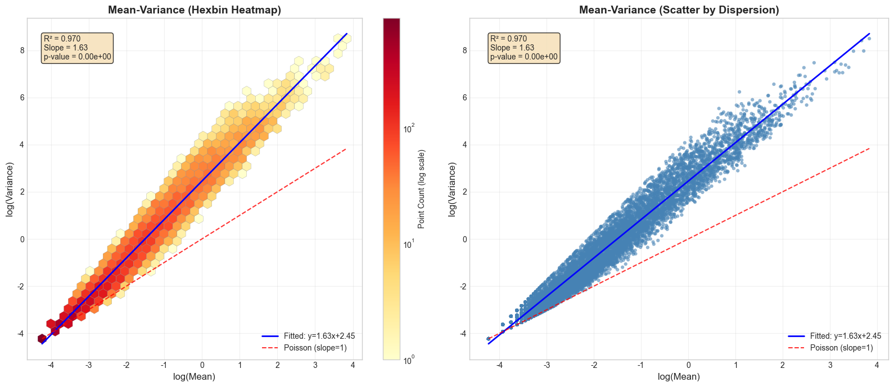
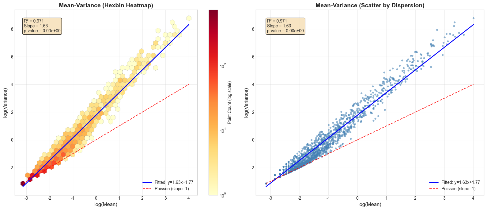
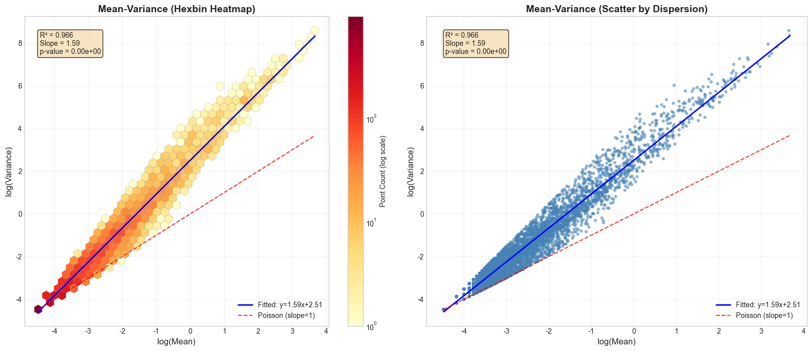

# 05 (Preparation)

## 1. Basic Concept
### 1.1. Quasi-poisson Model & Link Function
Condition: $E(Y) = \mu$, $\text{Var}(Y) = \phi \cdot \mu$
Link function: $\log(\mu) = \mathbf{X}\boldsymbol{\beta}$
### 1.2. Score Test & Null Model
$U(\theta) = \frac{\partial \ell(\theta)}{\partial \theta}$
$S = U_\psi(\hat{\lambda}_0)^T \left[I^{\psi\psi}(\hat{\lambda}_0)\right]^{-1} U_\psi(\hat{\lambda}_0)$
where $\hat{\lambda}_0$ is the MLE under constraint $\psi = \psi_0$,
$I(\theta) = \begin{pmatrix} I_{\psi\psi} & I_{\psi\lambda} \\ I_{\lambda\psi} & I_{\lambda\lambda} \end{pmatrix}$, $I(\theta)^{-1} = \begin{pmatrix} I^{\psi\psi} & I^{\psi\lambda} \\ I^{\lambda\psi} & I^{\lambda\lambda} \end{pmatrix}$
$\boxed{I^{\psi\psi} = \left(I_{\psi\psi} - I_{\psi\lambda} \, I_{\lambda\lambda}^{-1} \, I_{\lambda\psi}\right)^{-1}}$
Finally we have: $\boxed{S = U_\psi(\hat{\lambda}_0)^T \left(I_{\psi\psi} - I_{\psi\lambda} \, I_{\lambda\lambda}^{-1} \, I_{\lambda\psi}\right) U_\psi(\hat{\lambda}_0)}$
$S \xrightarrow{d} \chi^2(q)$, $q = \dim(\psi)$
If we want to solve null model, only replace the related rows of $U(\theta)=0$ by $\psi = \psi_0$
### 1.3. One-step Estimator
Newton-Raphson: $\lambda^{(t+1)} = \lambda^{(t)} - \left[\frac{\partial^2 \ell(\psi_0, \lambda)}{\partial \lambda \partial \lambda^T}\right]^{-1} \frac{\partial \ell(\psi_0, \lambda)}{\partial \lambda}\bigg|_{\lambda = \lambda^{(t)}}$
One-step estimator: $\hat{\lambda}_0^{(1)} = \lambda^{(0)} + \left(I_{\lambda\lambda}^{(0)}\right)^{-1} U_\lambda^{(0)}$
### 1.4. Quasi-likelihhod
$\frac{\partial Q}{\partial \mu_i} = \frac{y_i - \mu_i}{V(\mu_i)}$
Score equation: $\sum_{i=1}^{n} \frac{y_i - \mu_i}{V(\mu_i)} \cdot \frac{\partial \mu_i}{\partial \beta_j} = 0, \quad \forall j$
### 1.5. Firth's Correction
Firth's correction: $\ell^*(\boldsymbol{\beta}) = \ell(\boldsymbol{\beta}) + \frac{1}{2}\log|\mathbf{I}(\boldsymbol{\beta})|$
then $O(n^{-1})$ will disappear, only $O(n^{-2})$ left
for quasi-poisson+quasi-likelihood+firth's correctioin, we will have:
$\boxed{U^*(\boldsymbol{\beta}) = \sum_{i=1}^n (y_i - \mu_i) \mathbf{x}_i + \frac{1}{2} \text{diag}\left(\mathbf{I}^{-1} \frac{\partial \mathbf{I}}{\partial \boldsymbol{\beta}_j}\right)}$
if $\mu_i = \exp(\mathbf{x}_i^T \boldsymbol{\beta})$, then $\mathbf{I}(\boldsymbol{\beta}) = \mathbf{X}^T \mathbf{W} \mathbf{X}$, $w_i = \frac{\mu_i}{\phi}$
### 1.6. GLMM & random/fixed effects
$$g(E[Y|U]) = X\beta + ZU$$
$g$: link function
$X\beta$: fixed effects
$ZU$: random effects, $U \sim N(0, G)$
### 1.7. Saddlepoint Approximation (SPA)
CGF: $K(t) = \ln M(t) = \ln E[e^{tX}]$
find $K'(\hat{t}) = \bar{x}$, then use $\hat{t}$ to approximate $P(\bar{X} \le x)$
one example: Lugannani-Rice $P(\bar{X} \le x) \approx \Phi(z) + \phi(z) \left( \frac{1}{u} - \frac{1}{z} \right)$
## 2. Article Reading
### 2.1. SAIGE
#### 2.1.1. Variable Definition
$G_i$: SNP (0/1/2)
$X_i$: covariate for sample i
$b_i$: random effect
$Y_i$: binary trait
#### 2.1.2. Model Construction
<!-- highlight:1 -->
Model Assumption 1: $Y_i | b_i \sim \text{Bernoulli}(\mu_i), \quad \text{logit}(\mu_i) = X_i^T\alpha + G_i\beta + b_i, \quad b \sim N(0, \tau\psi)$
#### 2.1.3. Parameter Estimation
Under null hypothesis: $Y_i | b_i \sim \text{Bernoulli}(\mu_{i0}), \quad \text{logit}(\mu_{i0}) = X_i^T\alpha + b_i$
$\frac{\partial \ell}{\partial \beta} = \sum_i G_i(Y_i - \mu_i) = G^T(Y - \mu)$
score statistics: $T = G^T(Y-\hat{\mu})$
$S_\beta = G^T(Y - \mu_0), \quad \mu_{0,i} = \text{logistic}(X_i^T\hat\alpha + \hat{b}_i)$
If we suppose $b$ is fixed, that is, only $Y_i$ contain randomness, then only $Y_i \sim \text{Bernoulli}(\hat{\mu}_i)$ contain randomness
then log-likelihood: $$\ell(\alpha,\beta) = \sum_{i=1}^{N}\Big[ y_i\log\mu_i + (1-y_i)\log(1-\mu_i) \Big].$$
score vector:
$$U_{\beta} = \frac{\partial\ell}{\partial\beta} = \sum_i G_i\,(y_i-\mu_i) = G^{\mathsf{T}}(Y-\mu),$$
$$U_{\alpha} = \frac{\partial\ell}{\partial\alpha} = \sum_i X_i^{\mathsf{T}}(y_i-\mu_i) = X^{\mathsf{T}}(Y-\mu).$$
Fisher information:
$$\begin{aligned}\mathcal{I}_{\beta\beta} &= \mathbb{E}\!\left[-\frac{\partial^{2}\ell}{\partial\beta^{2}}\right] = \sum_i G_i^{2}w_i = G^{\mathsf{T}}WG,\\[4pt]\mathcal{I}_{\beta\alpha} &= \mathbb{E}\!\left[-\frac{\partial^{2}\ell}{\partial\beta\,\partial\alpha^{\mathsf{T}}}\right] = \sum_i G_i X_i^{\mathsf{T}}w_i = G^{\mathsf{T}}WX,\\[4pt]\mathcal{I}_{\alpha\alpha} &= \mathbb{E}\!\left[-\frac{\partial^{2}\ell}{\partial\alpha\,\partial\alpha^{\mathsf{T}}}\right] = \sum_i X_i^{\mathsf{T}}X_i w_i = X^{\mathsf{T}}WX.\end{aligned}$$
Finally we get score statistics: $$T = U_{\beta} - \mathcal{I}_{\beta\alpha}\,\mathcal{I}_{\alpha\alpha}^{-1}\,U_{\alpha}.$$
$$\begin{aligned}\operatorname{Var}^{*}(T) &= \operatorname{Var}(U_{\beta})    - 2\,\mathcal{I}_{\beta\alpha}\mathcal{I}_{\alpha\alpha}^{-1}\operatorname{Cov}(U_{\beta},U_{\alpha})    + \mathcal{I}_{\beta\alpha}\mathcal{I}_{\alpha\alpha}^{-1}\operatorname{Var}(U_{\alpha})\mathcal{I}_{\alpha\alpha}^{-1}\mathcal{I}_{\alpha\beta} \\[4pt]&= \mathcal{I}_{\beta\beta} - 2\,\mathcal{I}_{\beta\alpha}\mathcal{I}_{\alpha\alpha}^{-1}\mathcal{I}_{\alpha\beta}   + \mathcal{I}_{\beta\alpha}\mathcal{I}_{\alpha\alpha}^{-1}\mathcal{I}_{\alpha\alpha}\mathcal{I}_{\alpha\alpha}^{-1}\mathcal{I}_{\alpha\beta} \\[4pt]&= \mathcal{I}_{\beta\beta} - \mathcal{I}_{\beta\alpha}\mathcal{I}_{\alpha\alpha}^{-1}\mathcal{I}_{\alpha\beta}.\end{aligned}$$
then $$\boxed{\operatorname{Var}^{*}(T) = G^{\mathsf{T}}WG - \big(G^{\mathsf{T}}WX\big)\big(X^{\mathsf{T}}WX\big)^{-1}\big(X^{\mathsf{T}}WG\big)}.$$
If we define $$\tilde{G} = G - X(X^T\hat{W}X)^{-1}X^T\hat{W}G$$
then $$\operatorname{Var}^{*}(T)=\tilde{G}^TW\tilde{G}$$
<!-- highlight:1 -->
Model Assumption 2: $Var(T)/Var^{*}(T)=r$ for MAC is larger than or equal to 20, where $r$ fixed
$$T_{adj} = \frac{\tilde{G}^T(Y-\hat{\mu})}{\sqrt{\hat{r} \tilde{G}^T \hat{W} \tilde{G}}}$$
By using SPA (suppose $b$ fixed, statistics equals to sum of central Bernoulli variable
CGF: $$K(t; \mu, c) = \sum_{i=1}^N \log\left(1-\mu_i + \mu_i e^{ct\tilde{G}_i}\right) - ct \sum_{i=1}^N \tilde{G}_i \mu_i$$
then $$Pr(T_{adj} < q) \simeq \Phi\left\{ w + \frac{1}{w}\log\left(\frac{v}{w}\right) \right\}$$
where $w = \text{sign}(\hat{\zeta}) [2\{\hat{\zeta}q - K(\hat{\zeta})\}]^{1/2}$, $v = \hat{\zeta} \{K''(\hat{\zeta})\}^{1/2}$, $K'(\hat{\zeta}) = q$
Model efficiency: $O(PM_1N^{1.5})$ for null model, $O(MN)$ for all SNP
### 2.2. SAIGE-QTL
#### 2.2.1. Variable Definition
$y_{ij}$: sample i, cell j, UMI for target gene
$\mu_{ij}$: correlated expectation
$X_{d,i}$: covariates for sample i
$X_{c,ij}$: covariates for sample i, cell j
$G_i$: SNP (0/1/2)
#### 2.2.2. Model Construction
$$y_{ij} \sim Poisson(\mu_{ij})$$
$$\mu_{ij} = exp(\eta_{ij})$$
$$\eta_{ij} = X_{d,i}\alpha_d + X_{c,ij}\alpha_c + G_i\beta + b_i$$
$$b \sim N(0, \sum_{k=1}^K \tau_k \Psi_k)$$
#### 2.2.3. Parameter Estimation
PCG+fixed variance ratio+SPA
for gene level: $$T_{\text{ACAT}} = \sum_{k=1}^{m} w_k \cdot \tan^{-1}(T_k)$$
where $T_k = \Phi^{-1}(1−p_k/2)⋅\text{sign}(U_k)$
$$T_{\text{ACAT}} \sim \text{Cauchy}(0, 1)$$
$$p_{\text{ACAT}} = \frac{1}{2} - \frac{1}{\pi} \arctan(T_{\text{ACAT}})$$
### 2.3. PALM
#### 2.3.1 Variable Definition
$Y_{ik}$: reads for sample i, feature k
$N_i = \sum_{k=1}^K Y_{ik}$: total sequencing depth
$W_{ik}$: absolute abundance
$O_i = \sum_{k=1}^K W_{ik}$: total load for sample i
$X_i$: covariate for sample i
$b_k$: feature-specific measurement bias factor
#### 2.3.2 Model Construction
<!-- highlight:1 -->
Model Assumption 1: $E(Y_{ik} / N_i | O_i, X_i) = b_k E(W_{ik} / O_i | O_i, X_i)$
<!-- highlight:1 -->
Model Hypothesis 2: $E(W_{ik} | O_i, X_i)\approx  E(W_{ik} | X_i)$
Then we have: $$E(Y_{ik} | O_i, X_i) = N_i b_k \frac{E(W_{ik} | O_i, X_i)}{O_i} \approx N_i b_k \frac{E(W_{ik} | X_i)}{O_i}$$
<!-- highlight:1 -->
Model Hypothesis 3: $E(W_{ik}|X_i) = \exp(\beta_{0k} + \beta_k X_i)$
where $\beta_k$ is what we consider.
<!-- highlight:1 -->
Model Assumption 4: $O_i = \exp(\bar{O}_i + \beta_O X_i)$
<!-- highlight:1 -->
Model Hypothesis 5: $E(e^{-\bar{O}_i} | X_i) = C$
Finally we get $$E(Y_{ik} | X_i) = N_i \exp(\beta_{0k}^\dagger + \beta_k^* X_i)$$
where $\beta_k^* = \beta_k - \beta_O$
#### 2.3.3 Parameter Estimation
<!-- highlight:1 -->
Model Hypothesis 6: $Var(Y_{ik}) = \phi E(Y_{ik})$
Score function (with Firth's correction): $$S(\theta_k) = \sum_{i=1}^n \left( Y_{ik} - \mu_{ik} + \frac{1}{2} h_{ik} \right) X_i$$
One-step estimator: $$0 = S(\hat{\theta}_k) \approx S(\tilde{\theta}_k) + \frac{\partial S(\tilde{\theta}_k)}{\partial \theta_k} (\hat{\theta}_k - \tilde{\theta}_k)$$
Since we only care one parameter, then solve the equation:
$$\mathcal{I}_{00}(\hat{\theta}_0 - \tilde{\theta}_0) + \mathcal{I}_{01}(\hat{\theta}_1 - 0) = S_0(\tilde{\theta}) \quad \text{(equation 1)}$$
$$\mathcal{I}_{10}(\hat{\theta}_0 - \tilde{\theta}_0) + \mathcal{I}_{11}(\hat{\theta}_1 - 0) = S_1(\tilde{\theta}) \quad \text{(equation 2)}$$
then we get: $$\hat{\beta}_k^* - 0 \approx \mathcal{I}_{11 \cdot 0}^{-1}(\tilde{\theta}_k) \cdot S_{1 \cdot 0}(\tilde{\theta}_k)$$
where $$\boxed{\mathcal{I}_{1|0} = \mathcal{I}_{11} - \mathcal{I}_{10}\mathcal{I}_{00}^{-1}\mathcal{I}_{01}} \quad \text{（condition information）}$$
$$\boxed{S_{1|0} = S_1 - \mathcal{I}_{10}\mathcal{I}_{00}^{-1}S_0} \quad \text{（condition score）}$$
Finally we get $$Var(\hat{\beta}_k^*) = \mathcal{I}_{1 | 0}^{-1} \cdot Var(S_{1 | 0}) \cdot \mathcal{I}_{1 | 0}^{-1}$$
Since $$S_{1|0} = S_1 - \mathcal{I}_{10}\mathcal{I}_{00}^{-1}S_0 = \sum_{i=1}^n S_{1,i} - \mathcal{I}_{10}\mathcal{I}_{00}^{-1} \sum_{i=1}^n S_{0,i} = \sum_{i=1}^n \underbrace{(S_{1,i} - \mathcal{I}_{10}\mathcal{I}_{00}^{-1}S_{0,i})}_{U_i}$$
Finally we get: $$V_k^* = \mathcal{I}_1^{-1}(\tilde{\theta}_k) \left( \sum_{i=1}^n U_i(\tilde{\theta}_k) U_i^\top(\tilde{\theta}_k) \right) \mathcal{I}_1^{-1}(\tilde{\theta}_k)$$
Since $\beta_k^* = \beta_k - \beta_O$, and $\beta_k = 0$ for most of $k$, then
$$\hat{\beta}_k = \hat{\beta}_k^* - \text{median}\{\hat{\beta}_k^*\}_k$$
$$V_k \approx V_k^* + \frac{K}{4\left( \sum_{k=1}^K \frac{1}{\sqrt{2\pi V_k^*}} \right)^2}$$
#### 2.3.4 Meta-analysis
$$\hat{\beta}_{k,\text{meta}} = \frac{\sum_{\ell \in \mathcal{L}_k} \hat{\beta}_{k\ell}/V_{k\ell}}{\sum_{\ell \in \mathcal{L}_k} 1/V_{k\ell}}$$
$$V_{k,\text{meta}} = \frac{1}{\sum_{\ell \in \mathcal{L}_k} 1/V_{k\ell}}$$
$$Q_{k,\text{meta}} = \hat{\beta}_{k,\text{meta}}^2 / V_{k,\text{meta}}$$
### 2.4 mbGWAS Challenge & Future
Challenge
1. Low prevalence
2. Sequencing preference
3. $P < 5 \times 10^{-8}$ not enough
4. Experiment bias: like DNA kit could not efficiently break the thick cell walls of Gram-positive bacteria, less 30%
5. Bioinformatics analysis pipeline biases: annotation
Future:
1. meta-analysis
2. non-bacteria
3. MGS, like metabolic pathway, SNPs, structure variances
## 3. Basic Exploration
### 3.1. Hypothesis Verification
#### 3.1.1. Quasi-poisson Hypothesis
Download data from EMBL-EBI | MGnify
SRP114822: Marine metagenomes Metagenome

SRP137015: 16S rRNA gene amplicon sequencing of patients with colorectal cancer

ERP012803: American Gut Project

#### 3.1.2. Batch Effect Hypothesis
$E(Y_{ik} / N_i | O_i, X_i) = b_k E(W_{ik} / O_i | O_i, X_i)$
We need spike-in data. I select Synthetic spike-in standards for high-throughput 16S rRNA gene amplicon sequencing, it contains 12 different spike-in seq, 126 samples, but it do not contain the count matrix, only original sequencing data.
