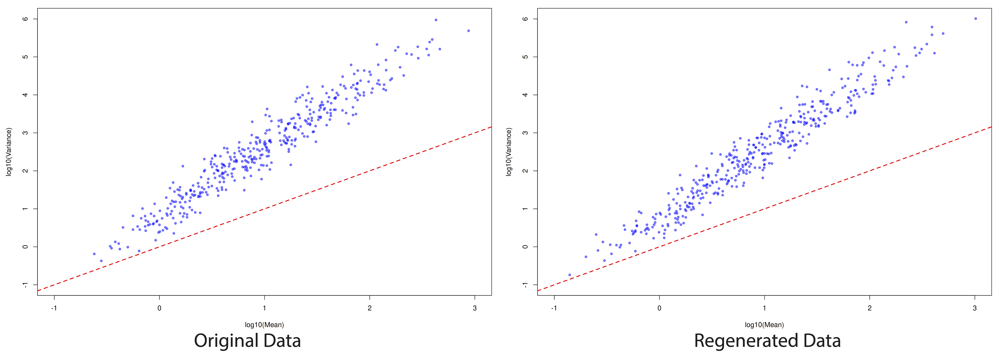
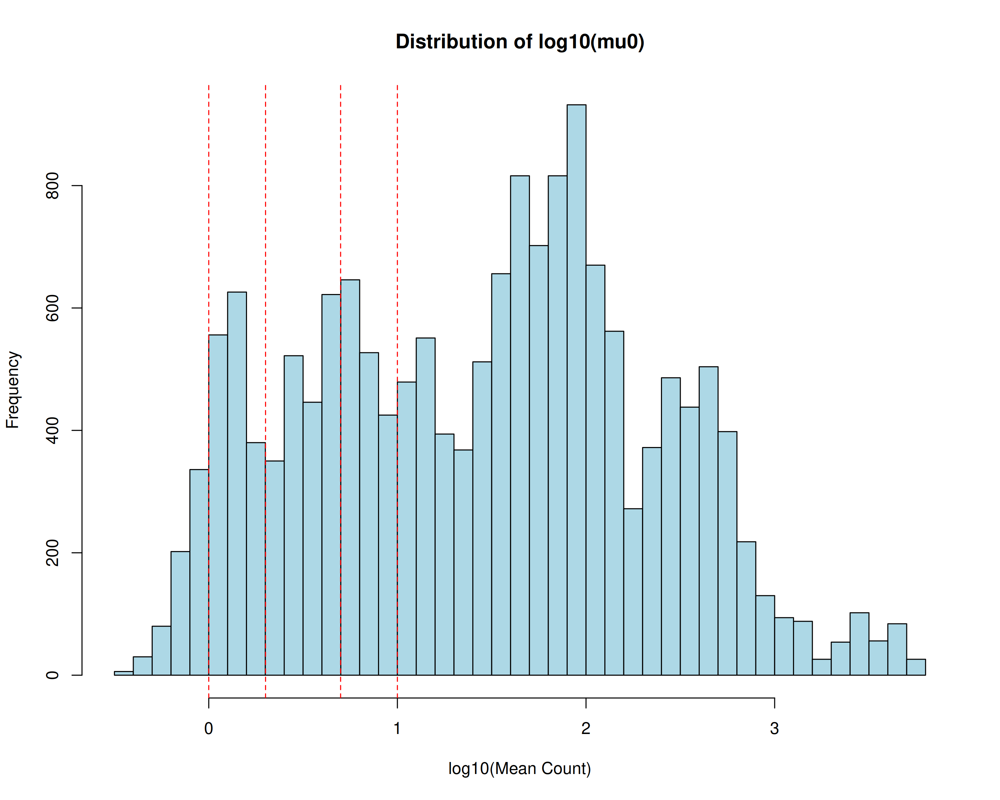
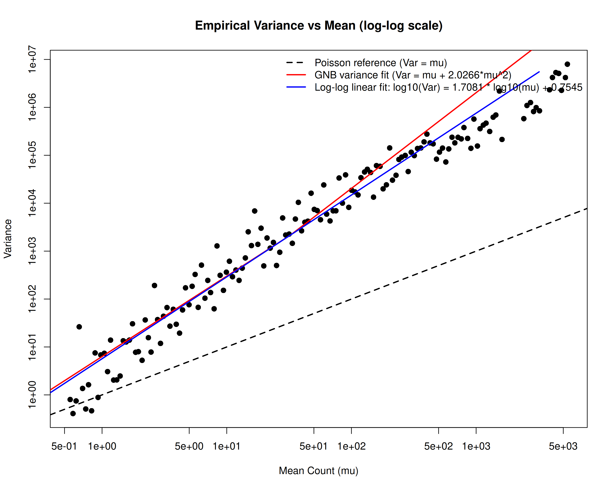

# 06 (NB Regression)

## 1. Model Construction & Parameter Estimation
### 1.1. Model Construction
We construct a negative binomial mixed-effect model:
$$\begin{cases}
Y_{ik} \mid b_i \sim \text{NB}(\mu_{ik}, \phi_k), \quad i=1,2,\dots,n, \, k=1,2,\dots,K \\
\mu_{ik} = \exp\left(\eta_{ik}\right) \\
\eta_{ik} = \log N_i + \alpha^{*}_{0k} + G_i \beta^{*}_k + X_i \gamma^{*}_k + b_i \\
\boldsymbol{b} \sim N\left(0, V(\tau)\right)
\end{cases}$$
### 1.2. Parameter Estimation with PQL + REML
In the current method, we treat $b$ as parameters, so estimating $b$ and $\theta$ allows us to directly write out the log-likelihood (terms are only related to $b$ and $\theta$):
$$\begin{aligned}
\hat{\boldsymbol{\theta}}, \hat{\boldsymbol{b}} = \arg\min_{\boldsymbol{\theta}, \boldsymbol{b}} \quad 
& \sum_{i=1}^n \sum_{k=1}^K \Bigg[ 
    - Y_{ik} \eta_{ik} + (Y_{ik}+\phi_k) \log\left( e^{\eta_{ik}} + \phi_k \right) 
\Bigg] \\
& + \frac{1}{2} \boldsymbol{b}^T \boldsymbol{V}(\tau)^{-1} \boldsymbol{b}
\end{aligned}$$
Meanwhile, we also estimate the newly added negative binomial dispersion parameter $\phi_k$ using MAP.
Finally, the method parameter $\tau$ is estimated simutaneously during the linearization step for solving $b$ and $\theta$.
In summary, we have a total of three nested loops: the inner loop estimates $b$ and $\theta$, the middle loop estimates $\phi$, the outer loop estimates $\tau$.
#### 1.2.1. PQL step
Every time we optimize the MAP, we employ Newton's method expanding with respect to $\eta$, and we consider separately the term in the MAP containing $\eta_{ik}$:
$f(\eta_{ik}) = - Y_{ik} \eta_{ik} + (Y_{ik}+\phi_k) \log\left( e^{\eta_{ik}} + \phi_k \right)$
We compute its first and second derivatives.
$$\begin{cases}
f'(\eta_{ik})\bigg|_{\eta^{(t)}} = \frac{\phi_k \cdot (\mu_{ik}^{(t)} - Y_{ik})}{\mu_{ik}^{(t)} + \phi_k} \\
f''(\eta_{ik})\bigg|_{\eta^{(t)}} = \frac{\phi_k \cdot \mu_{ik}^{(t)} \cdot (\phi_k + Y_{ik})}{(\mu_{ik}^{(t)} + \phi_k) ^ 2} = z_{ik}^{(t+1)}
\end{cases}$$
Then we can write out its second-order Taylor expansion: $f(\eta_{ik}) \approx \frac{1}{2} z_{ik}^{(t+1)} \left(\eta_{ik} - w_{ik}^{(t+1)}\right)^2 + C$, where $w_{ik}^{(t+1)} = \eta_{ik}^{(t)} + \frac{Y_{ik} - \mu_{ik}^{(t)}}{\mu_{ik}^{(t)}} \cdot \frac{\mu_{ik}^{(t)} + \phi_k}{\phi_k + Y_{ik}}$
Substituing back into the original MAP, we can write out the second-order approximation of the original MAP:
$$\begin{aligned}
\mathcal{L}_{\text{expansion}} = \frac{1}{2}\sum_{i=1}^n\sum_{k=1}^K z_{ik}^{(t+1)} \left(\eta_{ik} - w_{ik}^{(t+1)}\right)^2 + \frac{1}{2}\boldsymbol{b}^T \left(\boldsymbol{V}^{(t)}\right)^{-1}\boldsymbol{b} + C + O\left((...)^3\right)
\end{aligned}$$
The solution of the above equations is completely identical to that of the Poisson PQL.
Now we consider the update of $\phi_k$, and we write out the terms in MAP related to $\phi_k$ (we can observe that there are no cross terms between different $\phi_k$ in the MAP) :
$L_k(\phi_k) = \sum_{i=1}^n \left[ \ln\Gamma(Y_{ik}+\phi_k) - \ln\Gamma(\phi_k) - (Y_{ik}+\phi_k)\ln(\mu_{ik}^{(t)} + \phi_k) + \phi_k\ln\phi_k \right] - (a-1)\ln\phi_k + b\phi_k$
In order to compute the derivative of the above equation, we first define the digamma and trigamma functions $\psi(z) = \frac{d}{dz}\ln\Gamma(z)$, $\psi_1(z) = \frac{d}{dz}\psi(z)$
Then we define the derivative: $g_k(\phi_k) = \frac{d}{d\phi_k}L_k(\phi_k)$
and compute it with the previous definition:
$$g_k(\phi_k) = \sum_{i=1}^n \left[ \psi(Y_{ik}+\phi_k) - \psi(\phi_k) - \ln\left(\frac{\mu_{ik}^{(t)}+\phi_k}{\phi_k}\right) - \frac{Y_{ik} - \mu_{ik}^{(t)}}{\mu_{ik}^{(t)}+\phi_k} \right] - \frac{a-1}{\phi_k} + b$$
Meanwhile we can define the second-order derivative: $H_k(\phi_k) = \frac{d^2}{d\phi_k^2}L_k(\phi_k)$
and compute it as follows:
$H_k(\phi_k) = \sum_{i=1}^n \left[ \psi_1(Y_{ik}+\phi_k) - \psi_1(\phi_k) - \frac{\mu_{ik}^{(t)} - Y_{ik}}{(\mu_{ik}^{(t)}+\phi_k)^2} - \frac{1}{\mu_{ik}^{(t)}+\phi_k} + \frac{1}{\phi_k} \right] + \frac{a-1}{\phi_k^2}$
Since the dispersion parameters are constrainted to be positive, to avoid introducing constraints, we define a new parameter $\psi_k = \ln\phi_k$, which is unconstrainted.
We can then write out the update formula for this new parameter:
$$\psi_k^{(s+1)} = \psi_k^{(s)} - \frac{g_k(e^{\psi_k^{(s)}}) \cdot e^{\psi_k^{(s)}}}{H_k(e^{\psi_k^{(s)}}) \cdot e^{2\psi_k^{(s)}} + g_k(e^{\psi_k^{(s)}}) \cdot e^{\psi_k^{(s)}}}$$
#### 1.2.2. Result for Small Data
tau: true: 0.1 estimated: 0.1097
alpha:
        true estimate abs_error
1 -0.6035329  -0.7228    0.1193
2  0.1387146   0.0680    0.0707
3  0.5422206   0.4401    0.1022
4 -1.1728489  -1.2733    0.1005
beta:
         true estimate abs_error std_error
1  0.08582494   0.1674    0.0816    0.0666
2  0.10121118   0.1964    0.0952    0.0716
3 -0.11494799  -0.0557    0.0592    0.0711
4 -0.10932637  -0.0293    0.0801    0.0639
gamma:
           true estimate abs_error
1  -0.084667800  -0.0993    0.0146
2  -0.133505674  -0.1169    0.0166
3  -0.071578905  -0.0652    0.0064
4  -0.149757967  -0.1793    0.0296
5  -0.116438084  -0.1811    0.0647
6   0.009668823   0.0574    0.0477
7   0.143924109   0.1272    0.0167
8  -0.016542824  -0.0328    0.0163
9  -0.076651426  -0.0689    0.0077
10 -0.136679312  -0.1094    0.0273
11 -0.125575752  -0.0522    0.0734
12  0.362375277   0.3841    0.0217
phi:
       true estimate abs_error
1 1.0410465   1.0994    0.0584
2 0.8631164   0.9174    0.0542
3 0.8761970   0.9351    0.0589
4 1.1478342   1.2018    0.0540
correlation of b: 0.5183, max abs error: 0.214785
#### 1.2.2. Result for Simulation Data

### 1.3. Parameter Estimation with Laplace approximation
#### 1.3.1. Laplace Approximation Formula
In this method, we define the basic parameters $\boldsymbol{\theta} = \{\alpha^{*}_{0k}, \beta^{*}_k, \gamma^{*}_k, \phi_k, \tau \mid k=1,2,\dots,K\}$, and the objective is to computer the MLE. To do this, we need to approximate
$$p(Y;\boldsymbol{\theta}) = \int p(Y \mid \boldsymbol{b};\boldsymbol{\theta}) p(\boldsymbol{b};\boldsymbol{\theta}) d\boldsymbol{b}$$
We define $l(\boldsymbol{b};\boldsymbol{\theta}) = \log p(Y \mid \boldsymbol{b};\boldsymbol{\theta}) + \log p(\boldsymbol{b};\boldsymbol{\theta})$
where
$$\begin{aligned}
\log p(Y \mid \boldsymbol{b};\boldsymbol{\theta}) =& \sum_{i=1}^n \sum_{k=1}^K \Bigg[
    \log\Gamma(Y_{ik}+\phi_k) - \log\Gamma(\phi_k) - \log\Gamma(Y_{ik}+1) \\
    &+ Y_{ik}\log\mu_{ik} - (Y_{ik}+\phi_k)\log(\mu_{ik}+\phi_k) + \phi_k \log\phi_k
\Bigg]
\end{aligned}$$
$$\log p(\boldsymbol{b};\boldsymbol{\theta}) = -\frac{n}{2}\log(2\pi) - \frac{1}{2}\log\left|V(\tau)\right| - \frac{1}{2}\boldsymbol{b}^T V(\tau)^{-1} \boldsymbol{b}$$
Since we cannot evaluate the integral over $b$ analytically in the MLE, we  approximate the integrand as Gaussian. Specifically, we perform a second-order expansion of $l(\boldsymbol{b};\boldsymbol{\theta}) \approx l(\hat{\boldsymbol{b}};\boldsymbol{\theta}) - \frac{1}{2}(\boldsymbol{b}-\hat{\boldsymbol{b}})^T H (\boldsymbol{b}-\hat{\boldsymbol{b}})$ arround its mode $\hat{\boldsymbol{b}} = \arg\max_{\boldsymbol{b}} l(\boldsymbol{b};\boldsymbol{\theta})$, where $H = -\nabla^2_{\boldsymbol{b}} l(\hat{\boldsymbol{b}};\boldsymbol{\theta})$
Then we can obtain the Laplace approximation as follows:
$$p(Y;\boldsymbol{\theta}) \approx \exp\left(l(\hat{\boldsymbol{b}};\boldsymbol{\theta})\right) \cdot (2\pi)^{D/2} |H|^{-1/2}$$
Taking the log gives:
$$\log p(Y;\boldsymbol{\theta}) \approx l(\hat{\boldsymbol{b}};\boldsymbol{\theta}) - \frac{1}{2}\log|H| + \frac{n}{2}\log(2\pi)$$
Based on the above equations, we can finally obtain the objective that we need to optimize as follows:
<!-- highlight:1 -->
$$\hat{\boldsymbol{\theta}} = \arg\max_{\boldsymbol{\theta}} \left[ l(\hat{\boldsymbol{b}}(\boldsymbol{\theta}); \boldsymbol{\theta}) - \frac{1}{2}\log|H(\hat{\boldsymbol{b}}(\boldsymbol{\theta}); \boldsymbol{\theta})| + \frac{n}{2}\log(2\pi) \right]$$
#### 1.3.2. Computation of $H$
Assuming $V(\tau) = \tau I$, the Hessian $H$ is a diagonal matrix, and the log-determinant reduces to $\log|H| = \sum_{i=1}^n \log H_{ii}$, where
$$H_{ii} = -\frac{\partial^2 \log p(Y \mid \boldsymbol{b}; \boldsymbol{\theta})}{\partial b_i^2} - \frac{\partial^2 \log p(\boldsymbol{b}; \boldsymbol{\theta})}{\partial b_i^2}$$
We compute the two second derivatives separately.
For the prior $\boldsymbol{b} \sim N(0, \tau I)$:
$$\log p(\boldsymbol{b}; \boldsymbol{\theta}) = -\frac{n}{2}\log(2\pi\tau) - \frac{1}{2\tau}\sum_{i=1}^n b_i^2$$
$$\frac{\partial^2 \log p(\boldsymbol{b}; \boldsymbol{\theta})}{\partial b_i^2} = -\frac{1}{\tau}$$
For the likelihood:
$$\begin{aligned}
\log p(Y \mid \boldsymbol{b}; \boldsymbol{\theta}) =& \sum_{i=1}^n \sum_{k=1}^K \Bigg[
    \log\Gamma(Y_{ik}+\phi_k) - \log\Gamma(\phi_k) - \log\Gamma(Y_{ik}+1) \\
    &+ Y_{ik}\log\mu_{ik} - (Y_{ik}+\phi_k)\log(\mu_{ik}+\phi_k) + \phi_k\log\phi_k
\Bigg]
\end{aligned}$$
Applying $\frac{\partial \mu_{ik}}{\partial b_i} = \mu_{ik}$ from $\mu_{ik} = \exp(\eta_{ik})$ and $\frac{\partial \eta_{ik}}{\partial b_i} = 1$, we can derive the following equations:
$$\frac{\partial \log p(Y \mid \boldsymbol{b}; \boldsymbol{\theta})}{\partial b_i} = \sum_{k=1}^K \left[ Y_{ik} - \mu_{ik}\frac{Y_{ik}+\phi_k}{\mu_{ik}+\phi_k} \right]$$
$$\frac{\partial^2 \log p(Y \mid \boldsymbol{b}; \boldsymbol{\theta})}{\partial b_i^2} = -\sum_{k=1}^K \frac{\mu_{ik}\phi_k(Y_{ik}+\phi_k)}{(\mu_{ik}+\phi_k)^2}$$
Combining these two derivatives, substituing them back into the original expression, we can obtain:
<!-- highlight:1 -->
$$\log|H| = \sum_{i=1}^n \log\left( \frac{1}{\tau} + \sum_{k=1}^K \frac{\mu_{ik}\phi_k(Y_{ik}+\phi_k)}{(\mu_{ik}+\phi_k)^2} \right)$$
#### 1.3.3. Computation of $\hat{b}$
Finally, we consider how to solve $b$ from $\hat{\boldsymbol{b}}=\max_{\hat{\boldsymbol{b}}}l(\boldsymbol{b};\boldsymbol{\theta})$
Simplify this formula to obtain:
<!-- highlight:1 -->
$$\begin{aligned}
\hat{\boldsymbol{b}} = \arg\min_{\boldsymbol{b}} \quad 
& \sum_{i=1}^n \sum_{k=1}^K \Bigg[ 
    - Y_{ik} \eta_{ik} + (Y_{ik}+\phi_k) \log\left( e^{\eta_{ik}} + \phi_k \right) 
\Bigg] \\
& + \frac{1}{2} \boldsymbol{b}^T \boldsymbol{V}(\tau)^{-1} \boldsymbol{b}
\end{aligned}$$
To solve the above optimization problem, we directly apply Newton's method with line search, so we need to compute the first-order and second-order derivatives.
Additionally, it can be noted that there are no cross terms involving $b$, so we can optimize each $b_i$ directly.
<!-- highlight:1 -->
$$g_i=\frac{\partial l(\boldsymbol{b};\boldsymbol{\theta})}{\partial b_i} = \sum_{k=1}^K \left[ Y_{ik} - \frac{\mu_{ik}(Y_{ik}+\phi_k)}{\mu_{ik}+\phi_k} \right] + \left( -\frac{b_i}{\tau} \right)$$
<!-- highlight:1 -->
$$H_{ii} = \frac{\partial^2 (-l(\boldsymbol{b};\boldsymbol{\theta}))}{\partial b_i^2} = \frac{1}{\tau} + \sum_{k=1}^K \frac{\phi_k \mu_{ik} (Y_{ik}+\phi_k)}{(\mu_{ik}+\phi_k+\epsilon)^2}$$
#### 1.3.4. Computation of Total Derivative
We define
$$F(\boldsymbol{\theta}, \boldsymbol{b}) = l(\boldsymbol{b};\boldsymbol{\theta}) - \frac{1}{2}\log|H(\boldsymbol{b};\boldsymbol{\theta})| + \frac{n}{2}\log(2\pi)$$
then the overall gradient with respect to $\theta$ can be expressed as follows:
<!-- highlight:1 -->
$$\nabla_{\boldsymbol{\theta}} F(\boldsymbol{\theta}, \hat{\boldsymbol{b}}(\boldsymbol{\theta})) = \underbrace{\left.\nabla_{\boldsymbol{\theta}} F(\boldsymbol{\theta}, \boldsymbol{b})\right|_{\boldsymbol{b}=\hat{\boldsymbol{b}}(\boldsymbol{\theta})}}_{\text{Compute with AD}} + \underbrace{\left.\nabla_{\boldsymbol{b}} F(\boldsymbol{\theta}, \boldsymbol{b})\right|_{\boldsymbol{b}=\hat{\boldsymbol{b}}(\boldsymbol{\theta})} \cdot \nabla_{\boldsymbol{\theta}} \hat{\boldsymbol{b}}(\boldsymbol{\theta})}_{\text{Correction Term}}$$
From the definition of $\hat{b}$, we can obtain
$$\nabla_{\boldsymbol{b}} l\left(\hat{\boldsymbol{b}}(\boldsymbol{\theta}); \boldsymbol{\theta}\right) = \boldsymbol{0}$$
whicch expands to
$$\underbrace{\frac{\partial}{\partial \boldsymbol{\theta}} \left( \nabla_{\boldsymbol{b}} l \right)}_{-H_{b\theta}} + \underbrace{\frac{\partial}{\partial \boldsymbol{b}} \left( \nabla_{\boldsymbol{b}} l \right)}_{-H_{bb} = -H} \cdot \nabla_{\boldsymbol{\theta}} \hat{\boldsymbol{b}} = \boldsymbol{0}$$
We finally derive
<!-- highlight:1 -->
$$\boldsymbol{\nabla_{\boldsymbol{\theta}} \hat{\boldsymbol{b}} = - H_{bb}^{-1} H_{b\theta}}$$
#### 1.3.5. Computation of $H_{b\theta}$
From $\eta_{ik} = \log N_i + \alpha_k + \boldsymbol{X}_i^T\boldsymbol{\gamma}_k + G_i\beta_k + \hat{b}_i$, we can directly write out:
<!-- highlight:1 -->
$$[H_{b\theta}]_{i,j} = -\frac{\partial S_i}{\partial \theta_{u,j}} = 
\begin{cases}
\displaystyle\sum_{k=1}^K \left( -\frac{\partial S_i}{\partial \eta_{ik}} \right) \cdot \frac{\partial \eta_{ik}}{\partial \theta_{u,j}}, & \theta_{u,j} \in \{\alpha, \beta, \gamma\} \\
\displaystyle -\frac{\partial S_i}{\partial \phi_k} \cdot \frac{\partial \phi_k}{\partial \log\phi_k}, & \theta_{u,j} = \log\phi_k \\
\displaystyle -\frac{\partial S_i}{\partial \tau} \cdot \frac{\partial \tau}{\partial \log\tau}, & \theta_{u,j} = \log\tau
\end{cases}$$
where the score function is
$$S_i=\frac{\partial l}{\partial b_i} = \underbrace{\sum_{k=1}^K \left[ Y_{ik} - \frac{\mu_{ik}(Y_{ik}+\phi_k)}{\mu_{ik}+\phi_k} \right]}_{S_i^\text{lik}} + \underbrace{\left( -\frac{b_i}{\tau} \right)}_{S_i^\text{prior}}$$
And here we use $\theta_{u}$ to denote the unconstrainted parameters after the parameter transformation (log transformation).
Noted that $\frac{\partial \mu_{ik}}{\partial \eta_{ik}} = \mu_{ik}$, if we define
$$A_{ik} = \frac{\mu_{ik}(Y_{ik}+\phi_k)}{\mu_{ik}+\phi_k}$$
then 
$$\frac{\partial A_{ik}}{\partial \mu_{ik}} = \frac{(Y_{ik}+\phi_k)(\mu_{ik}+\phi_k) - \mu_{ik}(Y_{ik}+\phi_k)}{(\mu_{ik}+\phi_k)^2} = \frac{\phi_k(Y_{ik}+\phi_k)}{(\mu_{ik}+\phi_k)^2}$$
and
$$\frac{\partial S_i^\text{lik}}{\partial \eta_{ik}} = -\frac{\partial A_{ik}}{\partial \mu_{ik}} \cdot \frac{\partial \mu_{ik}}{\partial \eta_{ik}} = -\frac{\phi_k(Y_{ik}+\phi_k)\mu_{ik}}{(\mu_{ik}+\phi_k)^2}$$
#### 1.3.6. Variance Estimation
By asymptotic theory, the asymptotic variance is equal to the inverse of the information matrix, that is:
$$\mathcal{I}(\hat{\boldsymbol{\theta}}_u) = -\left. \nabla_{\boldsymbol{\theta}}^2 F(\boldsymbol{\theta}, \hat{\boldsymbol{b}}(\boldsymbol{\theta})) \right|_{\boldsymbol{\theta}=\hat{\boldsymbol{\theta}}}$$
Expand this equation, we can obtain
$$
\boldsymbol{\mathcal{I}}(\boldsymbol{\hat{\theta}}_u) = - \left[
\underbrace{F_{\theta\theta}}_{\text{From AD}}
+ \underbrace{F_{\theta b} \boldsymbol{J} + \boldsymbol{J}^T F_{\theta b}^T}_{O(1/\sqrt{n})}
+ \underbrace{\boldsymbol{J}^T F_{bb} \boldsymbol{J}}_{O(1/n)}
+ \underbrace{\sum_{i=1}^n \left( \nabla_{\boldsymbol{b}} F \right)_i \cdot \nabla_{\boldsymbol{\theta}_u}^2 \hat{b}_i}_{O(1/n)}
\right]
$$
#### 1.3.7. Algorithm Validation
##### 1.3.7.1. Basic Metric
n=100, K=4, px=3
$$
\begin{array}{lc}
\hline
\text{Metric} & \text{Value} \\
\hline
\text{Converged status} & \text{True} \\
\text{Outer iteration count} & 60 \\
\text{True } \tau & 0.01 \\
\text{Estimated } \tau & 0.0854 \\
\text{Absolute error of } \tau & 0.014633 \\
\text{Mean absolute error of } \alpha & 0.073337 \\
\text{Mean absolute error of } \beta & 0.13376 \\
\text{Mean absolute error of } \gamma & 0.059175 \\
\text{Mean absolute error of } \phi & 0.127615 \\
\text{Correlation between true } b \text{ and estimated } b & 0.5349 \\
\text{Mean absolute error of } b & 0.1977 \\
\hline
\end{array}
$$
$$
\begin{array}{cccc}
&\textbf{Alpha (intercept) comparison} \\
\hline
\text{ID} & \text{true} & \text{estimate} & \text{abs\_error} \\
\hline
1 & -0.6035329 & -0.6980 & 0.0945 \\
2 & 0.1387146 & 0.1694 & 0.0307 \\
3 & 0.5422206 & 0.5293 & 0.0129 \\
4 & -1.1728489 & -1.3281 & 0.1553 \\
\hline
\end{array}
$$
$$
\begin{array}{ccccc}
&\textbf{Beta (genetic effect) comparison} \\
\hline
\text{ID} & \text{true} & \text{estimate} & \text{abs\_error} & \text{std\_error} \\
\hline
1 & 0.08582494 & 0.2665 & 0.1807 & 0.2031 \\
2 & 0.10121118 & 0.1404 & 0.0392 & 0.1835 \\
3 & -0.11494799 & 0.0293 & 0.1443 & 0.2160 \\
4 & -0.10932637 & 0.0616 & 0.1709 & 0.1940 \\
\hline
\end{array}
$$
$$
\begin{array}{cccc}
&\textbf{Gamma (covariate effect) comparison} \\
\hline
\text{ID} & \text{true} & \text{estimate} & \text{abs\_error} \\
\hline
1 & -0.084667800 & -0.1426 & 0.0579 \\
2 & -0.133505674 & -0.2400 & 0.1065 \\
3 & -0.071578905 & -0.1299 & 0.0583 \\
4 & -0.149757967 & -0.1969 & 0.0471 \\
5 & -0.116438084 & -0.0484 & 0.0680 \\
6 & 0.009668823 & -0.0301 & 0.0398 \\
7 & 0.143924109 & 0.0968 & 0.0471 \\
8 & -0.016542824 & -0.0253 & 0.0088 \\
9 & -0.076651426 & -0.0848 & 0.0082 \\
10 & -0.136679312 & 0.0568 & 0.1934 \\
11 & -0.125575752 & -0.0866 & 0.0390 \\
12 & 0.362375277 & 0.3984 & 0.0360 \\
\hline
\end{array}
$$
$$
\begin{array}{cccc}
&\textbf{Phi (dispersion parameter) comparison} \\
\hline
\text{ID} & \text{true} & \text{estimate} & \text{abs\_error} \\
\hline
1 & 1.0410465 & 1.0320 & 0.0091 \\
2 & 0.8631164 & 1.3160 & 0.4529 \\
3 & 0.8761970 & 0.8794 & 0.0032 \\
4 & 1.1478342 & 1.1026 & 0.0453 \\
\hline
\end{array}
$$
##### 1.3.7.2. Variance
50 generation from true parameters
$$
\begin{array}{ccccc}
&\textbf{Rough Variation Comparison of Beta} \\
\hline
\text{beta\_id} & \text{true\_value} & \text{emp\_sd} & \text{estimated}\\
\hline
1 & 0.0858 & 0.2208 & 0.1983\\
2 & 0.1012 & 0.2403 & 0.2155 \\
3 & -0.1149 & 0.2020 & 0.2143\\
4 & -0.1093 & 0.1921 & 0.1855\\
\hline
\end{array}
$$

$$
\begin{array}{ccccc}
&\textbf{Exact Variation Comparison of Beta} \\
\hline
\text{beta\_id} & \text{true\_value} & \text{emp\_sd} & \text{estimated}\\
\hline
1 & 0.0858 & 0.2208 & 0.2108 \\
2 & 0.1012 & 0.2403 & 0.2280 \\
3 & -0.1149 & 0.2020 & 0.2267\\
4 & -0.1093 & 0.1921 & 0.1981 \\
\hline
\end{array}
$$
#### 1.3.8. Results for Simulated Data (Generated from True Data)

True Effect Rank in p-value:
PALMQTL: 1, 2, 3, 8, 10, 11, 13, 17, 18, 19, 29, 48, 57, 95, 113, 156, 179, 184, 243, 253
PALM: 1, 2, 3, 5, 8, 10, 13, 26, 32, 37, 54, 56, 67, 91, 104, 122, 147, 159, 183, 328 

#### 1.3.9 Score Stats

$\boldsymbol{\theta}^0_{\text{rest}} = \arg\max_{\boldsymbol{\theta}_{\text{rest}}} F\left(\boldsymbol{\theta}_{\text{rest}}, \boldsymbol{\beta}=0, \hat{\boldsymbol{b}}(\boldsymbol{\theta}_{\text{rest}}, \boldsymbol{\beta}=0)\right)$

## 2. Multiple Model Comparison
### 2.1. Data Generation Method in PALM
PALM uses two data generation modes: independent and correlated
In correlated mode, for each cluster, three independent samples are generated: base, X1, X2. Then two final samples are formed as floor((base+X1)/2) and floor((base+X2)/2). Each cluster contains exactly two samples.
This data construction method is only suitable to robust variance estimation methods, not to other approaches.
I previous used the correlated data by mistake, which made the demonstration inaccurate. I will now re-present the results using independent data.
### 2.2. Models without random effects
The basic model is defined as follows:
$$\mathbb{E}(Y_{ik})=\mu_{ik}=\exp(\alpha^*_{0k}+G_i \beta^*_k+X_i \gamma^*_k)$$
$$Y_{ik}\sim \text{NB} (\mu_{ik}, \phi_{ik})$$
where we have multiple options for the variance of the NB distribution.
We have two parameter estimation approaches. The first one is to initially esimate the expectation parameter using the same method as PALM, and then estimate the variance parameters via MLE. The second one is to directly solve the joint MLE with Firth correction. Numerical experiments show that there is little difference between the two.
#### 2.2.1. Variance Plot
To guess the possible values of the variance parameters, let us first try plotting a few figures.
First, esimate the mean via PALM. Then, by binning data points with adjacent mean values, treating points within each bin as completely independent, we can compute the sample variance. This allows us to plot the mean distribution and the variance distribution in log-log scale.

#### 2.2.2. Different Variance Modeling
We can model the variance as follows:
$$\phi_{ik}=(1+\lambda_k) \mu_{ik} + \phi_{k} \mu_{ik}^{q_k}$$
Numerical experiments show that if we assume the variance parameters vary across features, the results become numerically unstable -- specifically, the unconstrained MLE yields negative or extremely large variance parameter estimates.
So we need to model the variance as follows:
$$\phi_{ik}=(1+\lambda) \mu_{ik} + \phi \mu_{ik}^{q}$$
The loglikelihood with Firth correction can be written out:
$$\mathcal{L}(\theta) = -\left( \sum_{k=1}^K \sum_{i=1}^n \ell_{ik} + \frac{1}{2} \log|I(\theta)| \right)$$
where
$$
\begin{aligned}
\ell_{ik}
&= \log\Gamma\left(Y_{ik} + \dfrac{1}{\phi}\right)
- \log\Gamma\left(\dfrac{1}{\phi}\right)
- \log\Gamma\left(Y_{ik}+1\right) \\
&\quad + \dfrac{1}{\phi}\log\left(\dfrac{1}{1+\phi\mu_{ik}}\right)
+ Y_{ik}\log\left(\dfrac{\phi\mu_{ik}}{1+\phi\mu_{ik}}\right)
\end{aligned}
$$
Under this model construction, fitting individual datasets shows that the estimated q approaches 2 (e.g. 1.76~1.85), and lambda is estimated at zero for most simulation setting (if no constraint, it will be from -0.338 to -3.520), except for a few where it fits to a non-zero positive value (e.g. 0.3)

So we claim that $q=0$, $\lambda=0$
Under this setting, the score stats is
$$S = S_{likelihood} + S_{penalty} = \sum_{i=1}^n w_{ik} (G_i - \bar{G}_{\mu,k}) (Y_{ik} - \mu_{ik} + Y_{b,ik})$$
where $w_{ik} = 1/(1+\phi \mu_{ik})$, and $$I_{1,k} = \sum_{i=1}^n w_{ik} (G_i - \bar{G}_{\mu,k})^2 \mu_{ik}$$
The final stats need to be compute under robost variance estimation:
$$var_{sandwich,k} = \sum_{c=1}^{C} (cluster\_score_{c,k})^2$$
$$var_{\beta,sandwich,k} = \frac{var_{sandwich,k}}{I_{1,k}^2}$$
<!-- highlight:2 -->
Problem: Score stats and information matrix may be wrong.

#### 2.2.3. Revisiting the MB Mixed-Effect Model
From the above derivation, we can claim that in NB mix effect model, the variance also follows
$$\phi_{ik}= \mu_{ik} + \phi \mu_{ik}^{2}$$
##### 2.2.3.1. Score Stats
Score Stats need to be computed as integral with b, we can use Gauss-Hermite integral to compute it.
The problem lies in computing the information matrix -- this term requires integrating out $Y$. I have tried multiple approaches, but it is essentially infeasible.
If we use the observed $Y$ from the data as a one-step integral estimate, under $n=20$, $K=100$, the relative error of the variance reaches 60%. So we need to sample multiple $Y$ under null hypothesis.
##### 2.2.3.2. Comparison to NB
Under global phi assumption, we can directly estimate the difference between parameters fitted by the NB mixed-effect model and those fitted by a pure NB model.
For alpha, the Pearson correlation coefficient reaches 0.998, MAE is 0.070, RMSE is 0.093.
For phi, absolute error is 0.003 (in NB, 1/phi is 0.317; in NB mixed-effect, phi is 0.320)
Also we can compare $\mu$
$$
\begin{array}{lccc}
\hline
\text{Comparison} & \text{MAD} & \text{MRD} & \text{Max AD} \\
\hline
\text{With RE vs Without RE} & 7.047190 & 11.01\% & 1419.035061 \\
\text{GNB vs Without RE} & 4.045894 & 7.14\% & 287.549382 \\
\text{GNB vs With RE} & 8.387086 & 13.74\% & 1556.740636 \\
\hline
\end{array}
$$
### 2.3. Revisiting Score Stats and Poisson Mixed Model
#### 2.3.1. GMMAT

I tried GMMAT, which fits models for features separately, but the results were poor (fdr > 0.9)

#### 2.3.2. Poisson or NB, Globally or Separately, PQL&REML or Laplace, Score Stats

We have too many options, and it is too time-consuming and labor-intensive for writing code for each possible combination.

For the model itself, we can consider Poisson or Negative Binomial, each either with or withour random effects.

For the parameter settings, we can specify the variance-mean relationship as quadrative, linear or both. Additionally, the parameters can be either global (shared across all features) or feature-specific. The more parameters we include, the better the model can fit the data. However, the problem is that extra parameters may have very large variance, so they need to be excluded when computing the score test.

As for the fitting method, standard packages like GMMAT use PQL combined with REML. However, this approach is not suitable for our data -- as discussed earlier, it drives the random effect toward zero -- so we can only use Laplace approximation.

For the score statistics, we also have many options. 
One approach is similar to GMMAT: we treat the random effects as fixed and the test only the NB or Poisson component. This way we can derive an exact mathematical expression for score test, through it is still an approximation of real score test.
Alternatively we can compute the theoretical score, which requires numerical integration. For this we could use the Gauss-Hermite quadrature, sample a set of equally spaced points, or apply a Laplce approximation.
As  for the information matrix, there are also several choices: we can compute it by exact sampling Y under null hypothesis, or simply use the observed Y from the data. If we do sample Y, we need to decide how many samples to draw.
The information matrix itself can be estimated as $SS^T$ or as $-\mathbb{E}\left[\frac{\partial S}{\partial \theta}\right]$. Then there is the question of how to remove redundant parameters from the resulting matrix, and how to obtain a robust inverse.

Below show results for multiple models fitted by Laplace approximation:

#### 2.3.3. Score Stats and Variance
$$\begin{cases}
Y_{ik} \mid b_i \sim \text{NB}(\mu_{ik}, \phi_k), \quad i=1,2,\dots,n, \, k=1,2,\dots,K \\
\mu_{ik} = \exp\left(\eta_{ik}\right) \\
\eta_{ik} = \log N_i + \alpha^{*}_{0k} + G_i \beta^{*}_k + X_i \gamma^{*}_k + b_i \\
\boldsymbol{b} \sim N\left(0, V(\tau)\right)
\end{cases}$$

Generally, we want to test $H_0: \beta = 0$. Let $\gamma$ denote the vector of nuisance parameters. Let the log-likelihood be $\ell(\beta, \gamma)$.
Define the score vector: $S(\beta, \gamma) = \begin{pmatrix} S_\beta(\beta, \gamma) \\ S_\gamma(\beta, \gamma) \end{pmatrix} = \begin{pmatrix} \frac{\partial \ell}{\partial \beta} \\ \frac{\partial \ell}{\partial \gamma} \end{pmatrix}$
And the Fisher information matrix: $\mathcal{I}(\beta, \gamma) = \begin{pmatrix} \mathcal{I}_{\beta\beta} & \mathcal{I}_{\beta\gamma} \\ \mathcal{I}_{\gamma\beta} & \mathcal{I}_{\gamma\gamma} \end{pmatrix}$
We estimate $\gamma$ by solving $S_\gamma(0, \hat{\gamma}_0) = 0$, then we evaluate the score and information as $(\beta = 0, \gamma = \hat{\gamma}_0)$.
The score test statistic is:
$$T = \frac{S_\beta(0, \hat{\gamma}_0)^2}{\tilde{\mathcal{I}}_{\beta\beta}}$$
where $\tilde{\mathcal{I}}_{\beta\beta} = \mathcal{I}_{\beta\beta} - \mathcal{I}_{\beta\gamma}\,\mathcal{I}_{\gamma\gamma}^{-1}\,\mathcal{I}_{\gamma\beta}$
Under $H_0$, asymptotically: $T \xrightarrow{d} \chi^2_1$
For global $\phi$, nuisance parameters are $\phi$ and $\tau$, treating all other parameters are fixed, the results are as follows:

#### 2.3.4. Others

1. NB is not equal to PALM
2. how to access inspire data?

### 2.4. Revisiting Negative Binomial Score Test

For this report, we have divided it into four sections.
First we will discuss the numerical results.
Next, we will cover the improvement approaches I have already attempted.
Then, we will introduce the specific algorithm in detail.
Finally, we will briefly describe the progress & problem in the mbGWAS numerical experiments.
Also with future directions.

#### 2.4.1. Numerical Results

I compared four different methods: the original PALM, and three version of the new PALMQTL:
the basic version,
the version with robust variance added,
and the version with SPA correction applied.

#### 2.4.2. Possible Improvement Approaches

The main problem lies in incorrect variance, which makes robust variance correction a necessity. This actually indicates that there are still some issues with the model assumption.
We have several hypotheses, among which the most plausible one is that there are defects in the variance component. For example, we may need to add a first-order term, or our existing second-order term is not properly specified.
I have tested all these adjustments, but none of them could achieve MLE convergence (as judged by the nlminb optimizer) on the small dataset where N=20 and K=92.

#### 2.4.3. Score Stats Under New Perspective

##### 2.4.3.1. Standard Score Test

We treat random effects as fixed parameters, which means we are essentially performing tests on a pure NB model:
$$Y_{ik} \sim \text{NB}(\mu_{ik}, \phi_k), \quad \log(\mu_{ik}) = \log N_i + \alpha_k + \boldsymbol{X}_i^T \boldsymbol{\gamma}_k + b_i$$
In the calculation of the expected information matrix, the second-order cross term for $\mu$ and $\phi$ is zero, so we do not need to consider $\phi$ at all when correcting the variance.
We can write out the score as follows:
$$S_k = \left.\frac{\partial \ell(\beta_k, \boldsymbol{\theta}_0)}{\partial \beta_k}\right|_{\beta_k=0} = \sum_{i=1}^n G_i \cdot \frac{Y_{ik} - \hat{\mu}_{ik}^0}{1 + \hat{\mu}_{ik}^0/\phi_k}$$
where $\hat{\mu}_{ik}^0 = \exp\left(\log N_i + \alpha_k + \boldsymbol{X}_i^T \boldsymbol{\gamma}_k + \hat{b}_i\right)$

Parameters are ordered as $\{\beta_k, \alpha_k, \boldsymbol{\gamma}_k, b_1, ..., b_n\}$, with information matrix blocks defined as follows:
- $I_{\beta\beta} = \sum_{i=1}^n G_i^2 w_{ik}$: Marginal information for the genetic effect $\beta_k$
- $I_{\beta f} = \left[\sum_{i=1}^n G_i w_{ik},\ \sum_{i=1}^n G_i X_{i1} w_{ik},\ ...,\ \sum_{i=1}^n G_i X_{ip_x} w_{ik}\right]$: Cross-information between $\beta_k$ and fixed effects (intercept $\alpha_k$, covariates $\boldsymbol{\gamma}_k$)
- $I_{\beta b} = [G_1 w_{1k},\ G_2 w_{2k},\ ...,\ G_n w_{nk}]$: Cross-information between $\beta_k$ and subject-level random effects $b_i$
- $A$: Fixed-effect block information matrix ($m \times m$, where $m = 1 + p_x$)
- $B$: Cross-information matrix between fixed effects and random effects ($m \times n$)
- $D = \text{diag}(w_{ik} + 1/\tau)$: Diagonal random-effect block information matrix

The expected information weight $w_{ik}$ (Y-free, computed solely from null model parameters) is defined as:
$$w_{ik} = \frac{\hat{\mu}_{ik}^0}{1 + \hat{\mu}_{ik}^0/\phi_k}$$
where $\hat{\mu}_{ik}^0$ is the fitted mean under the null model $H_0: \beta_k = 0$.

The effective information for $\beta_k$ is derived via Woodbury matrix identity simplification, avoiding high-dimensional inversion:
$$
I_k = I_{\beta\beta} - I_{\beta b} D^{-1} I_{\beta b}^T - \left(I_{\beta f} - I_{\beta b} D^{-1} B^T\right) \left(A - B D^{-1} B^T\right)^{-1} \left(I_{\beta f} - I_{\beta b} D^{-1} B^T\right)^T
$$
with $D^{-1} = \text{diag}\left(1/(w_{ik} + 1/\tau)\right)$. Only a low-dimensional $m \times m$ matrix inversion is required, yielding $O(p_x^3)$ complexity that scales efficiently to large sample sizes.

##### 2.4.3.2. Robust Variance

When we use robust variance, we only need to use $U_{ik} = S_{1,i} - I_{10} I_{00}^{-1} S_{0,i}$.

##### 2.4.3.3. SPA Correction

To apply SPA, we need to examine the actual profile score:
$$U_i = G_i \cdot \frac{Y_i - \mu_i^0}{1+\mu_i^0/\phi} - \text{proj}_i \cdot \frac{Y_i - \mu_i^0}{1+\mu_i^0/\phi} = a_i \cdot (Y_i - \mu_i^0)$$
i.e. $$S = \sum_{i=1}^n U_i, \quad U_i = a_i Y_i + c_i$$
Here we assume that both $a_i$ and $c_i$ are non-random constants.

For standard NB $Y \sim \text{NB}(\mu, \phi)$, the distribution is:
$$P(Y=y) = \frac{\Gamma(y+\phi)}{\Gamma(\phi) \Gamma(y+1)} \left(\frac{\mu}{\mu+\phi}\right)^y \left(\frac{\phi}{\mu+\phi}\right)^\phi$$
And the MGF is:
$$M(t) = \mathbb{E}[e^{tY}] = \left( \frac{\phi}{\phi - \mu (e^t - 1)} \right)^\phi, \quad t < \log\left(1 + \frac{\phi}{\mu}\right)$$
Then the CGF is:
$$K_Y(t) = \phi \left( \log\phi - \log\left(\phi - \mu(e^t - 1)\right) \right)$$
So we can write out the final CGF:
$$K(t) = - t \sum_{i=1}^n a_i \mu_i^0 + \sum_{i=1}^n \phi \left( \log\phi - \log\left(\phi - \mu_i^0 (e^{a_i t} - 1)\right) \right)$$
For meta-analysis, the statistics is: $$S_{\text{meta}} = \sum_{m=1}^M w_m S_m$$, where $w_m = 1/I_m$, so we can write out the meta-CGF:
$$K_{\text{meta}}(t) = \sum_{m=1}^M K_m(w_m t)$$

#### 2.4.4. mbGWAS Progress & Problem

Progress: 
I have completed the preliminary setup of the preprocessing code for the SIF (Singularity Image File) required for mbGWAS, and have preliminarily organized my local PALMQTL implementation into a formal package.

Problem:
1. I am not proficient in working on the R Platform, which has been quite frustrating. For example, I cannot easily copy code (so I cannot conveniently use AI for debugging), and the connection is also unstable and very laggy.
2. Meanwhile, the current implementation does not take the kinship matrix into account, so the variance correction with random effects can still be calculated accurately. When kinship is considered, we need to verify whether it satisfies a first-order relationship, second-order relationship, or other forms.
3. 

#### 2.4.5. Future Directions

1. Complete mbGWAS test.
2. Explore ways to eliminate the need for robust variance.
3. Solve SPA problem + robust variance
4. mixed poisson share tau
5. pure NB (whether share phi), poisson (bi/bik, whether share tau)
