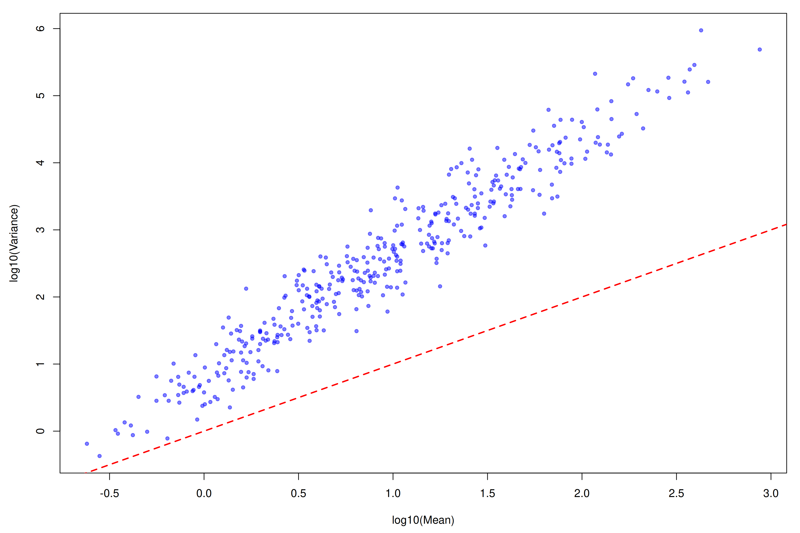
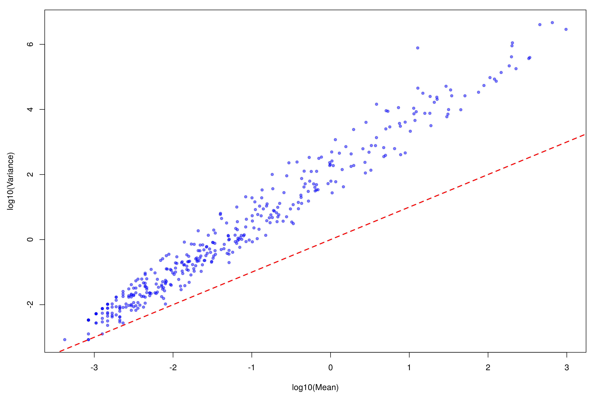
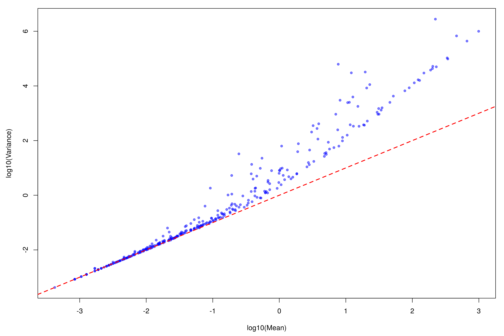

# 06 (Poisson Regression)

## 1. Model Construction & Parameter Estimation
GLMM Model:
$$\begin{cases}
Y_{ik} \mid b_i \sim \text{Poisson}(\mu_{ik}), \quad i=1,2,\dots,n, \, k=1,2,\dots,K \\
\mu_{ik} = \exp\left(\eta_{ik}\right) \\
\eta_{ik} = \log N_i + \alpha^{*}_{0k} + G_i \beta^{*}_k + X_i \gamma^{*}_k + b_i \\
b \sim N\left(0, V(\tau)\right)
\end{cases}$$
We define $\boldsymbol{\theta} = \left\{\alpha^{*}_{0k}, \beta^{*}_k, \gamma^{*}_k\right\}_{k=1}^K$ and $\mathbf{b} = (b_1, b_2, \dots, b_n)^\top$, and treat $\mathbf{b}$ as a parameter to be estimated.
The MAP estimates are given by
$$\hat{\boldsymbol{\theta}}, \hat{\boldsymbol{b}} = \arg\min_{\boldsymbol{\theta}, \boldsymbol{b}} \quad \sum_{i=1}^n \sum_{k=1}^K \left( \mu_{ik} - Y_{ik} \cdot \eta_{ik} \right) + \frac{1}{2} \boldsymbol{b}^T \boldsymbol{V}(\tau)^{-1} \boldsymbol{b}$$
We follow the normal procedure for estimation, it contains the following different steps at $t$-th step.
1. According to $\theta^{(t)}$, $b^{(t)}$ and $\tau^{(t)}$, calculate $\theta^{(t+1)}$, $b^{(t+1)}$ with PQL method
2. According to $\theta^{(t+1)}$, $b^{(t+1)}$ and $\tau^{(t)}$, calculate $\tau^{(t+1)}$ with AI-REML method
### 1.1. PQL part
At step $t$, we denote $\eta_{ik}^{(t)} = \log N_i + \alpha^{*(t)}_{0k} + G_i\beta^{*(t)}_k + X_i\gamma^{*(t)}_k + b_i^{(t)}, \quad \mu_{ik}^{(t)} = \exp\left(\eta_{ik}^{(t)}\right), \quad \boldsymbol{V}^{(t)} = \boldsymbol{V}(\tau^{*(t)}).$
For $f(\eta_{ik}) = \exp(\eta_{ik}) - Y_{ik}\eta_{ik}$, a second‑order Taylor expansion at $\eta_{ik} = \eta_{ik}^{(t)}$ yields
$$f(\eta_{ik}) = f(\eta_{ik}^{(t)}) + \left(\mu_{ik}^{(t)}-Y_{ik}\right)\left(\eta_{ik}-\eta_{ik}^{(t)}\right) + \frac{1}{2}\mu_{ik}^{(t)}\left(\eta_{ik}-\eta_{ik}^{(t)}\right)^2 + O\left((...)^3\right).$$
Thus we have
$$\mathcal{L}_{\text{expansion}} = \frac{1}{2}\sum_{i=1}^n\sum_{k=1}^K \mu_{ik}^{(t)} \left(\eta_{ik} - w_{ik}^{(t+1)}\right)^2 + \frac{1}{2}\boldsymbol{b}^T \left(\boldsymbol{V}^{(t)}\right)^{-1}\boldsymbol{b} + C + O\left((...)^3\right),$$
where
$$w_{ik}^{(t+1)} = \eta_{ik}^{(t)} + \frac{Y_{ik} - \mu_{ik}^{(t)}}{\mu_{ik}^{(t)}}.$$
Ignoring the third‑order term, the log‑likelihood of the GLMM is then equivalent to that of the LMM
$$w_{ik}^{(t+1)} = \log N_i + \alpha^{*}_{0k} + G_i \beta^{*}_k + X_i \gamma^{*}_k + b_i + \epsilon_{ik},$$
where
$$\begin{cases}
\epsilon_{ik} \overset{\text{i.i.d.}}{\sim} N\left(0, \frac{1}{\mu_{ik}^{*(t)}}\right) & \text{(observation error)} \\[6pt]
\boldsymbol{b} \sim N\left(\boldsymbol{0}_n, V^{*(t)}\right) & \text{(random effect, independent of all $\epsilon_{ik}$)}
\end{cases}$$
At this step we need only solve the following optimization:
$$\begin{aligned}
\theta^{*(t+1)}, b^{(t+1)} = \arg\min_{\theta^*, b} \; \frac{1}{2} \bigl( Z\theta^* + (\mathbf{1}_K\otimes b) + c - w^{(t+1)} \bigr)^\top D^{(t)}\\ \bigl( Z\theta^* + (\mathbf{1}_K\otimes b) + c - w^{(t+1)} \bigr)
+ \frac{1}{2} b^\top \bigl( V^{*(t)} \bigr)^{-1} b,
\end{aligned}$$
where
- $\boldsymbol{c} = \operatorname{vec}\bigl(\log \boldsymbol{N} \cdot \mathbf{1}_K^\top\bigr) \in \mathbb{R}^{nK\times 1}$
- $Z = \bigl[ \mathbf{I}_K\otimes\mathbf{1}_n,\; \mathbf{I}_K\otimes G,\; \mathbf{I}_K\otimes X \bigr] \in \mathbb{R}^{nK\times K(2+p_X)}$
- $\theta^* = \bigl[ (\alpha^*)^\top,\, (\beta^*)^\top,\, (\gamma^*)^\top \bigr]^\top \in \mathbb{R}^{K(2+p_X)\times 1}$
- $\boldsymbol{D}^{(t)} = \operatorname{diag}\bigl(\operatorname{vec}(\boldsymbol{\mu}^{*(t)})\bigr) \in \mathbb{R}^{nK \times nK}$
The solution equations of the above opimization are
$$\begin{bmatrix}
\boldsymbol{A} & \boldsymbol{B} \\
\boldsymbol{B}^\top & \boldsymbol{C}
\end{bmatrix}
\begin{bmatrix}
\boldsymbol{\theta}^{*(t+1)} \\
\boldsymbol{b^{(t+1)}}
\end{bmatrix}
=
\begin{bmatrix}
\boldsymbol{d}_1 \\
\boldsymbol{d}_2
\end{bmatrix},$$
with the subblocks defined as
- $\boldsymbol{A} = \boldsymbol{Z}^\top \boldsymbol{D}^{(t)} \boldsymbol{Z} \in \mathbb{R}^{ K(2+p_X) \times K(2+p_X)}$
- $\boldsymbol{B} = \boldsymbol{Z}^\top \boldsymbol{D}^{(t)} (\mathbf{1}_K \otimes \boldsymbol{I}_n) \in \mathbb{R}^{ K(2+p_X) \times n}$
- $\boldsymbol{C} = (\mathbf{1}_K^\top \otimes \boldsymbol{I}_n) \boldsymbol{D}^{(t)} (\mathbf{1}_K \otimes \boldsymbol{I}_n) + (\boldsymbol{V}^{*(t)})^{-1} = \operatorname{diag}\Bigl(\sum_{k=1}^K \mu_{1k}^{*(t)},\, \sum_{k=1}^K \mu_{2k}^{*(t)},\, \dots,\, \sum_{k=1}^K \mu_{nk}^{*(t)}\Bigr) + (\boldsymbol{V}^{*(t)})^{-1} \in \mathbb{R}^{n \times n}$
- $\boldsymbol{d}_1 = \boldsymbol{Z}^\top \boldsymbol{D}^{(t)} (\boldsymbol{w}^{(t+1)}-c) \in \mathbb{R}^{ K(2+p_X)}$
- $\boldsymbol{d_2} = (\mathbf{1}_K \otimes \boldsymbol{I}_n)^\top \boldsymbol{D}^{(t)} \left( \boldsymbol{w}^{(t+1)} - \boldsymbol{c} \right) \in \mathbb{R}^{n\times 1}$
Eliminating $\boldsymbol{b}^{(t+1)}$ gives

$$\boldsymbol{b}^{(t+1)} = \boldsymbol{C}^{-1}\bigl(\boldsymbol{d}_2 - \boldsymbol{B}^\top \boldsymbol{\theta}^*\bigr),$$
$$\bigl(\boldsymbol{A} - \boldsymbol{B}\boldsymbol{C}^{-1}\boldsymbol{B}^\top\bigr) \, \boldsymbol{\theta}^{*(t+1)} = \boldsymbol{d}_1 - \boldsymbol{B}\boldsymbol{C}^{-1}\boldsymbol{d}_2,$$

where $(\boldsymbol{A} - \boldsymbol{B}\boldsymbol{C}^{-1}\boldsymbol{B}^\top)$ is the Schur complement of dimension $K(2+p_X) \times K(2+p_X)$.  
The overall complexity of this step is $\mathcal{O}(nK + K^3)$.
### 1.2. AI-REML step
We denote $\boldsymbol{\tilde{w}}^{(t+1)} = \boldsymbol{w}^{(t+1)} - \boldsymbol{c}$.
The corresponding approximated LMM is then given by:
$$\boldsymbol{\tilde{w}}_{ik}= \alpha^{*}_{0k} + G_i \beta^{*}_k + X_i \gamma^{*}_k + b_i+\epsilon_{ik}$$
Its vectorized form is written as:
$$\operatorname{vec}(\boldsymbol{\tilde{w}}) = \boldsymbol{Z}\boldsymbol{\theta}^* + \operatorname{vec}(\boldsymbol{\psi})$$
where $\psi_{ik}=b_i+\epsilon_{ik}$, $\operatorname{vec}(\boldsymbol{\psi}) \sim N\left(\boldsymbol{0}, \boldsymbol{\Sigma}(\tau)\right)$, and
$$\boldsymbol{\Sigma}(\tau) = \underbrace{(\mathbf{1}_K \otimes \boldsymbol{I}_n) \boldsymbol{V}(\tau) (\mathbf{1}_K^\top \otimes \boldsymbol{I}_n)}_{\text{from random effect}} + \underbrace{(\boldsymbol{D}^{(t)})^{-1}}_{\text{from observed error}},$$
with design matrix $\boldsymbol{Z} \in \mathbb{R}^{nK \times p}$ and $p=K(2+p_x)$.
We now choose a full-rank matrix $\boldsymbol{K} \in \mathbb{R}^{nK \times (nK-p)}$ such that $\boldsymbol{K}^\top \boldsymbol{Z} = \boldsymbol{0}$, and define the transformed response $\boldsymbol{y}^* = \boldsymbol{K}^\top \operatorname{vec}(\tilde{\boldsymbol{w}})$.
It follows that $\boldsymbol{y}^* \sim N\left(\boldsymbol{0}, \boldsymbol{K}^\top \boldsymbol{\Sigma}(\tau)\boldsymbol{K}\right)$.
The log-likelihood for this transformed model is then:
$$\ell(\tau) = 
-\frac{nK-p}{2}\log(2\pi)
-\frac{1}{2}\log\left|\boldsymbol{K}^\top \boldsymbol{\Sigma}(\tau)\boldsymbol{K}\right|
-\frac{1}{2}\boldsymbol{y}^{*\top} \left(\boldsymbol{K}^\top \boldsymbol{\Sigma}(\tau)\boldsymbol{K}\right)^{-1} \boldsymbol{y}^*$$
We calculate the derivative of the above equation to get the score function of REML:
$$\begin{aligned}
\frac{\mathrm{d}\ell(\tau)}{\mathrm{d}\tau} =& -\frac{1}{2}\mathrm{tr}\left( \left(\boldsymbol{K}^\top \boldsymbol{\Sigma}(\tau)\boldsymbol{K}\right)^{-1}\boldsymbol{K}^\top \frac{\mathrm{d}\boldsymbol{\Sigma}(\tau)}{\mathrm{d}\tau}\boldsymbol{K} \right) \\
&+ \frac{1}{2}\operatorname{vec}(\tilde{\boldsymbol{w}})^\top \boldsymbol{K}\left(\boldsymbol{K}^\top \boldsymbol{\Sigma}(\tau)\boldsymbol{K}\right)^{-1}\boldsymbol{K}^\top \frac{\mathrm{d}\boldsymbol{\Sigma}(\tau)}{\mathrm{d}\tau}\boldsymbol{K}\left(\boldsymbol{K}^\top \boldsymbol{\Sigma}(\tau)\boldsymbol{K}\right)^{-1}\boldsymbol{K}^\top \operatorname{vec}(\tilde{\boldsymbol{w}})
\end{aligned}$$
We first define two matrices as follows:
$$\boldsymbol{P}(\tau) = \boldsymbol{\Sigma}^{-1} - \boldsymbol{\Sigma}^{-1}\boldsymbol{Z}\left(\boldsymbol{Z}^\top \boldsymbol{\Sigma}^{-1}\boldsymbol{Z}\right)^{-1}\boldsymbol{Z}^\top \boldsymbol{\Sigma}^{-1}, \quad \boldsymbol{L} = \boldsymbol{K} \left(\boldsymbol{K}^\top \boldsymbol{\Sigma} \boldsymbol{K}\right)^{-1} \boldsymbol{K}^\top$$
We verify their core properties below:
$$\boldsymbol{L} \boldsymbol{Z} = \boldsymbol{K} \left(\boldsymbol{K}^\top \boldsymbol{\Sigma} \boldsymbol{K}\right)^{-1} \underbrace{\boldsymbol{K}^\top \boldsymbol{Z}}_{=0} = \boldsymbol{0}$$
$$\boldsymbol{P}\boldsymbol{Z} = \boldsymbol{\Sigma}^{-1}\boldsymbol{Z} - \boldsymbol{\Sigma}^{-1}\boldsymbol{Z}\left(\boldsymbol{Z}^\top \boldsymbol{\Sigma}^{-1}\boldsymbol{Z}\right)^{-1} \underbrace{\boldsymbol{Z}^\top \boldsymbol{\Sigma}^{-1}\boldsymbol{Z}}_{\text{inversible}} = \boldsymbol{\Sigma}^{-1}\boldsymbol{Z} - \boldsymbol{\Sigma}^{-1}\boldsymbol{Z} = \boldsymbol{0}$$
$$\boldsymbol{L} \boldsymbol{\Sigma}\boldsymbol{K} = \boldsymbol{K} \left(\boldsymbol{K}^\top \boldsymbol{\Sigma} \boldsymbol{K}\right)^{-1} \underbrace{\boldsymbol{K}^\top \boldsymbol{\Sigma} \boldsymbol{K}}_{\text{inversible}} = \boldsymbol{K}$$
$$\boldsymbol{P}\boldsymbol{\Sigma}\boldsymbol{K} = \boldsymbol{\Sigma}^{-1}\boldsymbol{\Sigma}\boldsymbol{K} - \boldsymbol{\Sigma}^{-1}\boldsymbol{Z}\left(\boldsymbol{Z}^\top \boldsymbol{\Sigma}^{-1}\boldsymbol{Z}\right)^{-1}\boldsymbol{Z}^\top \underbrace{\boldsymbol{\Sigma}^{-1}\boldsymbol{\Sigma}\boldsymbol{K}}_{=\boldsymbol{K}} = \boldsymbol{K}$$

Since $\{\boldsymbol{Z}, \boldsymbol{\Sigma}\boldsymbol{K}\}$ forms a full-rank basis spanning the entire $\mathbb{R}^{nK}$ space, and $\boldsymbol{L}, \boldsymbol{P}(\tau)$ produce identical outputs when acting on all basis vectors, the two matrices are exactly equivalent:
<!-- highlight:3 -->
$$\boldsymbol{K} \left(\boldsymbol{K}^\top \boldsymbol{\Sigma}(\tau)\boldsymbol{K}\right)^{-1} \boldsymbol{K}^\top = \underbrace{\boldsymbol{\Sigma}(\tau)^{-1} - \boldsymbol{\Sigma}(\tau)^{-1}\boldsymbol{Z}\left(\boldsymbol{Z}^\top \boldsymbol{\Sigma}(\tau)^{-1}\boldsymbol{Z}\right)^{-1}\boldsymbol{Z}^\top \boldsymbol{\Sigma}(\tau)^{-1}}_{\boldsymbol{P}(\tau)}$$

Combining this equivalence with the earlier determinant identity, we obtain the standard closed-form REML score function:
$$\begin{aligned}
\frac{\mathrm{d}\ell(\tau)}{\mathrm{d}\tau} =& -\frac{1}{2}\mathrm{tr}\left( \boldsymbol{P}(\tau) \cdot \frac{\mathrm{d}\boldsymbol{\Sigma}(\tau)}{\mathrm{d}\tau} \right) \\
&+ \frac{1}{2}\cdot \operatorname{vec}(\tilde{\boldsymbol{w}}^{(t+1)})^\top \cdot \boldsymbol{P}(\tau) \cdot \frac{\mathrm{d}\boldsymbol{\Sigma}(\tau)}{\mathrm{d}\tau} \cdot \boldsymbol{P}(\tau) \cdot \operatorname{vec}(\tilde{\boldsymbol{w}}^{(t+1)})
\end{aligned}$$
where $\boldsymbol{P}(\tau) = \boldsymbol{\Sigma}(\tau)^{-1} - \boldsymbol{\Sigma}(\tau)^{-1} \boldsymbol{Z} \left( \boldsymbol{Z}^\top \boldsymbol{\Sigma}(\tau)^{-1} \boldsymbol{Z} \right)^{-1} \boldsymbol{Z}^\top \boldsymbol{\Sigma}(\tau)^{-1}$

We next simplify the score function using structural properties of the model. We assume $V(\tau)=\tau I_n$, then we have $$\frac{\mathrm{d}\boldsymbol{\Sigma}(\tau)}{\mathrm{d}\tau} = \mathbf{J}_K \otimes \boldsymbol{I}_n = (\boldsymbol{1}_K \boldsymbol{1}_K^\top) \otimes \boldsymbol{I}_n$$
For the trace term, recall the diagonal matrix $\boldsymbol{C} = \operatorname{diag}\left(\sum_{k=1}^K \mu_{ik}^{(t)}\right) + \frac{1}{\tau}\boldsymbol{I}_n$ and $\boldsymbol{S} = \boldsymbol{A} - \boldsymbol{B}\boldsymbol{C}^{-1}\boldsymbol{B}^\top = \boldsymbol{Z}^\top \boldsymbol{\Sigma}^{-1}\boldsymbol{Z}$ we derived in the PQL step. 
Using Woodbury formula and denoting $\boldsymbol{U} = \boldsymbol{1}_K \otimes \boldsymbol{I}_n$, we can derive $$\boldsymbol{\Sigma}^{-1} = \boldsymbol{D}^{(t)} - \boldsymbol{D}^{(t)} \boldsymbol{U} \boldsymbol{C}^{-1} \boldsymbol{U}^\top \boldsymbol{D}^{(t)}$$
$$\boldsymbol{U}^\top \boldsymbol{D}^{(t)} \boldsymbol{U} = \boldsymbol{C} - \frac{1}{\tau}\boldsymbol{I}_n$$
From $$\mathrm{tr}\left( \boldsymbol{P} \boldsymbol{U}\boldsymbol{U}^\top \right) = \mathrm{tr}\left( \boldsymbol{U}^\top \boldsymbol{P} \boldsymbol{U} \right)$$
and $$\boldsymbol{U}^\top \boldsymbol{P} \boldsymbol{U} = \underbrace{\boldsymbol{U}^\top \boldsymbol{\Sigma}^{-1} \boldsymbol{U}}_{Term 1} - \underbrace{\boldsymbol{U}^\top \boldsymbol{\Sigma}^{-1}\boldsymbol{Z} \boldsymbol{S}^{-1} \boldsymbol{Z}^\top \boldsymbol{\Sigma}^{-1} \boldsymbol{U}}_{Term 2}$$
We only need to calculate term 1 and 2 separately.
For term 1:
$$\boldsymbol{U}^\top \boldsymbol{\Sigma}^{-1} \boldsymbol{U} = \frac{1}{\tau}\boldsymbol{I}_n - \frac{1}{\tau^2}\boldsymbol{C}^{-1}$$
For term 2:
$$\boldsymbol{Z}^\top \boldsymbol{\Sigma}^{-1} \boldsymbol{U} = \boldsymbol{Z}^\top \boldsymbol{D}^{(t)} \boldsymbol{U} - \boldsymbol{Z}^\top \boldsymbol{D}^{(t)} \boldsymbol{U} \boldsymbol{C}^{-1} \boldsymbol{U}^\top \boldsymbol{D}^{(t)} \boldsymbol{U}$$
Replace $\boldsymbol{U}^\top \boldsymbol{D}^{(t)} \boldsymbol{U} = \boldsymbol{C} - \frac{1}{\tau}\boldsymbol{I}_n$ and $\boldsymbol{B}=\boldsymbol{Z}^\top \boldsymbol{D}^{(t)} \boldsymbol{U}$:
$$\boldsymbol{Z}^\top \boldsymbol{\Sigma}^{-1} \boldsymbol{U} = \boldsymbol{B} - \boldsymbol{B}\boldsymbol{C}^{-1}\left(\boldsymbol{C} - \frac{1}{\tau}\boldsymbol{I}_n\right) = \frac{1}{\tau}\boldsymbol{B}\boldsymbol{C}^{-1}$$
Then $$\text{Term 2} = \frac{1}{\tau^2} \boldsymbol{C}^{-1}\boldsymbol{B}^\top \boldsymbol{S}^{-1} \boldsymbol{B}\boldsymbol{C}^{-1}$$

$$\operatorname{tr}\left( \boldsymbol{P} (\mathbf{J}_K \otimes \boldsymbol{I}_n) \right) = \operatorname{tr}(\boldsymbol{C}^{-1}) = \sum_{i=1}^n C_{ii}^{-1}$$
$$\begin{aligned}
\mathrm{tr}\left( \boldsymbol{P}(\tau) \cdot \frac{\mathrm{d}\boldsymbol{\Sigma}(\tau)}{\mathrm{d}\tau} \right) &= \mathrm{tr}\left(\boldsymbol{P} \boldsymbol{U} \boldsymbol{U}^\top \right)\\
&= \mathrm{tr}\left( \boldsymbol{U}^\top \boldsymbol{P} \boldsymbol{U} \right)\\
&= \mathrm{tr}\left( \frac{1}{\tau}\boldsymbol{I}_n - \frac{1}{\tau^2}\boldsymbol{C}^{-1} \right) - \mathrm{tr}\left( \frac{1}{\tau^2} \boldsymbol{C}^{-1}\boldsymbol{B}^\top \boldsymbol{S}^{-1} \boldsymbol{B}\boldsymbol{C}^{-1} \right) \\
&= \frac{n}{\tau} - \frac{1}{\tau^2} \left[ \mathrm{tr}(\boldsymbol{C}^{-1}) + \mathrm{tr}\left( \boldsymbol{S}^{-1} \cdot \boldsymbol{B} \boldsymbol{C}^{-2} \boldsymbol{B}^\top \right) \right]
\end{aligned}$$
where $C_{ii}^{-1}$ denotes the $i$-th diagonal element of $\boldsymbol{C}^{-1}$, which is directly available from the PQL iteration results with no additional computation.

For the quadratic form term, $$Q = \frac{1}{2}\cdot \operatorname{vec}(\tilde{\boldsymbol{w}}^{(t+1)})^\top \cdot \boldsymbol{P}(\tau) \cdot \frac{\mathrm{d}\boldsymbol{\Sigma}(\tau)}{\mathrm{d}\tau} \cdot \boldsymbol{P}(\tau) \cdot \operatorname{vec}(\tilde{\boldsymbol{w}}^{(t+1)})$$
From the previous formula, we have 
$$\begin{aligned}
Q &= \frac{1}{2} \cdot \left(\boldsymbol{P} \operatorname{vec}(\tilde{\boldsymbol{w}})\right)^\top \boldsymbol{U}\boldsymbol{U}^\top \left(\boldsymbol{P} \operatorname{vec}(\tilde{\boldsymbol{w}})\right) \\
&= \frac{1}{2} \left\| \boldsymbol{U}^\top \boldsymbol{P} \operatorname{vec}(\tilde{\boldsymbol{w}}) \right\|_2^2
\end{aligned}$$
From $\boldsymbol{P} = \boldsymbol{\Sigma}^{-1} - \boldsymbol{\Sigma}^{-1}\boldsymbol{Z}\boldsymbol{S}^{-1}\boldsymbol{Z}^\top \boldsymbol{\Sigma}^{-1}$, we have $$\boldsymbol{U}^\top \boldsymbol{P} \operatorname{vec}(\tilde{\boldsymbol{w}}) = \underbrace{\boldsymbol{U}^\top \boldsymbol{\Sigma}^{-1} \operatorname{vec}(\tilde{\boldsymbol{w}})}_{Term A} - \underbrace{\boldsymbol{U}^\top \boldsymbol{\Sigma}^{-1}\boldsymbol{Z} \boldsymbol{S}^{-1} \boldsymbol{Z}^\top \boldsymbol{\Sigma}^{-1} \operatorname{vec}(\tilde{\boldsymbol{w}})}_{Term B}$$
For term A, same as previous steps, using $\boldsymbol{d}_2 = \boldsymbol{U}^\top \boldsymbol{D}^{(t)} \operatorname{vec}(\tilde{\boldsymbol{w}})$, $\boldsymbol{\Sigma}^{-1} = \boldsymbol{D}^{(t)} - \boldsymbol{D}^{(t)} \boldsymbol{U} \boldsymbol{C}^{-1} \boldsymbol{U}^\top \boldsymbol{D}^{(t)}$ and $\boldsymbol{U}^\top \boldsymbol{D}^{(t)} \boldsymbol{U} = \boldsymbol{C} - \frac{1}{\tau}\boldsymbol{I}_n$, we can derive
$$\begin{aligned}
\text{Term A} &= \boldsymbol{U}^\top \left( \boldsymbol{D}^{(t)} - \boldsymbol{D}^{(t)} \boldsymbol{U} \boldsymbol{C}^{-1} \boldsymbol{U}^\top \boldsymbol{D}^{(t)} \right) \operatorname{vec}(\tilde{\boldsymbol{w}}) \\
&= \boldsymbol{U}^\top \boldsymbol{D}^{(t)} \operatorname{vec}(\tilde{\boldsymbol{w}}) - \boldsymbol{U}^\top \boldsymbol{D}^{(t)} \boldsymbol{U} \boldsymbol{C}^{-1} \boldsymbol{U}^\top \boldsymbol{D}^{(t)} \operatorname{vec}(\tilde{\boldsymbol{w}}) \\
&= \boldsymbol{d}_2 - \left(\boldsymbol{C} - \frac{1}{\tau}\boldsymbol{I}_n\right)\boldsymbol{C}^{-1}\boldsymbol{d}_2 \\
&= \boldsymbol{d}_2 - \boldsymbol{d}_2 + \frac{1}{\tau}\boldsymbol{C}^{-1}\boldsymbol{d}_2 \\
&= \frac{1}{\tau}\boldsymbol{C}^{-1}\boldsymbol{d}_2
\end{aligned}$$
For term B, same as previous steps, using $\boldsymbol{U}^\top \boldsymbol{\Sigma}^{-1}\boldsymbol{Z} = \frac{1}{\tau}\boldsymbol{C}^{-1}\boldsymbol{B}^\top$ and $\boldsymbol{Z}^\top \boldsymbol{\Sigma}^{-1} \operatorname{vec}(\tilde{\boldsymbol{w}}) = \boldsymbol{d}_1 - \boldsymbol{B}\boldsymbol{C}^{-1}\boldsymbol{d}_2 = \boldsymbol{S}\boldsymbol{\theta}^*$, we can derive
$$\begin{aligned}
\text{Term B} &= \frac{1}{\tau}\boldsymbol{C}^{-1}\boldsymbol{B}^\top \cdot \boldsymbol{S}^{-1} \cdot \boldsymbol{S}\boldsymbol{\theta}^* \\
&= \frac{1}{\tau}\boldsymbol{C}^{-1}\boldsymbol{B}^\top \boldsymbol{\theta}^*
\end{aligned}$$
Finally we can get
$$\begin{aligned}
\boldsymbol{U}^\top \boldsymbol{P} \operatorname{vec}(\tilde{\boldsymbol{w}}) &= \frac{1}{\tau}\boldsymbol{C}^{-1}\boldsymbol{d}_2 - \frac{1}{\tau}\boldsymbol{C}^{-1}\boldsymbol{B}^\top \boldsymbol{\theta}^* \\
&= \frac{1}{\tau}\boldsymbol{C}^{-1}\left(\boldsymbol{d}_2 - \boldsymbol{B}^\top \boldsymbol{\theta}^*\right) \\
&= \frac{1}{\tau}\boldsymbol{b}^{(t+1)}
\end{aligned}$$
So 
$$Q = \frac{1}{2} \left\| \frac{1}{\tau}\boldsymbol{b}^{(t+1)} \right\|_2^2 = \frac{1}{2\tau^2} \sum_{i=1}^n \left(b_i^{(t+1)}\right)^2$$
Also $I_{\text{AI}}(\tau) = -\mathbb{E}\left[\frac{\mathrm{d}^2 \ell(\tau)}{\mathrm{d} \tau^2}\right]$, from $\frac{\mathrm{d}\ell}{\mathrm{d}\tau} = -\frac{1}{2}\mathrm{tr}(\boldsymbol{P}\boldsymbol{S}_1) + \frac{1}{2}\tilde{\boldsymbol{w}}^\top \boldsymbol{P}\boldsymbol{S}_1\boldsymbol{P}\tilde{\boldsymbol{w}}$, where $\boldsymbol{S}_1 = \frac{\mathrm{d}\boldsymbol{\Sigma}}{\mathrm{d}\tau} = \boldsymbol{U}\boldsymbol{U}^\top$
we have $\mathbb{E}\left[\frac{\mathrm{d}^2 \ell(\tau)}{\mathrm{d} \tau^2}\right] = -\frac{1}{2}\mathrm{tr}\left( \boldsymbol{P}\boldsymbol{S}_1 \boldsymbol{P}\boldsymbol{S}_1 \right)$
So we get
$$I_{\text{AI}}(\tau) = \frac{1}{2}\mathrm{tr}\left( \left( \frac{1}{\tau}\boldsymbol{I}_n - \frac{1}{\tau^2}\boldsymbol{C}^{-1} - \frac{1}{\tau^2}\boldsymbol{C}^{-1}\boldsymbol{B}^\top \boldsymbol{S}^{-1}\boldsymbol{B}\boldsymbol{C}^{-1} \right)^2 \right)$$ 
### 1.3. One-step Estimator & Variation
Origin definition:
- $Z = \bigl[ \mathbf{I}_K\otimes\mathbf{1}_n,\; \mathbf{I}_K\otimes G,\; \mathbf{I}_K\otimes X \bigr] \in \mathbb{R}^{nK\times K(2+p_X)}$
- $\theta^* = \bigl[ (\alpha^*)^\top,\, (\beta^*)^\top,\, (\gamma^*)^\top \bigr]^\top \in \mathbb{R}^{K(2+p_X)\times 1}$
New definition:
- $\boldsymbol{\theta}_0 = [\boldsymbol{\alpha}^*, \boldsymbol{\gamma}^*]^T$ from null model
- $\boldsymbol{\theta}_{\text{full}} = \begin{bmatrix}\boldsymbol{\theta}_0 \\ \boldsymbol{\beta}^*\end{bmatrix}$, $\boldsymbol{\theta}_{\text{full}}^{(0)} = \begin{bmatrix}\boldsymbol{\theta}_{0,\text{null}} \\ \boldsymbol{0}\end{bmatrix}$
- $\boldsymbol{Z}_{\text{full}} = \begin{bmatrix}\boldsymbol{Z}_0 & \boldsymbol{Z}_G\end{bmatrix}$, $\boldsymbol{Z}_G = \boldsymbol{I}_K \otimes \boldsymbol{G}$
- $d=\boldsymbol{d}_1 - \boldsymbol{B}\boldsymbol{C}^{-1}\boldsymbol{d}_2$
- $\boldsymbol{S} \hat{\boldsymbol{\theta}}_{\text{full}} = \boldsymbol{d}$, where
$$\boldsymbol{S} = \begin{bmatrix}
\boldsymbol{S}_{00} & \boldsymbol{S}_{0G} \\
\boldsymbol{S}_{G0} & \boldsymbol{S}_{GG}
\end{bmatrix}, \quad \boldsymbol{d} = \begin{bmatrix}
\boldsymbol{d}_0 \\
\boldsymbol{d}_G
\end{bmatrix}$$
Then we have $$\hat{\boldsymbol{\beta}}^* = \left( \boldsymbol{S}_{GG} - \boldsymbol{S}_{G0} \boldsymbol{S}_{00}^{-1} \boldsymbol{S}_{0G} \right)^{-1} \left( \boldsymbol{d}_G - \boldsymbol{S}_{G0} \boldsymbol{S}_{00}^{-1} \boldsymbol{d}_0 \right)$$
$$\widehat{\text{Var}}(\hat{\beta}^*) = \left( \boldsymbol{S}_{GG} - \boldsymbol{S}_{G0} \boldsymbol{S}_{00}^{-1} \boldsymbol{S}_{0G} \right)^{-1}$$
## 2. Simulation Results
### 2.1 Algorithm Proof
$N=1000$, $K=3$, $p_x=2$, $\tau=0.7$
Results:
MASS: $\tau=0.7022$, PALM-QTL: $\tau=0.7016$, lme4: errror with 'Downdated VtV is not positive definite'
correlation for random effect $b$: 0.9994 vs 0.9992
   Para  True PALM-QTL MASS
 alpha1  0.50  0.4983  0.4994
 alpha2 -0.20 -0.2037 -0.2027
 alpha3  0.30  0.2975  0.2986
  beta1  0.10  0.0866  0.0855
  beta2  0.00 -0.0136 -0.0146
  beta3 -0.05 -0.0644 -0.0654
 gamma1  0.20  0.1945  0.1949
 gamma2 -0.10 -0.0912 -0.0546
 gamma3 -0.05 -0.0550  0.2958
 gamma4  0.10  0.1103 -0.0910
 gamma5  0.30  0.2954  0.1105
 gamma6 -0.20 -0.1915 -0.1913
### 2.2. HMP16SData
$n=4740$, $K=393$, $p_x=12$, finally converge to $\tau=0.00829$
Divided Line: 
"Gardnerella",15563610863312e-13
"Anaerofustis",0.999996174172193
Almost correct
### 2.3. Basic mbGWAS
$n=300$, $K=8$, $p_x=3$, number of SNPs = $50$, only one causal SNP
PALM results:
SNP	pval	feature
chr11:12218350:G:T	1.11022302462516e-16	Bug_002
chr16:116330614:C:G	5.52885080051801e-07	Bug_048
chr20:89908343:C:G	5.6005071501497e-06	Bug_048
chr13:4396967:A:C	8.13665771914884e-06	Bug_048
chr17:9574028:A:T	8.57322490988022e-06	Bug_048
PALM-QTL results:
 1: 1.150e-11
 2: 5.877e-02
### 2.4. PALM paper figure test
For $n=100$, $\tau$ converge to 1e-11, fdr extremely large
positive truth rank in p-value: 2, 4, 5, 6, 10, 13, 18, 20, 24, 27, 63, 75, 85, 86, 109, 126, 139, 156, 228, 296
### 2.5. Variation vs Expectation
Simulation Data

HMP

HMP_fit

