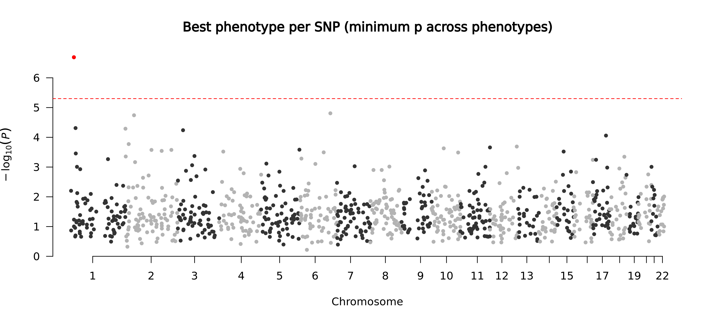
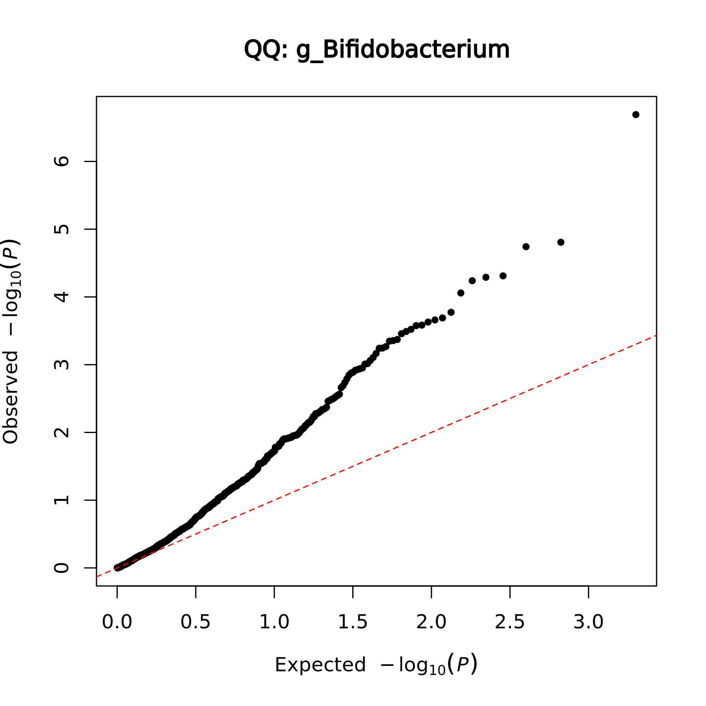

## 07/17 (SPA and phi estimation)

- Review
- Correcting SPA and phi problem
- Current progress in mbGWAS
- Future
## 1. Review

- Poisson models are not better than NB.
- NB-GLMM with robust variance has bad performance on mbGWAS simple data.
- SPA can't control FDR on some data.
- We mainly focus our subsequent experiments on NB-GLM.

## 2. Correcting SPA and phi problem

### 2.1. The weight of SPA in meta-analysis.

For meta-analysis, the combined score is (all is profiled):
$$S_{\text{meta}} = \sum_{m=1}^M w_m S_m$$
In previous report, I directly select $w_m = 1/I_m$. It is inspired by how meta-analysis is performed under the standard normal distribution. But it is wrong, the correct weight is $w_m = I_m$.

### 2.2. Whether the original SPA cann't control FDR on some data?

The reason is that we do not apply median correction on the original SPA method!

Specifically, the actual meta profiled score statistics can be written out as follows:

$$S_{\text{meta}}^{adj}
=\sum_{m=1}^M w_m S_m^{adj}
=\sum_{m=1}^M w_m\bigl(S_m-w_m\lambda_{0,m}\bigr)
=\sum_{m=1}^M w_m S_m - \sum_{m=1}^M w_m^2\lambda_{0,m}.$$
where $\lambda_{0,m}=\operatorname{median}_k(\hat\beta_{m,k}),$.

The meaning of the above equation is from $\hat\beta_{m,k}^{adj}=\hat\beta_{m,k}-\lambda_{0,m},$, which can be transformed to $S_{\text{meta}}^{adj}=S_{\text{meta}}-s_0,\qquad s_0=\sum_m w_m^2\lambda_{0,m}.$, by applying $\hat\beta_m = \frac{S_m}{I_m}$.

<!-- highlight:1 -->
The above method may be not correct.

### 2.3. Robust variance in SPA

The bad performance of SPA is from its inaccurate $\phi$ estimation. We can somehow modify it through robust variance:

$$\operatorname{Var}(S)=\sum_i a_i^2\mu_{0,i}\Bigl(1+\frac{\mu_{0,i}}{\phi}\Bigr)
= S_2 + \frac{S_3}{\phi}.$$

### 2.4. Results

Parameter estimation can be done by edgeR or my own MLE, I test them on small data and find no difference.

## 3. Current progress in mbGWAS

### 3.1. Simple data test

The original tested method is NB-GLMM with robust variance.

I carefully check the code (extract that SNP directly) and confirm that the computation is correct. Looking carefully at the SNP with added effect, its p-value in the corresponding species is indeed anomalous -- it is quite small, but not small enough to stand out among a large number of SNP.

If we change to the SPA with robust variance, we can find it, but with bad qqplot.

### 3.2. Progress for large number of SNPs

Completed:
- change taxon-wise to SNP-wise.
- move the R for-loop to Rcpp
- redesign of parameter storage
- OpenMP

Incomplete:
- accelerate the inverse operation of matrix
- SNP block parallel
- metafor EE method and SNP preprocessing step 

## 4. Future

1. Regenerate bad data locally / remotely
2. Find the reason (one study)
