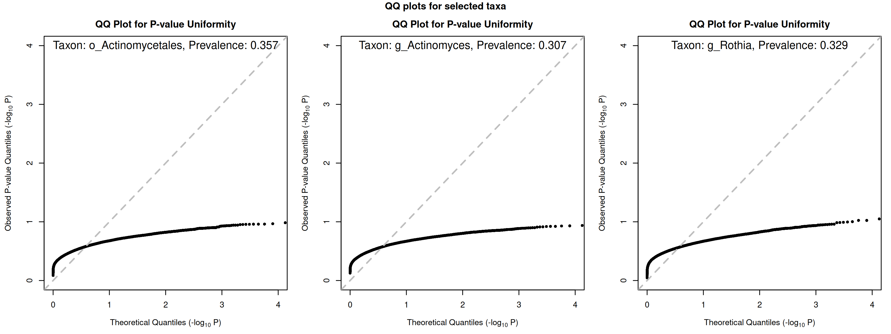
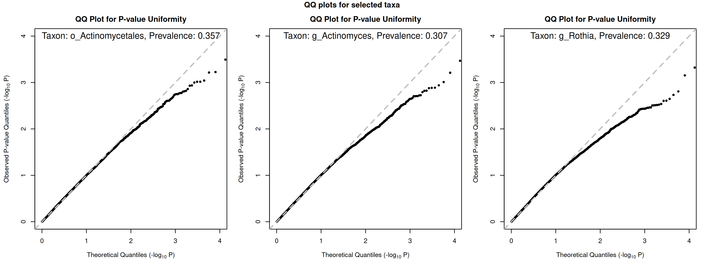
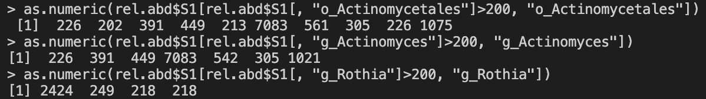
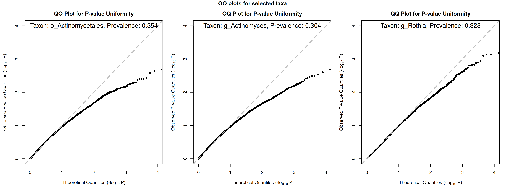
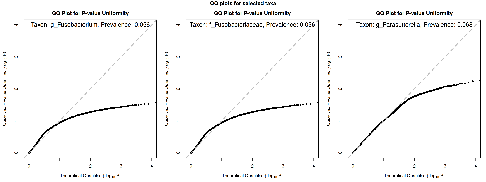
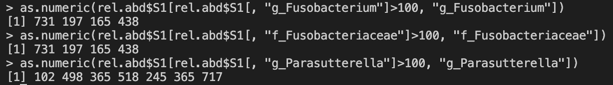
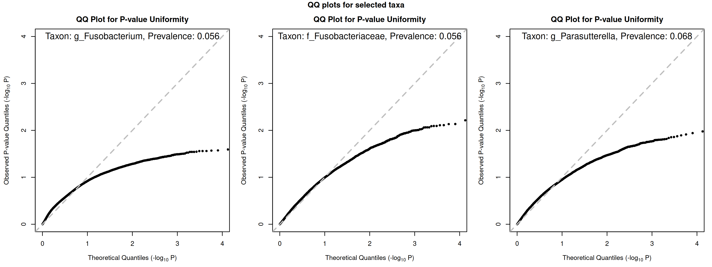
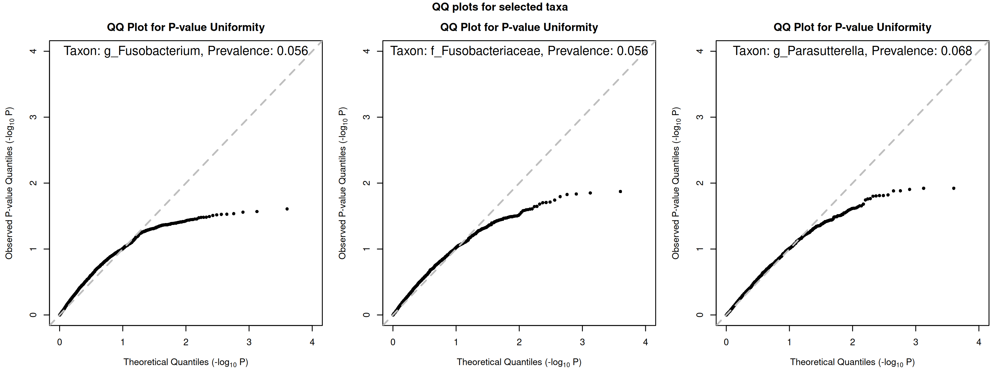

## 07/24 (Bad P-value Problem)

## 1. Review

- SPA has bad performance, both on qq plot and PALM simulation test, perhaps due to its bad estimation of $\phi$.
- But simple data in mbGWAS shows that only NB with robust variance, median correction and SPA can find the effect point.
- Change our focus from NB to why PALM has bad qq-plot for some species.

## 2. Problem in High Prevalence Species

Here we only focus on species with high prevalence

### 2.1. Construction of Bad Data

- 50% of 1
- number of samples is 20000

We can obtain the following image:

### 2.2. Regenerated Data from Fit Result

We first fit the null model with NB-GLMM, and then generate data from model assumption. We use PALM to draw qq-plot:

PALMQTL has similar figures.

So the problem is our model assumption, instead of the estimation of $\phi$.

### 2.3. One Approach to Make P-value Proper

Look at the data:

We can delete some samples to avoid high number, and then fit it.

## 3. Problem in Low Prevalence Species

We first construct bad data as follows:

The data sample can be shown as follows:

So we can not drop out any value from it.

Then we use NB-GLM to fit the data, generate a new one, and use PALM to draw qq-plot for the new generated data:

We can see they are nearly same, and SPA will not improve it much (2000 samples for higher computation speed).

## 4. Future

- zero-inflated+beta-binomial
- quasi-multinomial
- nb1 + SPA
- phi of multiple dataset
