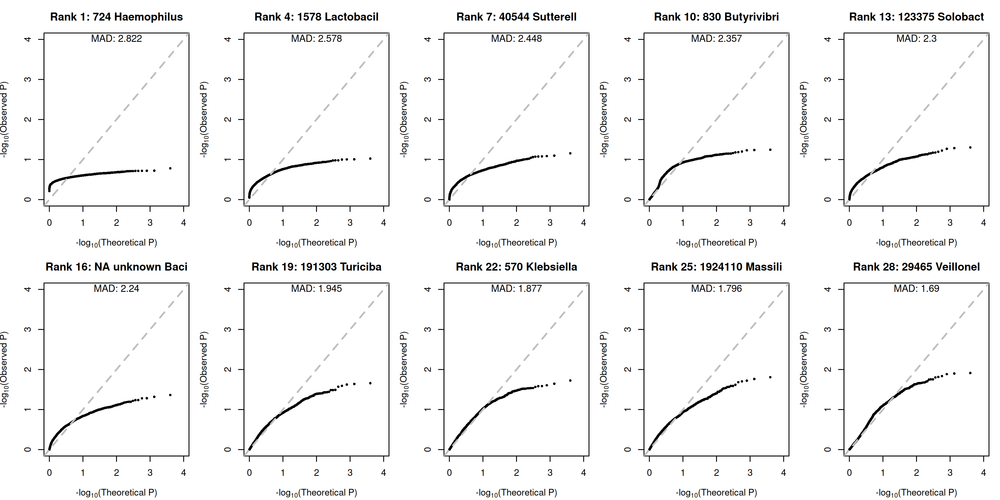
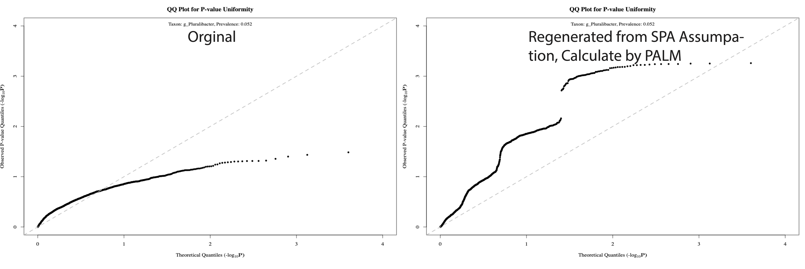
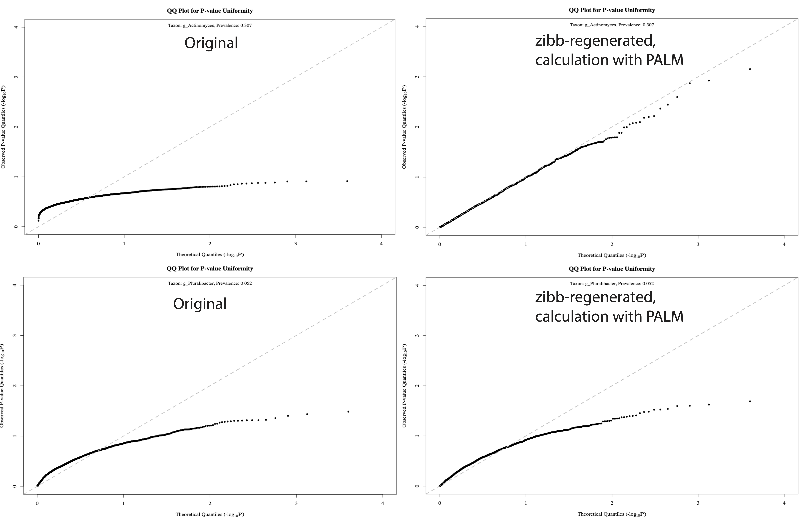

## 07/31 (Continuation of Bad P-value Problem)

## 1. Review

- Reproduce bad data, based on the original data from mbGWAS
- find that the problem somehow can be divided into low prevalence part and high prevalence part, and the latter one can be solved by eliminate one outlier
- If we reproduce the data from NB, the problem will be slightly alleviated, which suggests that it may stem from the model assumptions.
- We need to try different directions, such as zero-inflated beta-binomial distribution, quasi-multinomial, nb1 with SPA and PALM with SPA.

## 2. Several Conclution

- PALM-mbGWAS may have got some things wrong: it mixed up/put together the taxonomic ranks Phylum, Family, Order, Class, and Genus.

- High prevalence problem is not due to high rate of $Y_{ik}/N_i$, since I found some bad species with $Y_{ik}/N_i$ from 0.1 to 0.2.

- PALM-simulation data can reproduce the problem

- We can view the NB from the perspective of the Poisson-Gamma mixture model

$$Y_{ik}\sim \text{Poisson} ( \exp(\log N_i + \alpha_k + \beta_k G_i+b_{ik}))$$
$$b_{ik}\sim \text{log-Gamma} (\phi_k, \phi_k)$$
$$\hat{\exp(b_{ik})}=\mathbb{E}_{b|Y} (\exp(b_{ik}))=\frac{Y_{ik}+\phi_k}{\mu_{ik}+\phi_k}$$

We can reproduce the bad qq-plot problem by estimating $\hat{b}$ first, fixing it, and regenerating $Y$.

- PALM-SPA perhaps cannot solve any problem.

- Zero infliated beta-binomial cannot solve any problem.

## 3. Future

- PALM + Firth? + SPA
- random effect explore
