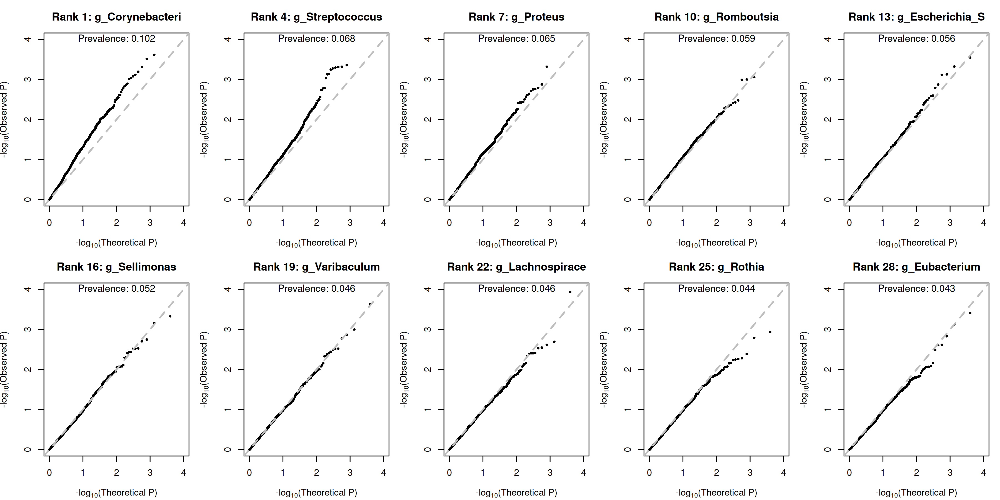

## 08/14 (Poisson Normal)

## 1. Review

- In previous report, I show that we can view NB as Poisson + Gamma for fitting random effects, and then regenerate the data with those random effects fixed, which can reproduce the bad QQ plot.
- To rephrase it: a bad QQ plot should correspond to poor model fit.
- Next, we will continue with a range of additional explorations, including PALM-SPA.

<!-- highlight:1 -->
I need to apologize for my earlier mistake. The GMMAT I tried previously was incorrectly implemented as a Poisson GLM plus random effects; in fact, the current results indicate that the GMMAT method is adequate.

## 2. GMMAT Results

### 2.1. qqplot from simulation

- Regenerate $Gi=0, 1$ with equal possibility.
- A manually re-implemented Poisson + Normal model, without using robust variance estimation. 

### 2.2. PALM simulation test

### 2.3. Why?

$$\begin{cases}
Y_{ik} \mid b_{ik} \sim \text{Poisson}(exp(\log N_i + \alpha^{*}_{0k} + G_i \beta^{*}_k + X_i \gamma^{*}_k + b_{ik})) \\
\boldsymbol{b_{ik}} \sim N\left(0, \tau_k)\right)
\end{cases}$$

- 
## 3. PALM-SPA

## 4. Future

- Poisson Normal + Robust / SPA
- Prior, Normal, Log-Gamma
- Firth
- Poisson Firth
- whether PALM uses firth in information matrix
- Prior View of Count Data pdf

8.21, 8.25, 8.28
