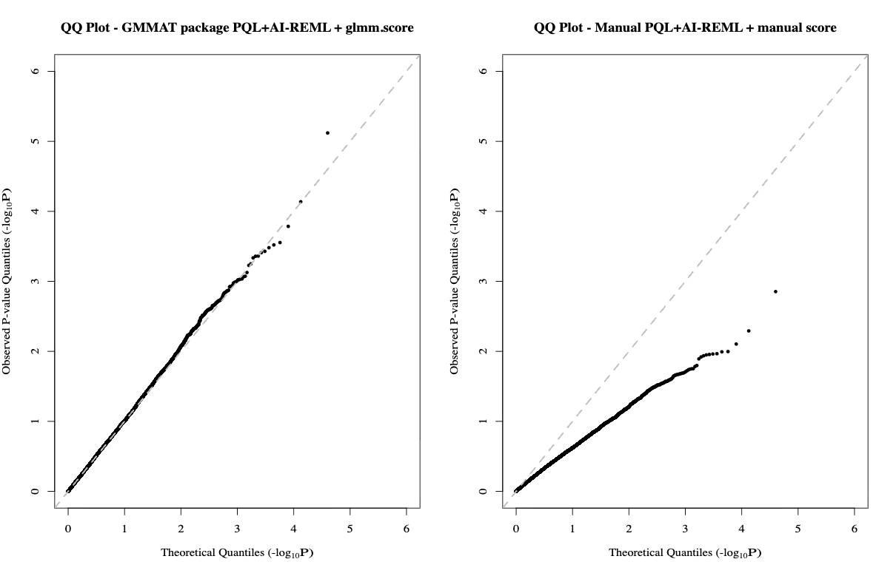
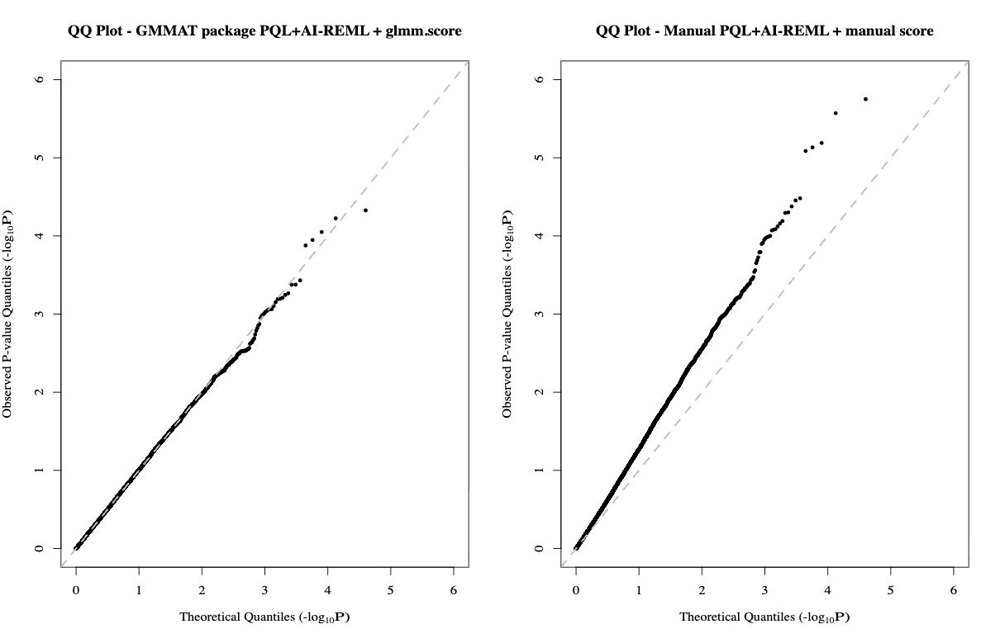
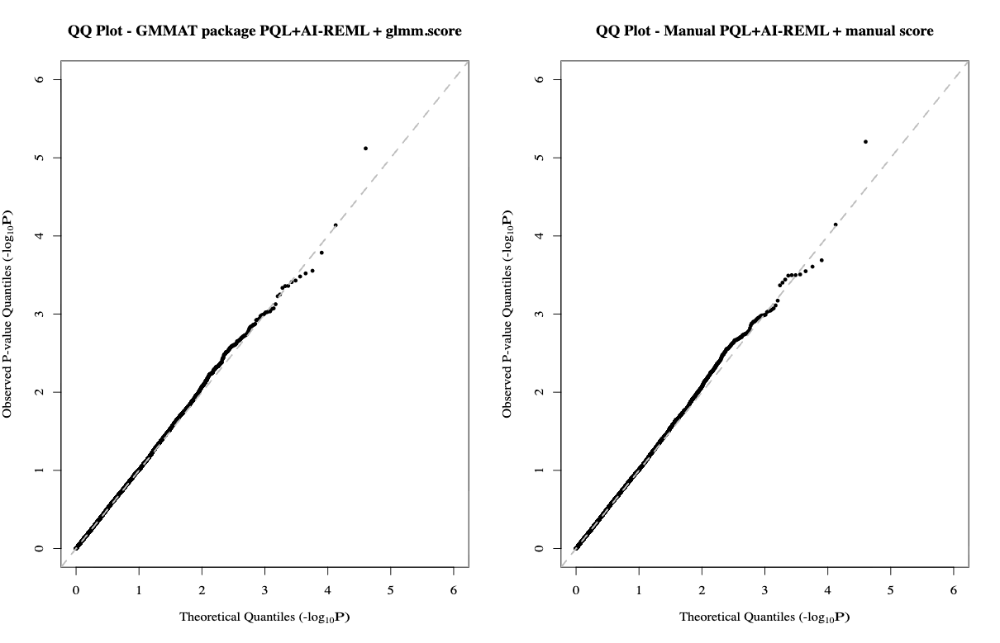
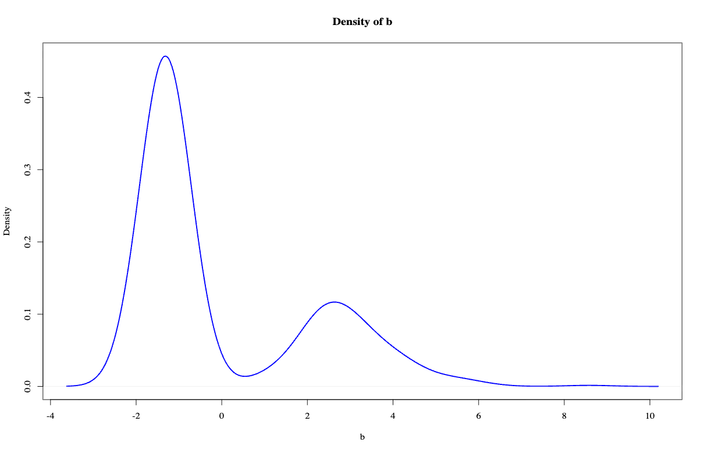
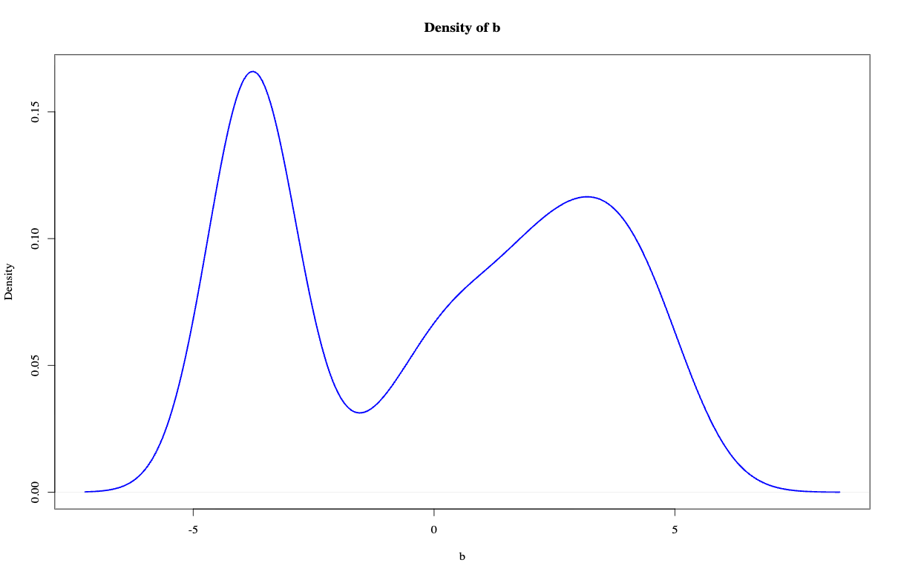
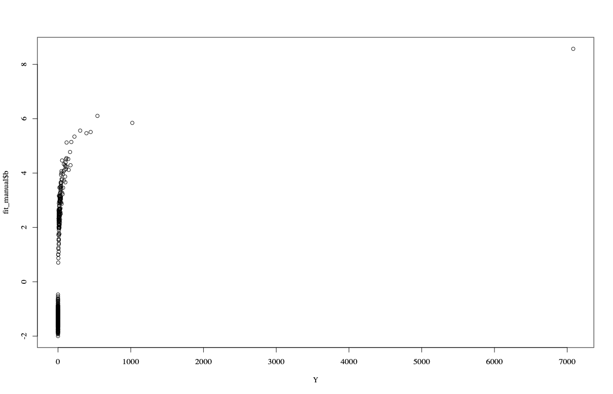
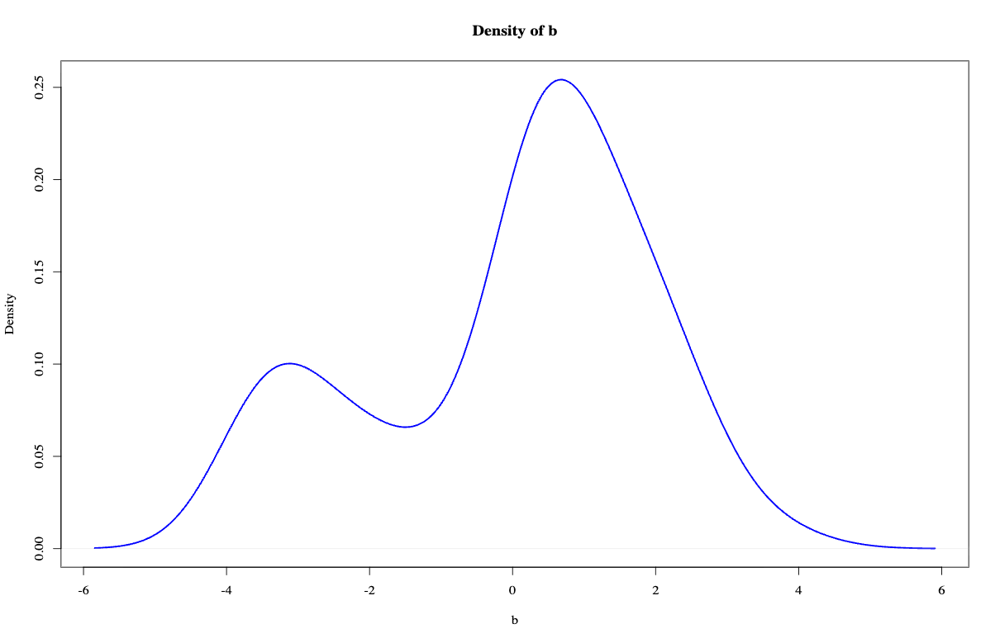
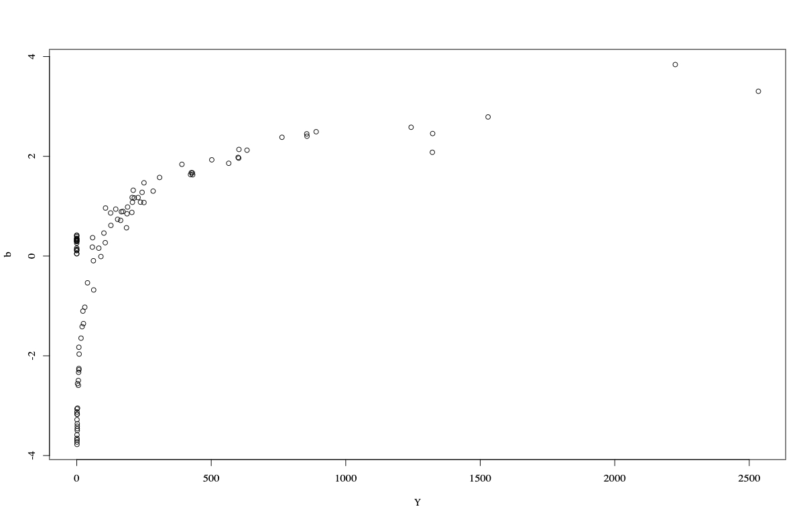
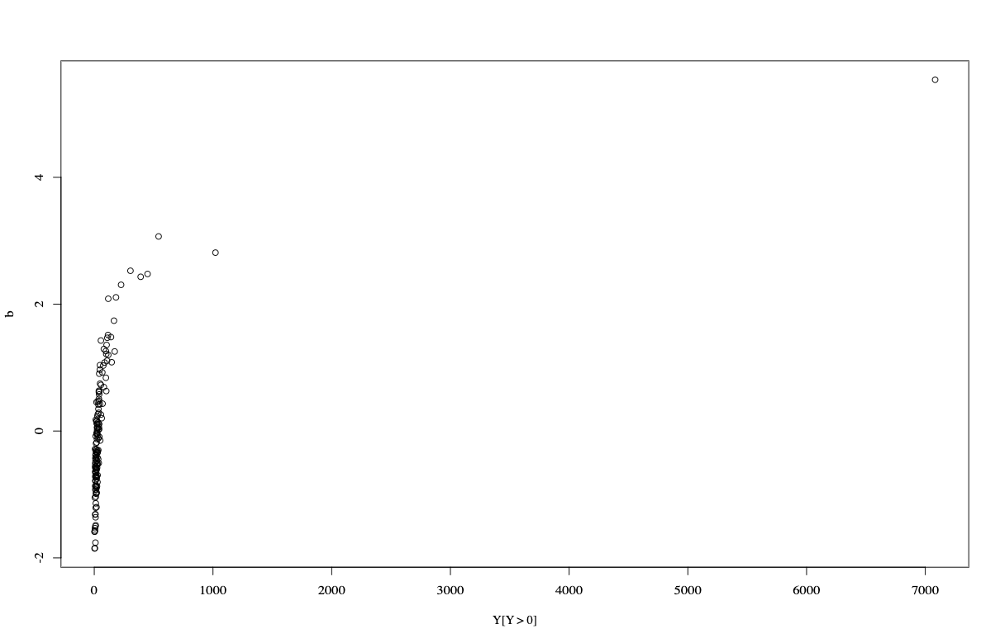
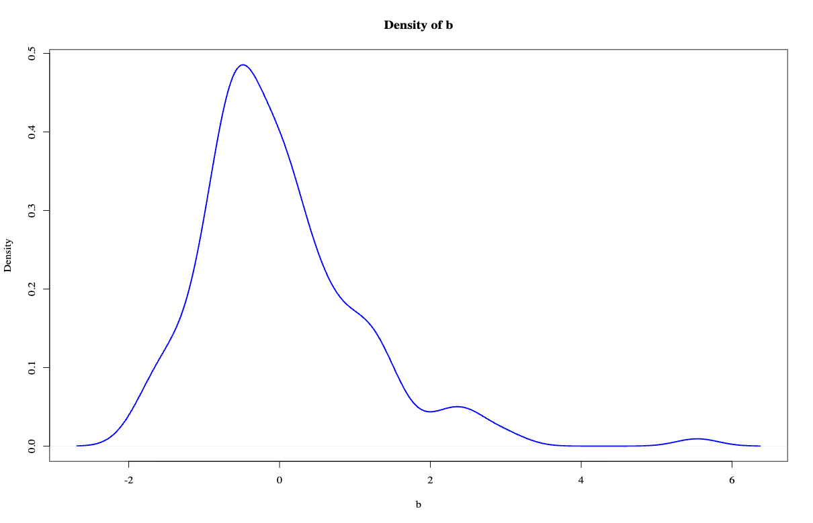

## 08/21 (Prior + Zero-Inflation)

## 1. Review

- We have re-evaluated the model: the conservative part can be modeled as a Poisson process, and we realized that outliers in the raw data (e.g., 7083) cannot be modeled directly—an explicit prior must be incorporated.
- The QQ-plot from the direct first-order PQL + REML implementation is worse than that from the second-order Laplace method, which suggests we need to revisit our understanding of both the fitting procedure and the score.
- The PQL + REML approach is inferior to PALM in terms of both power and FDR control.
- The next steps are to adjust the prior, clarify the role of Firth’s correction, and resolve several outstanding questions.

## 2. Clarification of Some Questions

### 2.1. Does PALM include a Firth term in the information matrix?

The answer is: No. PALM only uses firth correction in parameter estimation.

### 2.2. What is PQL + REML?

$Yi\sim \text{Poisson}(\mu_i),\quad \mu_i = \exp(\alpha+\beta G_i+b_i), \quad b_i\sim N(0, \tau)$
#### 2.2.1. PQL:
$$\ell_p(\alpha,\beta,b,\tau)
=
\sum_{i=1}^n\Bigl[Y_i \log \mu_i-\mu_i\Bigr]
-\frac{1}{2\tau}\sum_{i=1}^n b_i^2
-\frac{n}{2}\log\tau$$
#### 2.2.2. REML:
$$Y_i^* = \widehat\eta_i + (Y_i-\widehat\mu_i)/\widehat\mu_i,\qquad
\widehat\eta_i=\widehat\alpha+\widehat\beta G_i+\widehat b_i,\ \widehat\mu_i=\exp(\widehat\eta_i),$$
$$Y_i^* = \alpha+\beta G_i + b_i+\varepsilon_i,\quad
\mathrm{Var}(\varepsilon_i)=1/w_i=1/\widehat\mu_i,\quad
b_i\sim N(0,\tau).$$
$$V = W^{-1}+\tau ZZ^\top = \mathrm{diag}(1/\widehat\mu_i)+\tau I_n.$$
$$\boxed{
\begin{aligned}
l_{\mathrm{REML}}(\tau)
={}&
-\frac{1}{2}\log|V|
-\frac{1}{2}\log|X^\top V^{-1}X|\\
&
-\frac{1}{2}\,(Y^*-X\widehat\beta_\tau)^\top V^{-1}(Y^*-X\widehat\beta_\tau),
\end{aligned}}$$
#### 2.2.3. Modified Laplace / Firth Correction:
parameters: $\theta=(\alpha,\beta,b_1,\dots,b_n)$, hyperparameters: $\tau$
$$\ell_p(\theta;\tau)=\sum_i \log f(Y_i\mid\theta)+\log p(b\mid\tau),$$
$$H(\theta;\tau)=-\frac{\partial^2 \ell_p(\theta;\tau)}{\partial\theta\,\partial\theta^\top}.$$
$$\boxed{
\ell_{\mathrm{Lap}}(\tau)
=
\ell_p(\widehat\theta_\tau;\tau)
-\frac{1}{2}\log\det H(\widehat\theta_\tau;\tau)
}$$

Laplace without robust variance:

Standard without robust variance:

Standard with robust variance:

## 3. Prior

### 3.1. Different Prior

$b\sim$ GGD: 
$$\ell(\alpha,\beta;\mathbf{b})
= n\log\beta - n\log(2\alpha) - n\log\Gamma\!\left(\frac{1}{\beta}\right)
- \sum_{i=1}^{n}\left(\frac{|b_i|}{\alpha}\right)^{\beta}.$$
$\exp(b)\sim$ Gamma
$$\ell(\alpha,\beta;\mathbf{b})
=n\alpha\log\beta - n\log\Gamma(\alpha)
+\alpha\sum_{i=1}^{n}b_i - \beta\sum_{i=1}^{n}e^{b_i}.
$$
$b\sim$ Student-$t$
$$\begin{aligned}
\ell(\sigma,\nu;\mathbf{b})
={}& n\log\Gamma\!\left(\frac{\nu+1}{2}\right)
- n\log\Gamma\!\left(\frac{\nu}{2}\right)
- \frac{n}{2}\log(\nu\pi)
- n\log\sigma \\
&- \frac{\nu+1}{2}\sum_{i=1}^{n}\log\!\left(1+\frac{1}{\nu}\left(\frac{b_i}{\sigma}\right)^2\right).
\end{aligned}$$
$b\sim$ Logistic
$$\ell(s;\mathbf{b})
=
-n\log s
-\frac{1}{s}\sum_{i=1}^{n}b_i
-2\sum_{i=1}^{n}\log\!\left(1+\exp\!\left(-\frac{b_i}{s}\right)\right).$$

### 3.2. Distribution of $b$ in Real Data

We use Poisson + Normal to fit data, then plot $b$ with $Y$

## 4. Zero-Inflation

### 4.1. Delete Zeros

Test on small data: Compared with PALM, power decreased from 1 to 0.95, while the FDR increased to 0.17.

### 4.2. Direct Zero-Inflation

$$\boxed{
P(Y_i=y \mid,b_i)
=
\begin{cases}
\pi+(1-\pi)e^{-\mu_i}, & y=0,\\[6pt]
(1-\pi)\dfrac{\mu_i^y e^{-\mu_i}}{y!}, & y=1,2,\dots
\end{cases}
}$$

Test on a new smaller data: Difficult to achieve convergence in fitting,  the FDR increased to 0.16.

### 4.3. Zero-Inflation with $\mu_i$

$$\log\mu_i=x_i^\top\beta+u_i,
\qquad
\operatorname{logit}(\pi_i)=q_0+q_1 \log u_i$$

But finally $q_1$ converge to zero

### 4.4. Hurdle

- Model $Y>0$ with Zero-Truncated Poisson
- Model  $Y==0$ with Seperate Logistics

We can test $\beta=0$ and $\beta_0=0$ with robust variance

ZTP part: power 0.95, fdr 0.16
zero part: power 0.1, fdr 0
combined: power 0.95, fdr 0.32

## 5. Future

- pdf of perspectives on count data
- PALM qq-plot problem + average correction of variance
