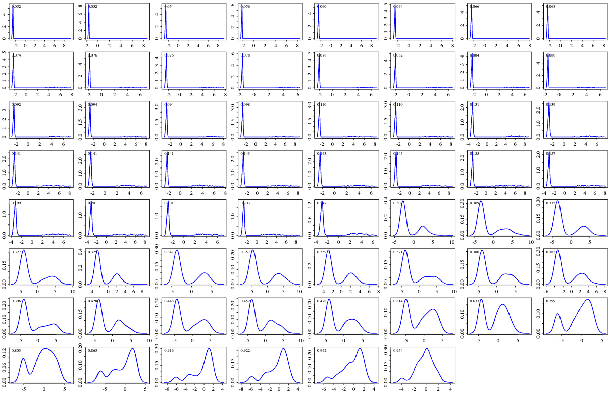
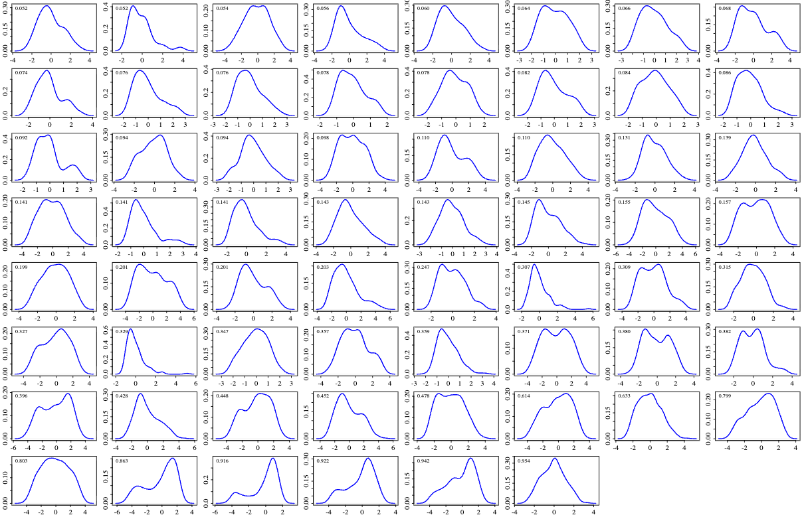
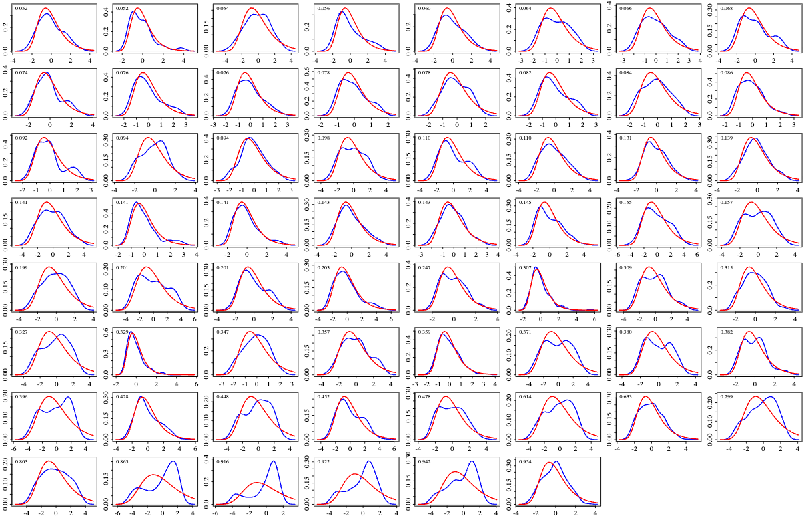
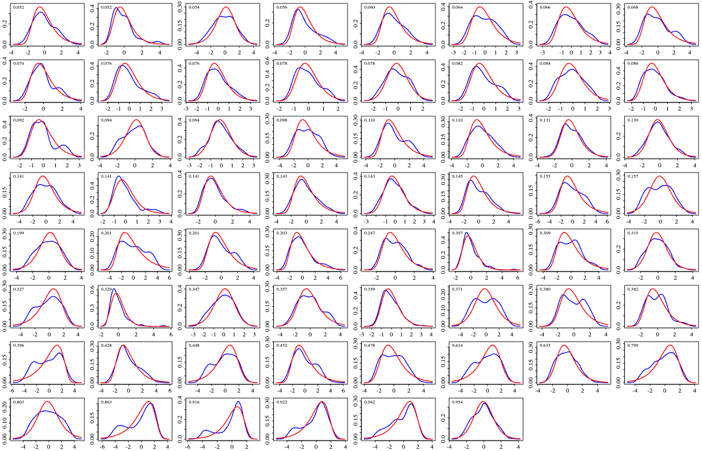
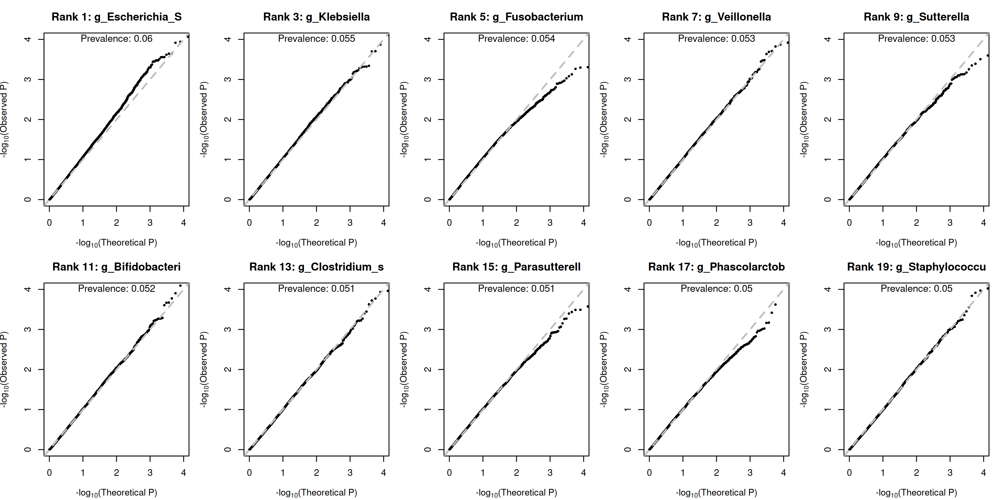
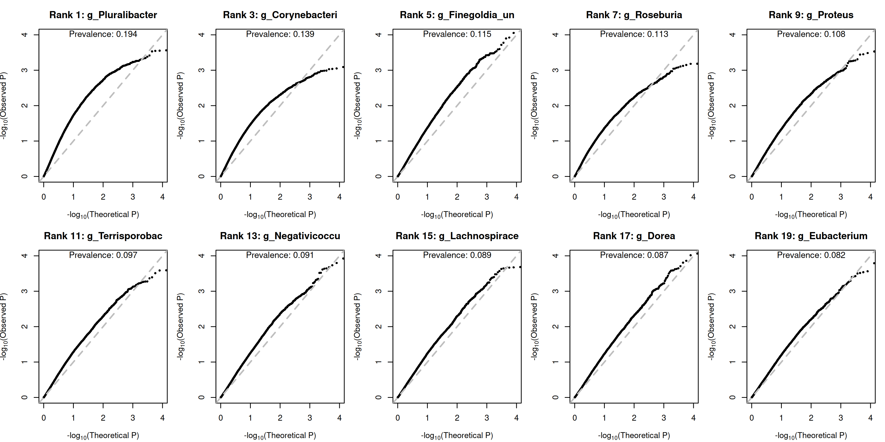
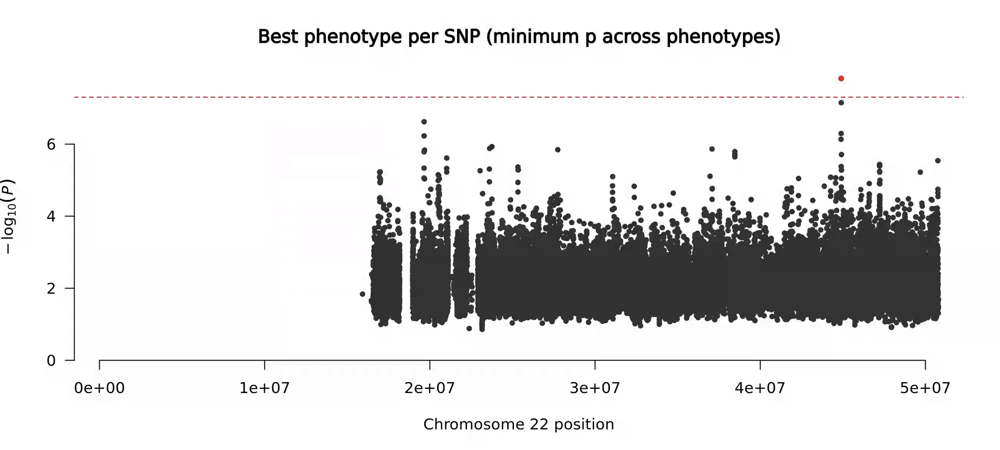
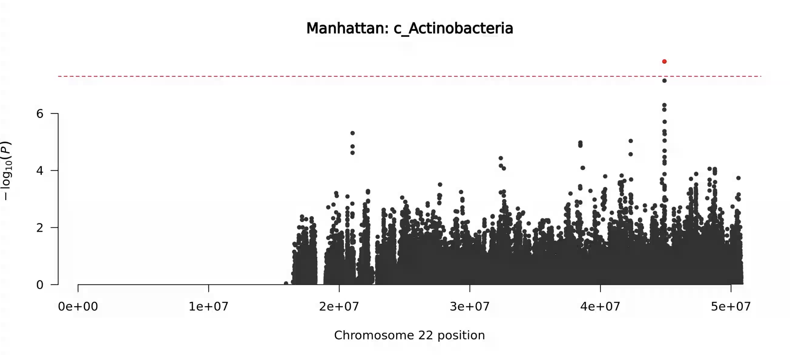
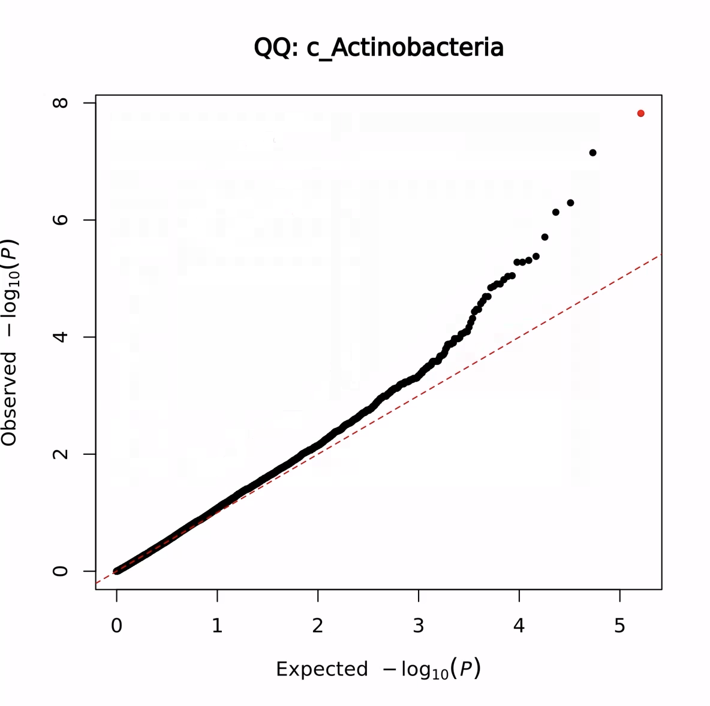

## 08/25 (How to Model Data)

## 1. Review

- We clarified the PQL+REML approach and concluded that it cannot be directly extended; however, a similar effect can be achieved through a correction to the log-determinant term combined with a robust variance estimator.
- By directly examining the shape of the random effects, we found that it exhibited two modes, which naturally suggested the presence of zero inflation. However, due to the difficulty in modeling the zero component, we temporarily chose to model only the positive part. As a result, the random effects were successfully made unimodal.
- We compared the new method on small datasets and found that it already outperforms PALM in terms of both power and FDR control.
- We need to carefully investigate the cause of PALM's poor QQ plot. It was found that the cause is that extreme values lead to a violation of the Lindeberg condition.

## 2. Prior

### 2.1. Density of $b$ in Poisson+Normal

### 2.2. Density of $b$ in ZTP+Normal

### 2.3. Gumbel Fit

### 2.4. logistics type IV fit

## 3. Power of ZTP+Prior

### 3.1. Model

$$
Y_{ik}|Y_{ik}>0\sim \text{Zero-Truncated-Poisson}(\exp(X_i^T \alpha_k+G_i \beta_k+b_{ik})),\quad b_{ik}\sim N(0, \tau_k)
$$
$$\ell_p(\alpha_k,\beta_k,\{b_{ik}\};\tau_k)=\sum_{i:Y_{ik}>0}\!\Big[
Y_{ik}(\log\mu_{ik}$$
$$+b_{ik})-\mu_{ik}e^{b_{ik}}-\log\!\big(1-e^{-\mu_{ik}e^{b_{ik}}}\big)-\log(Y_{ik}!)
\Big]
-\frac{1}{2\tau_k}\sum_{i:Y_{ik}>0} b_{ik}^2$$

### 3.2. Comparison of Different Prior

### 3.3. Comparison of Different Parameters and Variance Estimation

### 3.4. QQ plot without Covariates (Normal Prior + Robust Variance)

### 3.5. QQ plot with Covariates (Normal Prior + Robust Variance)

### 3.6. Simple mbGWAS Test

## 4. How to Model Zero Part?

$W_{ik}$: True absolute abundance in sample $i$
$O_i=\sum_k W_{ik}$: Total load of sample $i$
$$\text{For } W_{ik}\neq 0, \quad W_{ik} = \exp(X_i^T \alpha_k^*+G_i\beta_k^*+b^*_{ik})$$
$$O_{ik} = \exp(X_i^T \alpha_k^{**}+G_i\beta_k^{**}+b^{**}_{ik})$$
$$Q_{ik}\sim\text{Poisson},\quad \mathbb{E}(Q_{ik})=N_im_kW_{ik}/O_i$$
$$Q_{ik}\sim\text{Poisson}(\exp(X_i^T \alpha_k+G_i\beta_k+b_{ik}))$$
<!-- highlight:1 -->
We believe that $b_{ik}$ has a smooth distribution.
$$\text{For } W_{ik}= 0$$
$$\text{We believe it is determined by probability } \pi_k, \quad \text{logit}\pi_k=X_i^T \alpha^0_k + G_i \beta^0_k$$
$$Y_{ik}|(W_{ik}\neq 0) = Q_{ik},\quad Y_{ik}|(W_{ik}=0)=0$$
$$\boxed{
\begin{aligned}
\ell_{\text{pen}}(\theta)
&= \sum_{(i,k)\in S^+}\!\Big[
\log(1-\pi_{ik}) + y_{ik}(\eta_{ik}+b_{ik}) - e^{\eta_{ik}+b_{ik}} - \log(y_{ik}!)
\Big] \\
&\quad + \sum_{(i,k)\in S^0}\log\!\Big(\pi_{ik} + (1-\pi_{ik})\,P_0(\eta_{ik},\tau)\Big) \\
&\quad - \frac{1}{2\tau}\sum_{(i,k)\in S^+} b_{ik}^2
\;-\;\frac{|S^+|}{2}\log(2\pi\tau),
\end{aligned}}$$
where 
$$\pi_{ik}=\frac{\exp(X_i^\top\alpha_k^0+G_i\beta_k^0)}{1+\exp(X_i^\top\alpha_k^0+G_i\beta_k^0)},\qquad
\eta_{ik}=X_i^\top\alpha_k+G_i\beta_k,$$
$$P_0(\eta,\tau)=\int_{-\infty}^{\infty}\exp\!\left(-e^{\eta+b}\right)\frac{1}{\sqrt{2\pi\tau}}\exp\!\left(-\frac{b^2}{2\tau}\right)db.$$

## 5. Future
- covariates qqplot
- Change Simulation Test
- SAIGE-QTL? scRNA-seq?
- Multiple Simulation
- Read Paper
