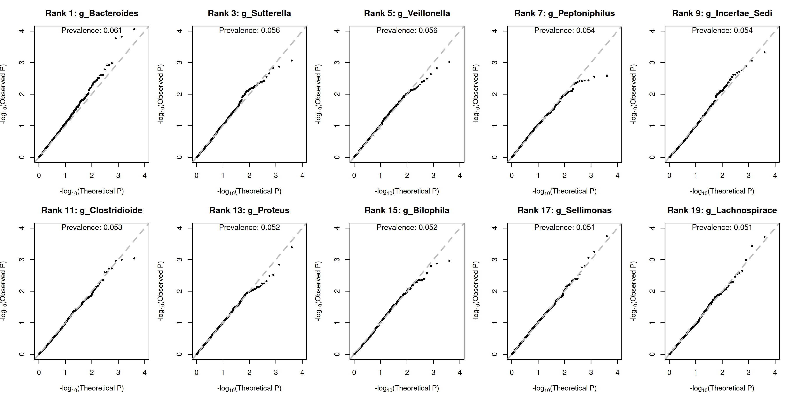
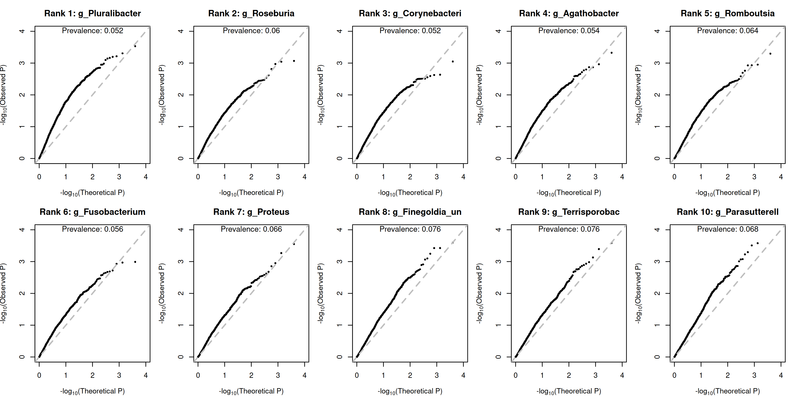
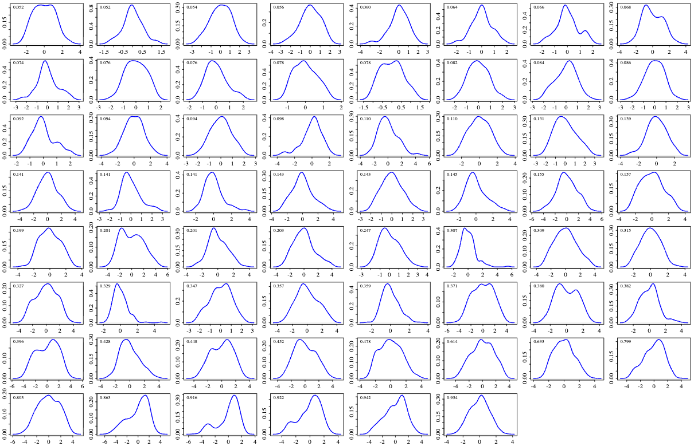
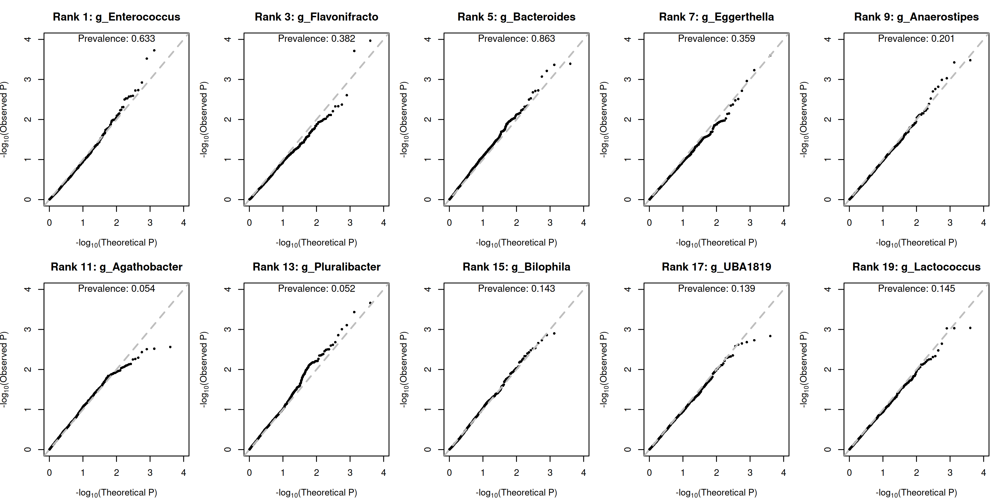

## 08/28 (Final Model for Count)

## 1. Review

- We found that the zero-truncated Poisson model itself can increase power, and adding random effects increases power even further.
- If a Firth-like correction term is used to estimate the variance of the random effects, using a robust variance in the score test barely changes the estimated power / fdr control.
- Comparing different priors for the random effects revealed no particularly substantial differences.
- The QQ plot looks good when no covariates are included.
- The current model does not include a component for zeros; we attempted to model the zero component, but that part is not yet clearly articulated.
- To investigate how zeros are generated, we need to add an effect for the zero component to the current simulation.
- Since our method can be extended to arbitrary sequencing data, and mbGWAS data are difficult to obtain, we need to explore other application areas as well.
### 1.1. Why does the QQ plot look worse after covariates are added?

Hat Matrix: $H = X(X^\top X)^{-1}X^\top$, average of $H_{ii}$ is p/n.
For our bad data, len($Y>0$)=26, p=13, $\max(H_{ii})=0.9$

## 2. How to Build Model with Zero?

### 2.1. Parameter Estimation and Score Formula

$$A_i=I(Y_i>0).$$
$$P(\text{sample zero})=1-\pi_i.$$
$$Z_i=Y_i|A_i=1$$

$$\eta_i^0=X_i^\top\alpha^0+G_i\beta^0,\ \pi_i=\dfrac{e^{\eta_i^0}}{1+e^{\eta_i^0}}$$
$$\eta_i=X_i^\top\alpha+G_i\beta$$
$$P_{0i}=P_{0i}(\eta_i,\tau)
=E_{U\sim N(0,\tau)}\left[e^{-\exp(\eta_i+U)}\right]
=\int_{-\infty}^{\infty}e^{-e^{\eta_i+u}}\frac{1}{\sqrt{2\pi\tau}}e^{-u^2/(2\tau)}\,du.$$
$$\boxed{
\begin{aligned}
P(A_i=0)&=(1-\pi_i)+\pi_i P_{0i},\\
P(A_i=1)&=\pi_i(1-P_{0i}).
\end{aligned}}$$
$$\boxed{
Z_i\mid b_i\sim \operatorname{ZTP}(\lambda_i),\qquad
\lambda_i=e^{\eta_i+b_i}.
}$$
$$\boxed{
p(b_i)
=
\frac{\big(1-e^{-e^{\eta_i+b_i}}\big)
\displaystyle\frac{1}{\sqrt{2\pi\tau}}e^{-b_i^2/(2\tau)}}
{1-P_{0i}}.
}$$
$$\boxed{
\begin{aligned}
\ell_{\rm pen}
=&\
\sum_{i=1}^n
\Big[
(1-A_i)\log\!\big((1-\pi_i)+\pi_i P_{0i}\big)
+A_i\log(\pi_i(1-P_{0i}))
\Big]\\
&\qquad
+\sum_{i\in S^+}
\Big[
Z_i(\eta_i+b_i)
-
e^{\eta_i+b_i}
-
\log(Z_i!)\\
&\qquad\qquad\qquad
-\frac{b_i^2}{2\tau}
-\frac{1}{2}\log(2\pi\tau)
-\log(1-P_{0i})
\Big].
\end{aligned}
}$$
$$\lambda_i=e^{\eta_i+b_i},\quad
Q_i=(1-\pi_i)+\pi_i P_{0i},\quad
\tilde P_{1i}=\int e^{\eta_i+u}e^{-e^{\eta_i+u}}\varphi_\tau(u)\,du.$$
$$\tilde P_{2i}=\int e^{2(\eta_i+u)}e^{-e^{\eta_i+u}}\varphi_\tau(u)\,du,$$
$$\boxed{
\begin{aligned}
\frac{\partial\ell_{\rm pen}}{\partial b_i}
&=
Z_i-\lambda_i-\frac{b_i}{\tau},
\qquad i\in S^+,
\\[8pt]
\frac{\partial\ell_{\rm pen}}{\partial\alpha^0}
&=
\sum_{i=1}^n
\left[
A_i(1-\pi_i)
-
(1-A_i)
\frac{\pi_i(1-\pi_i)(1-P_{0i})}{Q_i}
\right]X_i,
\\[8pt]
\frac{\partial\ell_{\rm pen}}{\partial\beta^0}
&=
\sum_{i=1}^n
\left[
A_i(1-\pi_i)
-
(1-A_i)
\frac{\pi_i(1-\pi_i)(1-P_{0i})}{Q_i}
\right]G_i,
\\[8pt]
\frac{\partial\ell_{\rm pen}}{\partial\alpha}
&=
\sum_{i\in S^+}
\left[
Z_i-\lambda_i-\frac{\tilde P_{1i}}{1-P_{0i}}
\right]X_i
\\
&\qquad+
\sum_{i=1}^n
\left[
A_i\frac{\tilde P_{1i}}{1-P_{0i}}
-
(1-A_i)
\frac{\pi_i\tilde P_{1i}}{Q_i}
\right]X_i,
\\[8pt]
\frac{\partial\ell_{\rm pen}}{\partial\beta}
&=
\sum_{i\in S^+}
\left[
Z_i-\lambda_i-\frac{\tilde P_{1i}}{1-P_{0i}}
\right]G_i
\\
&\qquad+
\sum_{i=1}^n
\left[
A_i\frac{\tilde P_{1i}}{1-P_{0i}}
-
(1-A_i)
\frac{\pi_i\tilde P_{1i}}{Q_i}
\right]G_i.
\end{aligned}
}$$

$$\boxed{
\begin{aligned}
&R_i=1-P_{0i},\quad Q_i=1-\pi_iR_i,\quad
C_i=\frac{\tilde P_{1i}-\tilde P_{2i}}{R_i}-\frac{\tilde P_{1i}^2}{R_i^2},\\[8pt]
&-\frac{\partial^2\ell_{\rm pen}}{\partial b_i^2}=\lambda_i+\frac{1}{\tau},\quad i\in S^+,
\quad -\frac{\partial^2\ell_{\rm pen}}{\partial b_i\partial b_j}=0,\ i\neq j,\\[4pt]
&-\frac{\partial^2\ell_{\rm pen}}{\partial b_i\partial\alpha}=\lambda_iX_i,\quad
-\frac{\partial^2\ell_{\rm pen}}{\partial b_i\partial\beta}=\lambda_iG_i,\\[4pt]
&-\frac{\partial^2\ell_{\rm pen}}{\partial b_i\partial\alpha^0}=-\frac{\partial^2\ell_{\rm pen}}{\partial b_i\partial\beta^0}=0,\\[8pt]
&w_i^{00}=A_i\pi_i(1-\pi_i)
+(1-A_i)\left[
\frac{\pi_i(1-\pi_i)(1-2\pi_i)R_i}{Q_i}+\frac{\pi_i^2(1-\pi_i)^2R_i^2}{Q_i^2}
\right],\\[6pt]
&w_i^{01}=(1-A_i)\frac{\pi_i(1-\pi_i)\tilde P_{1i}}{Q_i^2},\\[6pt]
&w_i^{++}=\lambda_i+\frac{(\tilde P_{1i}-\tilde P_{2i})R_i-\tilde P_{1i}^2}{R_i^2},\quad i\in S^+,\\[6pt]
&w_i^A=
A_i\left[
\frac{\tilde P_{2i}-\tilde P_{1i}}{R_i}+\frac{\tilde P_{1i}^2}{R_i^2}
\right]
+(1-A_i)\left[
\frac{\pi_i(\tilde P_{1i}-\tilde P_{2i})}{Q_i}+\frac{\pi_i^2\tilde P_{1i}^2}{Q_i^2}
\right],\\[8pt]
&-\frac{\partial^2\ell_{\rm pen}}{\partial\alpha^0\partial\alpha^{0\top}}=\sum_{i=1}^n w_i^{00}X_iX_i^\top,\quad
-\frac{\partial^2\ell_{\rm pen}}{\partial\beta^0\partial\beta^{0\top}}=\sum_{i=1}^n w_i^{00}G_iG_i^\top,\\[4pt]
&-\frac{\partial^2\ell_{\rm pen}}{\partial\alpha^0\partial\beta^{0\top}}=\sum_{i=1}^n w_i^{00}X_iG_i^\top,\\[8pt]
&-\frac{\partial^2\ell_{\rm pen}}{\partial\alpha^0\partial\alpha^\top}=\sum_{i=1}^n w_i^{01}X_iX_i^\top,\quad
-\frac{\partial^2\ell_{\rm pen}}{\partial\alpha^0\partial\beta^\top}=\sum_{i=1}^n w_i^{01}X_iG_i^\top,\\[4pt]
&-\frac{\partial^2\ell_{\rm pen}}{\partial\beta^0\partial\alpha^\top}=\sum_{i=1}^n w_i^{01}G_iX_i^\top,\quad
-\frac{\partial^2\ell_{\rm pen}}{\partial\beta^0\partial\beta^\top}=\sum_{i=1}^n w_i^{01}G_iG_i^\top,\\[8pt]
&-\frac{\partial^2\ell_{\rm pen}}{\partial\alpha\partial\alpha^\top}=\sum_{i\in S^+}w_i^{++}X_iX_i^\top+\sum_{i=1}^n w_i^A X_iX_i^\top,\\[4pt]
&-\frac{\partial^2\ell_{\rm pen}}{\partial\beta\partial\beta^\top}=\sum_{i\in S^+}w_i^{++}G_iG_i^\top+\sum_{i=1}^n w_i^A G_iG_i^\top,\\[4pt]
&-\frac{\partial^2\ell_{\rm pen}}{\partial\alpha\partial\beta^\top}=\sum_{i\in S^+}w_i^{++}X_iG_i^\top+\sum_{i=1}^n w_i^A X_iG_i^\top
\end{aligned}
}$$

$$\boxed{
\begin{aligned}
&R_i=1-P_{0i},\quad Q_i=1-\pi_iR_i,\quad
C_i=\frac{\tilde P_{1i}-\tilde P_{2i}}{R_i}-\frac{\tilde P_{1i}^2}{R_i^2},\\[8pt]
&I_{bb,i}=\lambda_i+\frac{1}{\tau},\quad i\in S^+,\quad
I_{b_i b_j}=0,\ i\neq j,\\[4pt]
&I_{b\alpha,i}=\lambda_iX_i,\quad
I_{b\beta,i}=\lambda_iG_i,\\[4pt]
&I_{b\alpha^0,i}=I_{b\beta^0,i}=0,\\[8pt]
&w_{00,i}=\frac{\pi_i(1-\pi_i)^2R_i}{Q_i},\\[6pt]
&w_{01,i}=Q_i\cdot\frac{\pi_i(1-\pi_i)\tilde P_{1i}}{Q_i^2}=\frac{\pi_i(1-\pi_i)\tilde P_{1i}}{Q_i},\\[6pt]
&w_{++,i}=\lambda_i+\frac{(\tilde P_{1i}-\tilde P_{2i})R_i-\tilde P_{1i}^2}{R_i^2},\quad i\in S^+,\\[6pt]
&w_{A,i}=\pi_iR_i\left[
\frac{\tilde P_{2i}-\tilde P_{1i}}{R_i}+\frac{\tilde P_{1i}^2}{R_i^2}
\right]
+Q_i\left[
\frac{\pi_i(\tilde P_{1i}-\tilde P_{2i})}{Q_i}+\frac{\pi_i^2\tilde P_{1i}^2}{Q_i^2}
\right],\\[8pt]
&I_{\alpha^0\alpha^0}=\sum_{i=1}^n w_{00,i}X_iX_i^\top,\quad
I_{\beta^0\beta^0}=\sum_{i=1}^n w_{00,i}G_iG_i^\top,\\[4pt]
&I_{\alpha^0\beta^0}=\sum_{i=1}^n w_{00,i}X_iG_i^\top,\\[8pt]
&I_{\alpha^0\alpha}=\sum_{i=1}^n w_{01,i}X_iX_i^\top,\quad
I_{\alpha^0\beta}=\sum_{i=1}^n w_{01,i}X_iG_i^\top,\\[4pt]
&I_{\beta^0\alpha}=\sum_{i=1}^n w_{01,i}G_iX_i^\top,\quad
I_{\beta^0\beta}=\sum_{i=1}^n w_{01,i}G_iG_i^\top,\\[8pt]
&I_{\alpha\alpha}=\sum_{i\in S^+}w_{++,i}X_iX_i^\top+\sum_{i=1}^n w_{A,i}X_iX_i^\top,\\[4pt]
&I_{\beta\beta}=\sum_{i\in S^+}w_{++,i}G_iG_i^\top+\sum_{i=1}^n w_{A,i}G_iG_i^\top,\\[4pt]
&I_{\alpha\beta}=\sum_{i\in S^+}w_{++,i}X_iG_i^\top+\sum_{i=1}^n w_{A,i}X_iG_i^\top
\end{aligned}
}$$
$$\boxed{
\begin{aligned}
&\psi=(\beta,\beta^0),\quad \nu=(b,\alpha^0,\alpha),\\[8pt]
&K=\operatorname{diag}_{i\in S^+}\left(\lambda_i+\frac{1}{\tau}\right),\quad
B=I_{b\alpha},\quad B_{i\cdot}=\lambda_iX_i^\top,\ i\in S^+,\\[4pt]
&C=I_{\alpha^0\alpha^0}=X^\top W_{00}X,\quad
D=I_{\alpha^0\alpha}=X^\top W_{01}X,\quad
E=I_{\alpha\alpha}=X^\top W_cX,\\[4pt]
&W_{00}=\operatorname{diag}(w_{00,i}),\quad W_{01}=\operatorname{diag}(w_{01,i}),\quad
(W_c)_{ii}=w_{A,i}+\mathbb I(i\in S^+)w_{++,i},\\[8pt]
&U_{b_i}=Z_i-\lambda_i-\frac{b_i}{\tau},\quad i\in S^+,\\[6pt]
&U_{\alpha^0}=\sum_{i=1}^n\left[
A_i(1-\pi_i)-(1-A_i)\frac{\pi_i(1-\pi_i)R_i}{Q_i}
\right]X_i,\\[6pt]
&U_\alpha=\sum_{i\in S^+}\left(Z_i-\lambda_i-\frac{\tilde P_{1i}}{R_i}\right)X_i
+\sum_{i=1}^n\left[
A_i\frac{\tilde P_{1i}}{R_i}-(1-A_i)\frac{\pi_i\tilde P_{1i}}{Q_i}
\right]X_i,\\[6pt]
&U_{\beta^0}=\sum_{i=1}^n\left[
A_i(1-\pi_i)-(1-A_i)\frac{\pi_i(1-\pi_i)R_i}{Q_i}
\right]G_i,\\[6pt]
&U_\beta=\sum_{i\in S^+}\left(Z_i-\lambda_i-\frac{\tilde P_{1i}}{R_i}\right)G_i
+\sum_{i=1}^n\left[
A_i\frac{\tilde P_{1i}}{R_i}-(1-A_i)\frac{\pi_i\tilde P_{1i}}{Q_i}
\right]G_i,\\[10pt]
&P_\beta=I_{\beta b}=G_+^\top\Lambda_+,\quad \Lambda_+=\operatorname{diag}_{i\in S^+}(\lambda_i),\\[4pt]
&R_\beta=I_{\beta\alpha^0}=G^\top W_{01}X,\quad
T_\beta=I_{\beta\alpha}=G^\top W_cX,\\[4pt]
&R_0=I_{\beta^0\alpha^0}=G^\top W_{00}X,\quad
T_0=I_{\beta^0\alpha}=G^\top W_{01}X,\\[10pt]
&S_\alpha=E-B^\top K^{-1}B-D^\top C^{-1}D,\\[4pt]
&r_\alpha=U_\alpha-B^\top K^{-1}U_b-D^\top C^{-1}U_{\alpha^0},\\[4pt]
&x_\alpha=S_\alpha^{-1}r_\alpha,\quad
x_0=C^{-1}(U_{\alpha^0}-Dx_\alpha),\quad
x_b=K^{-1}(U_b-Bx_\alpha),\\[10pt]
&U_\beta^{\rm eff}=U_\beta-P_\beta x_b-R_\beta x_0-T_\beta x_\alpha,\\[4pt]
&U_{\beta^0}^{\rm eff}=U_{\beta^0}-R_0x_0-T_0x_\alpha,\\[10pt]
&I_{\psi\psi}^{\rm eff}=I_{\psi\psi}-I_{\psi\nu}I_{\nu\nu}^{-1}I_{\nu\psi}
\end{aligned}
}$$
### 2.1. Simulation Construction

#### 2.1.1. What is MIDASim?

The data generation mechanism in MIDASim proceeds in two steps: it first determines whether a value is zero, and then decides what non-zero value to generate. The actual values are sampled from the empirical distribution of the observed samples.

Core Parameter:
- mean.rel.abund
- sample.1.prop
- taxa.1.prop
- lib.size

#### 2.1.2. How to Do Simulation

For Positive Part:
$\beta_j \sim \text{Uniform}(1, 10),\quad j\in \text{Signal Set}$
$\beta_j =1,\quad j\notin \text{Signal Set}$
$\pi_j^{0} = \text{colMeans}(Y / \text{rowSums}(Y))$
$\pi_j^{ctrl} = \frac{\pi_j^{0} \beta_{neg,j}}{\sum_k \pi_k^{0} \beta_{neg,k}}$

For Zero Part:
$\beta_j \sim \text{Uniform}(1, 10), j\in \text{Signal Set}$
$\beta_j =1, j\notin \text{Signal Set}$
$\text{logit}(q_j^{case}) = \text{logit}(q_{0,j}) + \gamma_{zero,j} G_j$
Hope: $\sum_i s_i^{case} = \frac{n_{case}}{J} \sum_j q_j^{case}$
Solve it with $\text{logit}(s_i^{case}) = \text{logit}(s_{0,i}) + \delta$

### 2.2. Power

#### 2.2.1. Positive Part

For small data
$\text{PALM} \lesssim \text{ZI-ZTP} \lesssim \text{ztPALM} < \text{ztPoisson-Normal}$

#### 2.2.2. Zero Part

$\text{PALM}\ll \text{ztPoisson-Normal} < \text{ZI-ZTP}$

### 2.3. Q-Q plot

## 3. Other Sequencing Data

- Perturb-seq
- Problem: Whether one perturbation actually has effect on one gene?
- Basic Method: SCEPTRE, NBGLM+Empirical Distribution of Score
- MAST: Hurdle Model
- perturbation-response heterogeneity
- CellOT
- VAE+tokenizer

## 4. Future
- simulation in our model
- seperate model in MIDAsim
- Judge whether sampling zero
- Rarefy, Re-sampling
