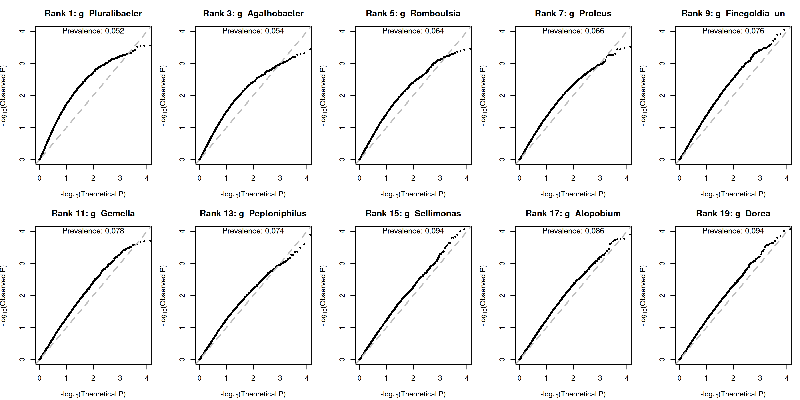
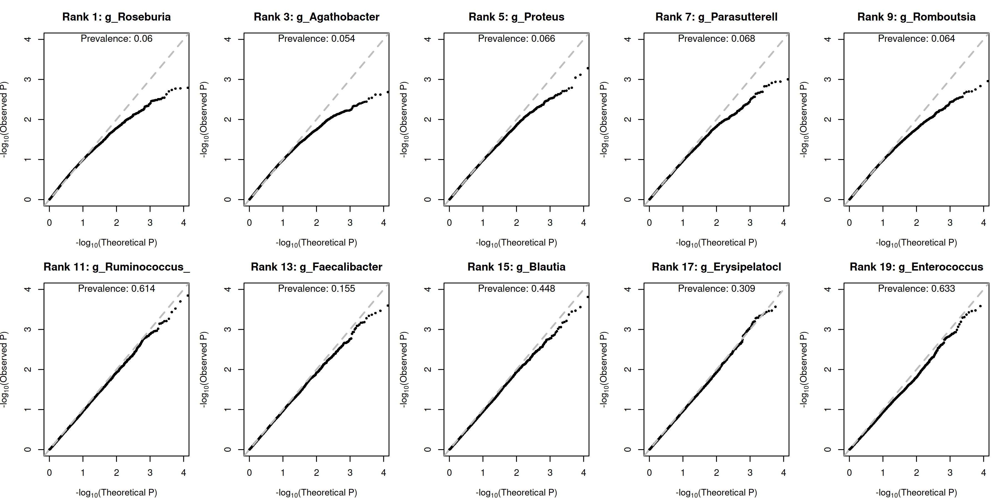
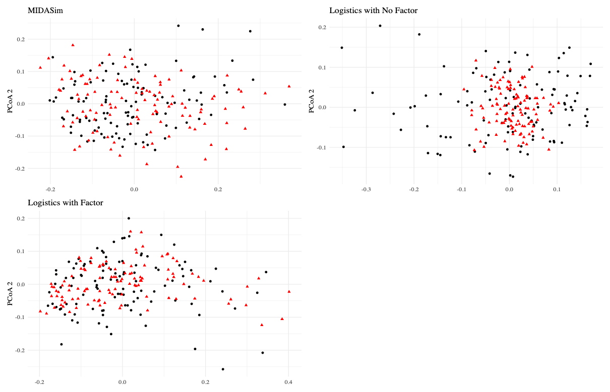
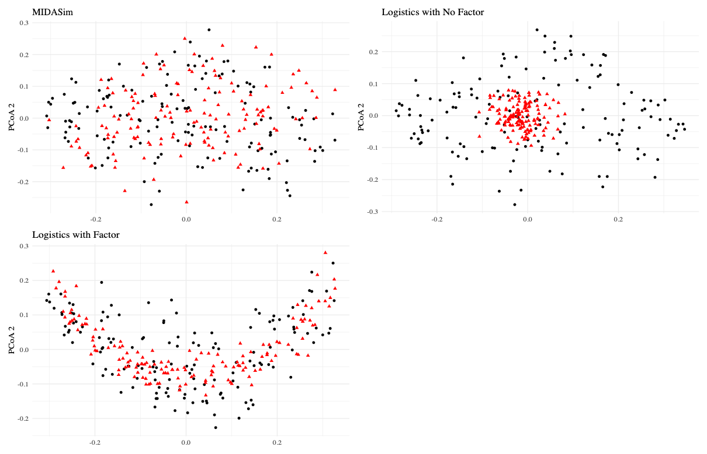
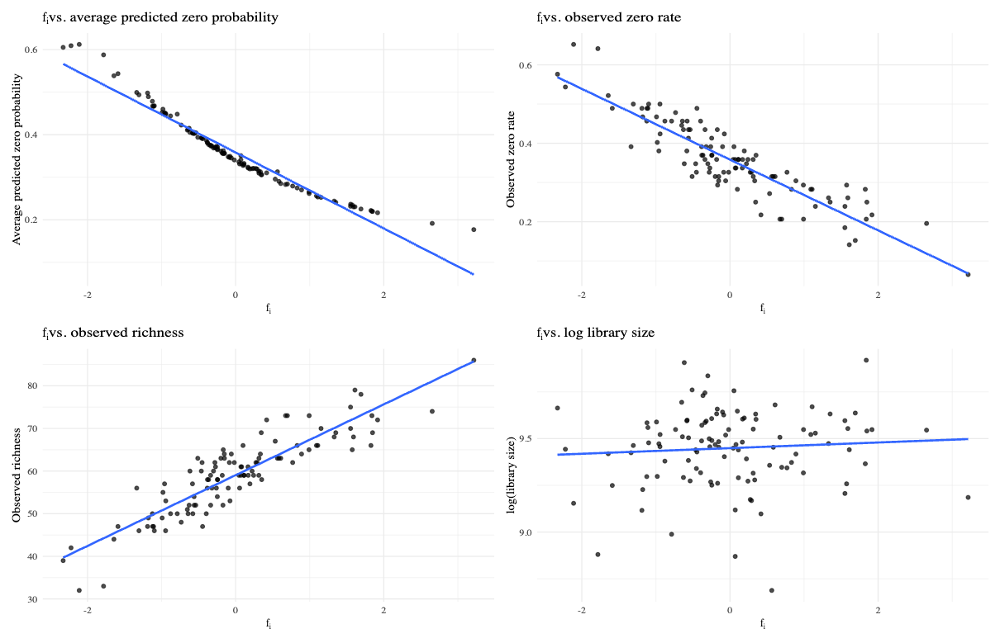

## 09/01 (Seperate ZI-ZTP)

## 1. Review

- We attempted to jointly model the zero part and the positive part, but found that FDR was difficult to control using data generated from MIDASim.
- Therefore, our core work ahead will focus on two main themes: 
  - attempting to model the zero part and the positive part separately; 
  - investigating whether FDR can be controlled if the data-generating process is changed from MIDASim to data generation under model assumptions.

### 1.1. Supplement to the Previous Meeting

- The Q–Q plot with robust variance differs from that without robust variance when the number of covariates is relatively large.

## 2. Seperate ZI-ZTP

### 2.1. Model

$$\boxed{
\begin{aligned}
&\hat\theta=\arg\max_\theta\ell^Z(\theta,0),\qquad
\hat\theta_0=\arg\max_{\theta_0}\ell^A(\hat\theta,\theta_0,0),\\[6pt]
&U^Z_\theta=\sum_i\frac{\partial\ell^Z_i}{\partial\theta}(\hat\theta,0),\quad
U^Z_\beta=\sum_i\frac{\partial\ell^Z_i}{\partial\beta}(\hat\theta,0),\\
&U^A_{\theta_0}=\sum_i\frac{\partial\ell^A_i}{\partial\theta_0}(\hat\theta,\hat\theta_0,0),\quad
U^A_{\beta_0}=\sum_i\frac{\partial\ell^A_i}{\partial\beta_0}(\hat\theta,\hat\theta_0,0),\\[6pt]
&I^Z_{\theta\theta}=-\sum_i\frac{\partial^2\ell^Z_i}{\partial\theta\partial\theta^\top},\quad
I^Z_{\theta\beta}=-\sum_i\frac{\partial^2\ell^Z_i}{\partial\theta\partial\beta},\quad
I^Z_{\beta\theta}=(I^Z_{\theta\beta})^\top,\quad
I^Z_{\beta\beta}=-\sum_i\frac{\partial^2\ell^Z_i}{\partial\beta^2},\\[4pt]
&I^A_{\theta_0\theta_0}=-\sum_i\frac{\partial^2\ell^A_i}{\partial\theta_0\partial\theta_0^\top},\quad
I^A_{\theta_0\theta}=-\sum_i\frac{\partial^2\ell^A_i}{\partial\theta_0\partial\theta},\quad
I^A_{\theta\theta_0}=(I^A_{\theta_0\theta})^\top,\\
&I^A_{\theta_0\beta_0}=-\sum_i\frac{\partial^2\ell^A_i}{\partial\theta_0\partial\beta_0},\quad
I^A_{\beta_0\theta_0}=(I^A_{\theta_0\beta_0})^\top,\\
&I^A_{\beta_0\theta}=-\sum_i\frac{\partial^2\ell^A_i}{\partial\beta_0\partial\theta},\quad
I^A_{\theta\beta_0}=(I^A_{\beta_0\theta})^\top,\quad
I^A_{\beta_0\beta_0}=-\sum_i\frac{\partial^2\ell^A_i}{\partial\beta_0^2},\\[6pt]
&\tilde S_\beta=U^Z_\beta-I^Z_{\beta\theta}(I^Z_{\theta\theta})^{-1}U^Z_\theta,\qquad
\tilde S_{\beta_0}=U^A_{\beta_0}-I^A_{\beta_0\theta_0}(I^A_{\theta_0\theta_0})^{-1}U^A_{\theta_0}
  -\bigl(I^A_{\beta_0\theta}-I^A_{\beta_0\theta_0}(I^A_{\theta_0\theta_0})^{-1}I^A_{\theta_0\theta}\bigr)(I^Z_{\theta\theta})^{-1}U^Z_\theta,\\[6pt]
&\tilde V_{\beta\beta}=I^Z_{\beta\beta}-I^Z_{\beta\theta}(I^Z_{\theta\theta})^{-1}I^Z_{\theta\beta},\\[4pt]
&\tilde V_{\beta_0\beta_0}=I^A_{\beta_0\beta_0}
  -I^A_{\beta_0\theta_0}(I^A_{\theta_0\theta_0})^{-1}I^A_{\theta_0\beta_0}
  -\bigl(I^A_{\beta_0\theta}-I^A_{\beta_0\theta_0}(I^A_{\theta_0\theta_0})^{-1}I^A_{\theta_0\theta}\bigr)(I^Z_{\theta\theta})^{-1}
   \bigl(I^A_{\theta\beta_0}-I^A_{\theta\theta_0}(I^A_{\theta_0\theta_0})^{-1}I^A_{\theta_0\beta_0}\bigr),\\[4pt]
&\tilde V_{\beta\beta_0}=-I^Z_{\beta\theta}(I^Z_{\theta\theta})^{-1}\bigl(I^A_{\theta\beta_0}-I^A_{\theta\theta_0}(I^A_{\theta_0\theta_0})^{-1}I^A_{\theta_0\beta_0}\bigr),\quad
\tilde V_{\beta_0\beta}=(\tilde V_{\beta\beta_0})^\top,\\[6pt]
&\tilde S=\begin{pmatrix}\tilde S_\beta\\\tilde S_{\beta_0}\end{pmatrix},\qquad
\tilde V=\begin{pmatrix}\tilde V_{\beta\beta}&\tilde V_{\beta\beta_0}\\\tilde V_{\beta_0\beta}&\tilde V_{\beta_0\beta_0}\end{pmatrix},\\[6pt]
&T=\tilde S^\top\tilde V^{-1}\tilde S\;\xrightarrow{H_0}\;\chi^2_2.
\end{aligned}
}$$

$$\boxed{
\begin{aligned}
&S^+=\{i:A_i=1\},\quad i\in S^+:\quad
\eta_i=X_i^\top\alpha+G_i^\top\beta,\quad
\lambda_i=e^{\eta_i+b_i},\quad
R_i=1-P_{0i},\\[6pt]
&Z_i\mid b_i\ \sim \text{Zero-Truncated-Poisson}(\lambda_i),\\
&P(Z_i=z\mid b_i)=\frac{1}{\big(1-e^{-e^{\eta_i+b_i}}\big)}\cdot\frac{\lambda_i^z e^{-\lambda_i}}{z!},\quad
p(b_i) = \frac{\big(1-e^{-e^{\eta_i+b_i}}\big)
\displaystyle\frac{1}{\sqrt{2\pi\tau}}e^{-b_i^2/(2\tau)}}
{R_i},\\[10pt]
&\ell^{Z}=
\sum_{i\in S^+}\left[
Z_i(\eta_i+b_i)-\lambda_i-\log(Z_i!)-\frac{b_i^2}{2\tau}-\frac{1}{2}\log(2\pi\tau)-\log R_i
\right],\quad \theta=(\alpha,b),\\[12pt]
&U^Z_\theta=\frac{\partial\ell^Z}{\partial\theta}
=\begin{pmatrix}
\dfrac{\partial\ell^Z}{\partial\alpha}\\[6pt]
\dfrac{\partial\ell^Z}{\partial b}
\end{pmatrix}
=\begin{pmatrix}
\displaystyle\sum_{i\in S^+}\left(Z_i-\lambda_i-\frac{\partial\log R_i}{\partial\eta_i}\right)X_i\\[8pt]
\bigl(Z_i-\lambda_i-b_i/\tau\bigr)_{i\in S^+}
\end{pmatrix},\\[14pt]
&U^Z_\beta=\frac{\partial\ell^Z}{\partial\beta}
=\sum_{i\in S^+}\left(Z_i-\lambda_i-\frac{\partial\log R_i}{\partial\eta_i}\right)G_i,
\qquad C_i:=\frac{\partial^2\log R_i}{\partial\eta_i^2},\\[14pt]
&I^Z=-\frac{\partial^2\ell^Z}{\partial(\theta,\beta)\partial(\theta,\beta)^\top}
=\begin{pmatrix}I^Z_{\theta\theta}&I^Z_{\theta\beta}\\ I^Z_{\beta\theta}&I^Z_{\beta\beta}\end{pmatrix},\\[8pt]
&I^Z_{\theta\theta}
=\sum_{i\in S^+}\lambda_i
\begin{pmatrix}X_i\\ e_{b,i}\end{pmatrix}
\begin{pmatrix}X_i\\ e_{b,i}\end{pmatrix}^{\!\top}
+\begin{pmatrix}\displaystyle\sum_{i\in S^+} C_i X_iX_i^\top & 0\\ 0 & \tau^{-1}I_{n_+}\end{pmatrix},\\[8pt]
&I^Z_{\theta\beta}
=\sum_{i\in S^+}\lambda_i
\begin{pmatrix}X_i\\ e_{b,i}\end{pmatrix}G_i^\top
+\begin{pmatrix}\displaystyle\sum_{i\in S^+} C_i X_i G_i^\top\\ 0\end{pmatrix}
=\sum_{i\in S^+}(\lambda_i+C_i)\begin{pmatrix}X_i\\ 0\end{pmatrix}G_i^\top
+\sum_{i\in S^+}\lambda_i\begin{pmatrix}0\\ e_{b,i}\end{pmatrix}G_i^\top,\\[8pt]
&I^Z_{\beta\theta}=(I^Z_{\theta\beta})^\top,\qquad
I^Z_{\beta\beta}=\sum_{i\in S^+}(\lambda_i+C_i)G_iG_i^\top.
\end{aligned}
}$$

$$\boxed{
\begin{aligned}
&S=\{i:A_i=0\ \text{or}\ 1\},\quad
\theta_0=\alpha_0,\qquad \operatorname{logit}\pi_i=X_i^\top\theta_0+G_i^\top\beta_0,\quad
\eta_i=X_i^\top\alpha+G_i^\top\beta,\quad \theta=(\alpha,b),\\[4pt]
&P_{0i}=P_{0i}(\eta_i,\tau)
=E_{U\sim N(0,\tau)}\left[e^{-\exp(\eta_i+U)}\right]
=\int_{-\infty}^{\infty}e^{-e^{\eta_i+u}}\frac{1}{\sqrt{2\pi\tau}}e^{-u^2/(2\tau)}\,du,\\[4pt]
&R_i=1-P_{0i},\qquad Q_i=1-\pi_iR_i=(1-\pi_i)+\pi_iP_{0i},\\[4pt]
&A_i\mid \pi_i,P_{0i}\sim \text{Bernoulli}(\pi_iR_i),\\[4pt]
&P(A_i=1)=\pi_iR_i,\qquad P(A_i=0)=Q_i,\\[8pt]
&\tilde P_{1i}=\int e^{\eta_i+u}e^{-e^{\eta_i+u}}\varphi_\tau(u)\,du,\qquad
\tilde P_{2i}=\int e^{2(\eta_i+u)}e^{-e^{\eta_i+u}}\varphi_\tau(u)\,du,\\[6pt]
&\frac{\partial P_{0i}}{\partial\eta_i}=-\tilde P_{1i},\qquad
\frac{\partial R_i}{\partial\eta_i}=\tilde P_{1i},\\[6pt]
&\frac{\partial\pi_i}{\partial\theta_0}=\pi_i(1-\pi_i)X_i,\qquad
\frac{\partial\pi_i}{\partial\beta_0}=\pi_i(1-\pi_i)G_i,\qquad
\frac{\partial R_i}{\partial\theta}=\tilde P_{1i}\begin{pmatrix}X_i\\0\end{pmatrix},\qquad
\frac{\partial R_i}{\partial\beta_0}=0,\\[10pt]
&\ell^A=\sum_i\left[(1-A_i)\log Q_i+A_i\log\pi_i+A_i\log R_i\right],\\[8pt]
&a_i=\frac{A_i}{\pi_i}-\frac{(1-A_i)R_i}{Q_i},\qquad
c_i=\frac{A_i}{R_i}-\frac{(1-A_i)\pi_i}{Q_i},\\[8pt]
&U^A_{\theta_0}
=\frac{\partial\ell^A}{\partial\theta_0}
=\sum_i a_i\pi_i(1-\pi_i)X_i,\qquad
U^A_{\beta_0}
=\frac{\partial\ell^A}{\partial\beta_0}
=\sum_i a_i\pi_i(1-\pi_i)G_i,\\[10pt]
&U^A_\theta
=\frac{\partial\ell^A}{\partial\theta}
=\sum_i c_i\tilde P_{1i}
\begin{pmatrix}X_i\\0\end{pmatrix}
=\begin{pmatrix}
\displaystyle\sum_i c_i\tilde P_{1i}X_i\\[6pt]
0
\end{pmatrix},\qquad
U^A_\beta
=\frac{\partial\ell^A}{\partial\beta}
=\sum_i c_i\tilde P_{1i}G_i,\\[14pt]
&I^A=-\,E\!\left[\frac{\partial^2\ell^A}{\partial(\theta_0,\theta,\beta_0)\partial(\theta_0,\theta,\beta_0)^\top}\right]
=\sum_i\frac{1}{\pi_iR_iQ_i}
\frac{\partial(\pi_iR_i)}{\partial(\theta_0,\theta,\beta_0)}
\frac{\partial(\pi_iR_i)}{\partial(\theta_0,\theta,\beta_0)^\top},\\[10pt]
&I^A_{\theta_0\theta_0}
=\sum_i\frac{\pi_iR_i(1-\pi_i)^2}{Q_i}X_iX_i^\top,\\[8pt]
&I^A_{\theta_0\beta_0}
=\sum_i\frac{\pi_iR_i(1-\pi_i)^2}{Q_i}X_iG_i^\top,\qquad
I^A_{\beta_0\theta_0}=(I^A_{\theta_0\beta_0})^\top,\\[8pt]
&I^A_{\theta_0\theta}
=\sum_i\frac{\pi_i(1-\pi_i)\tilde P_{1i}}{Q_i}X_i
\begin{pmatrix}X_i\\0\end{pmatrix}^{\!\top},\qquad
I^A_{\theta\theta_0}=(I^A_{\theta_0\theta})^\top,\\[8pt]
&I^A_{\beta_0\theta}
=\sum_i\frac{\pi_i(1-\pi_i)\tilde P_{1i}}{Q_i}G_i
\begin{pmatrix}X_i\\0\end{pmatrix}^{\!\top},\qquad
I^A_{\theta\beta_0}=(I^A_{\beta_0\theta})^\top,\\[8pt]
&I^A_{\beta_0\beta_0}
=\sum_i\frac{\pi_iR_i(1-\pi_i)^2}{Q_i}G_iG_i^\top.
\end{aligned}
}$$

### 2.2. Conclustion

- The new method is unable to control the FDR.
- Due to the lack of robustness of the numerical integration and $\tau$ estimation, the Q–Q plot exhibits a plateau when covariates are present.
- If the data fully satisfy the model assumptions, the FDR can be seen to be controlled.

## 3. Zero Structure

### 3.1. MIDASim

$$\boxed{
\begin{aligned}
q_{\text{case},j} &= \sigma\!\left(\sigma^{-1}(q_{0,j}) + \gamma_{j}G_{j}\right), \\
\gamma_j &= \log\mathrm{OR}_j,\quad \mathrm{OR}_j \sim \mathrm{Unif}(1,\,1),\quad q_{0,j}\in[\epsilon,\,1-\epsilon],\quad G_j\in\{-1,0,1\}
\end{aligned}
}$$

### 3.2. Factor

### 3.3. Logit

### 3.3. Conclusion

- If the data follow our generative framework, the FDR of the original method can be controlled, which in turn requires us to show that our data generation process is preferable/superior to that of MIDASim.
- Under the MIDASim framework, although the factor-based version better reproduces the data, its FDR control is inferior to that of the version without factors.

## 4. Future

- Simulation for multiple factor
- P0i?
