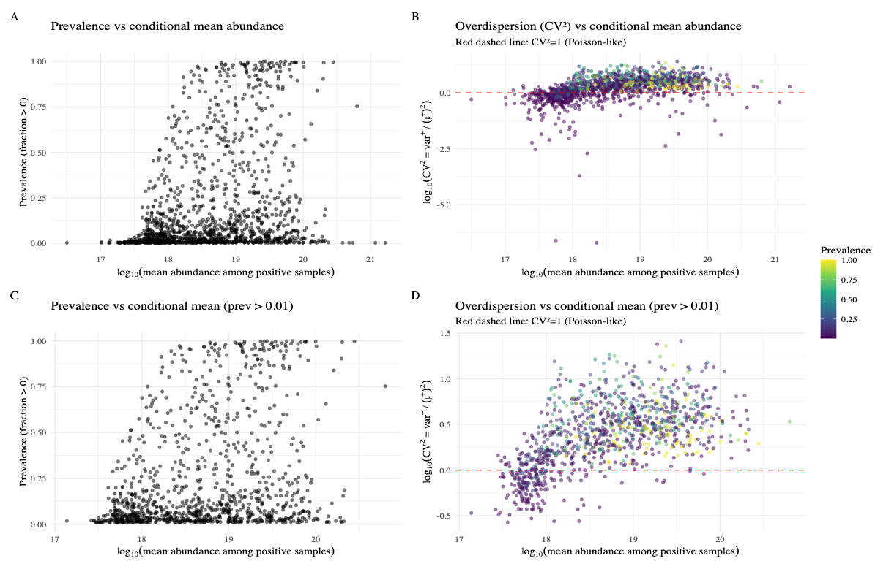
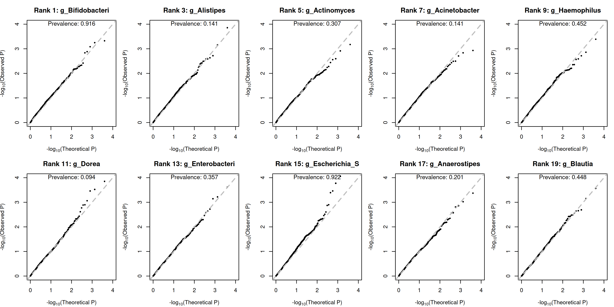

## 09/04 (Simulation)

## 1. Review

- If the zero part and the positive part are modeled jointly, the performance is very poor.
- The model for the zero component exhibits a certain degree of sample heterogeneity, which is revealed by the factor analysis; however, if no correction is applied, the performance is poor.
- In any case, we next consider generating data directly from the spike-in data based on the raw data according to the model definition.

## 2. Masslin3 in Simulation

### 2.1. Model

$$
\boxed{
\begin{aligned}
&R_{ik}=\frac{Y_{ik}}{\sum_l Y_{il}},\quad A_{ik}=I(R_{ik}>0)\\[6pt]
&A_{ik}\sim \operatorname{Bernoulli}(p_{ik})\\[4pt]
&\operatorname{logit}(p_{ik})=\alpha_k^{(P)}+X_i^\top\gamma_k^{(P)}+G_i\beta_k^{(P)}\\[8pt]
&\text{Given }A_{ik}=1:\\
&Z_{ik}=\log_2 R_{ik}=\alpha_k^{(A)}+X_i^\top\gamma_k^{(A)}+G_i\beta_k^{(A)}+\epsilon_{ik}\\[4pt]
&\epsilon_{ik}\sim N(0,\sigma_k^2)
\end{aligned}
}
$$

### 2.2. Comparison in PALM Simulation Test

### 2.3. Comparison in Spike-in Simulation Test

#### 2.3.1. Data Structure

#### 2.3.2. Simluation Setting

$$
\begin{aligned}
&\textbf{Notation}\\
&\quad i = 1,\dots,n \ \text{(samples)},\quad j = 1,\dots,p \ \text{(taxa)},\quad Y_i \in \{0,1\} \ \text{(0 = control, 1 = case)}.\\[6pt]
&\textbf{Step 1. Base absolute abundance (resampled from input)}\\
&\quad A^{0}_{ij} \ge 0 \ \text{is the absolute abundance matrix after prevalence filtering}\\
&\quad \text{(and optional random taxon selection to size } p\text{).}\\[6pt]
&\textbf{Step 2. Signal assignment}\\
&\quad S \subset \{1,\dots,p\} \ \text{is the set of signal taxa, } |S| = \max(1,\operatorname{round}(p\cdot f_s));\\
&\quad \text{for } j \in S:\quad b_j \sim \operatorname{Unif}(1,\beta_{+}),\quad s_j \in \{-1,+1\},\ P(s_j = +1) = \pi_{+},\\
&\quad \qquad\qquad\quad z_j \sim \operatorname{Unif}(1,\beta_{0}),\quad \varepsilon_{ij} \sim \mathcal{N}(0,\sigma^{2}_{e});\\
&\quad \log\!\left(A'_{ij}\right) = \log(A^{0}_{ij}) + s_j\log b_j\cdot Y_i + \varepsilon_{ij}\quad (j \in S),\\
&\quad A'_{ij} = A^{0}_{ij}\quad (j \notin S),\quad \text{then } A'_{ij} \leftarrow \max(A'_{ij},0).\\[6pt]
&\textbf{Step 3. Extra structural zeros (zero-inflation effect)}\\
&\quad p^{\operatorname{extra}}_{j} = 1 - 1/z_j;\\
&\quad \text{if } s_j = +1:\ Z^{\operatorname{extra}}_{ij} \sim \operatorname{Bern}(p^{\operatorname{extra}}_{j}) \ \text{only for } Y_i = 0;\\
&\quad \text{if } s_j = -1:\ Z^{\operatorname{extra}}_{ij} \sim \operatorname{Bern}(p^{\operatorname{extra}}_{j}) \ \text{only for } Y_i = 1;\\
&\quad A_{ij} = A'_{ij}\cdot(1-Z^{\operatorname{extra}}_{ij})\quad \Rightarrow \quad \text{selected group gets extra zeros for taxon } j.\\[6pt]
&\textbf{Step 4. Library size } D_i\\
&\quad \text{(a) If a depth pool is provided:}\\
&\quad\qquad D_i \leftarrow \text{sample from pool (with replacement)},\\
&\quad\qquad D_i \leftarrow D_i\cdot \bar{D}\big/\operatorname{mean}(D)\quad (\text{global scaling to target mean}),\\
&\quad\qquad \text{if } r \neq 1:\ D_{i:Y=0} \leftarrow D_{i:Y=0}\cdot c_0,\ D_{i:Y=1} \leftarrow D_{i:Y=1}\cdot c_1,\\
&\quad\qquad\qquad \text{where } c_0 = \frac{n}{n_0 + n_1 r},\ c_1 = r c_0 \Rightarrow \operatorname{mean}(D)=\bar{D},\ \frac{\operatorname{mean}(D_{i:Y=1})}{\operatorname{mean}(D_{i:Y=0})}=r,\\
&\quad\qquad \text{if } \sigma_d > 0:\ D_i \leftarrow D_i\cdot\exp(\eta_i),\ \eta_i \sim \mathcal{N}(0,\sigma^{2}_{d});\\
&\quad \text{(b) Otherwise (empirical log-normal from }A\text{):}\\
&\quad\qquad \mu_{\ell},\sigma_{\ell} = \text{mean/sd of } \log\!\left(\sum_{j} A_{ij}\right),\\
&\quad\qquad D_i \sim \operatorname{LogNormal}\!\left(\log\bar{D} + \log r\cdot Y_i - \tfrac{1}{2}\sigma'^{2}_{d},\ \sigma'_{d}\right),\ \sigma'^{2}_{d} = \sigma^{2}_{\ell} + \sigma^{2}_{d};\\
&\quad \text{finally } D_i \leftarrow \max\!\left(\left\lceil D_i\cdot\bar{D}\big/\operatorname{mean}(D)\right\rceil,1\right) \in \mathbb{Z}_{>0}.\\[6pt]
&\textbf{Step 5. Observed read counts (multinomial sampling)}\\
&\quad P_{ij} = \frac{A_{ij} + \epsilon}{\sum_{k}(A_{ik}+\epsilon)},\quad \epsilon = 10^{-9},\\
&\quad \mathbf{C}_i = (C_{i1},\dots,C_{ip}) \sim \operatorname{Multinomial}\!\left(D_i,\mathbf{P}_i\right),\\
&\quad \sum_{j} C_{ij} = D_i,\quad C_{ij} \in \mathbb{Z}_{\ge 0}.
\end{aligned}
$$

Parameter mapping:

| Symbol | Argument | Meaning |
|---|---|---|
| $n$ | `n_total` | total sample size |
| $\bar{D}$ | `mean_depth` | target mean sequencing depth |
| $r$ | `case_control_depth_ratio` | depth ratio case / control |
| $\sigma_d$ | `depth_noise_sd` | log-scale depth noise |
| $\beta_+$ | `effect_positive` | upper bound of multiplicative effect $b_j$ |
| $\beta_0$ | `effect_zero` | upper bound of zero-inflation factor $z_j$ |
| $f_s$ | `signal_frac` | fraction of signal taxa |
| $\sigma_e$ | `effect_noise_sd` | log-scale per-sample effect noise |
| $\pi_+$ | `signal_positive_frac` | fraction of signals with positive direction |
| $\mathbf{C}$ | `rel_abd` (output) | final observed count matrix |

#### 2.3.2. Simulation Results

### 2.4. Maaslin3 qqplot

## 3. Next Project

$$\log p(x) \ge \mathbb{E}_{q(z)} \left[ \log p(x|z) \right] - D_{KL}(q(z) \parallel p(z))$$

$$\begin{aligned}
z_n &\sim \mathcal{N}(0, I) \\
\ell_n &\sim \text{LogNormal}(\ell_\mu, \ell_\sigma^2) \\
\rho_n &= f_w(z_n, s_n) \\
w_{ng} &\sim \text{Gamma}(\rho_{ng}, \theta_g) \\
y_{ng} &\sim \text{Poisson}(\ell_n w_{ng}) \\
h_{ng} &\sim \text{Bernoulli}(f_h^g(z_n, s_n)) \\
x_{ng} &=
\begin{cases}
y_{ng} & \text{if } h_{ng} = 0 \\
0 & \text{otherwise}
\end{cases}
\end{aligned}$$

$$p(z_{\text{GP}}) \sim \mathcal{GP}(0, K_{\theta}(X, X))$$

## 4. Future
- LMM score vs wald, with outlier
- maaslin3 with meta
- outlier with effect
- PALMQTL joint with zero part
- beat maaslin3?
- GWAS simulation
- Family data simulation (GMMAT)
