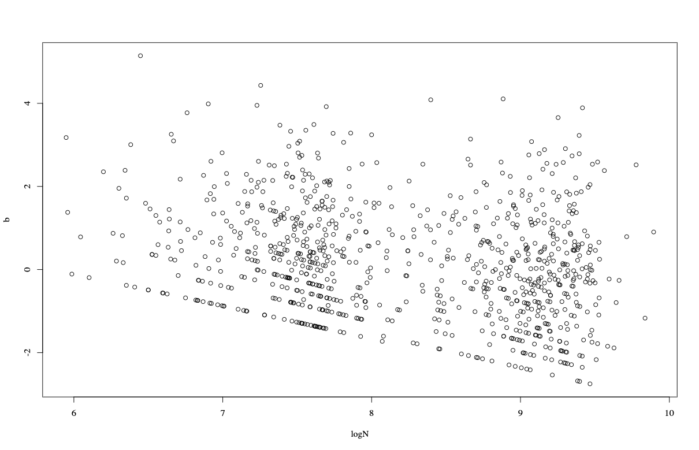

## 09/15 (Estimation of b)

## 1. Review

- We observed that under high sequencing depth, both methods incorporating random effects and the approach of directly applying LMM to log-transformed data outperform PALM. In contrast, PALM delivers better control over FDR when sequencing depth is low and uneven.

### 1.1. PALM Simulation for Maaslin3

## 2. Exploration in Multiple Direction

To minimize confounding as much as possible, we implemented the following steps:
- We discarded the zero-inflation component;
- We generated data directly from a standard log-normal distribution;
- We supplied the true value of τ to the model;
- We directly incorporated the compositional effect (estimated from data) as an offset to the model.

We have these models:
- lognormal
- PALM
- poisson with random effect
- ztpoisson with random effect

Several Conclusion:

- When sequencing depth is high, PALM exhibits insufficient statistical power.
- When sequencing depth is low, the current model that only considers the positive component fails to maintain proper FDR control in scenarios of unbalanced sequencing depth across samples/groups.
- Even when the data are generated strictly under the normal-multinomial generative model, the truncated zero-inflated Poisson mixed-effects model still fails to maintain valid FDR control.

Actually, I think the following model would be possible:

$$ \boxed{ F_i= \begin{cases} Y_i,&0\le Y_i\le D,\\ D+1,&Y_i>D, \end{cases} \qquad L_i=Y_i\quad\text{only for }F_i=D+1. } $$

$$ \boxed{ h_{\mathrm{total}} = \ell_F(\alpha,\beta,\alpha_0,\beta_0;\tau) + h_L(\alpha,\beta,b_{\mathcal I_H};\tau). } $$

## 3. Future
