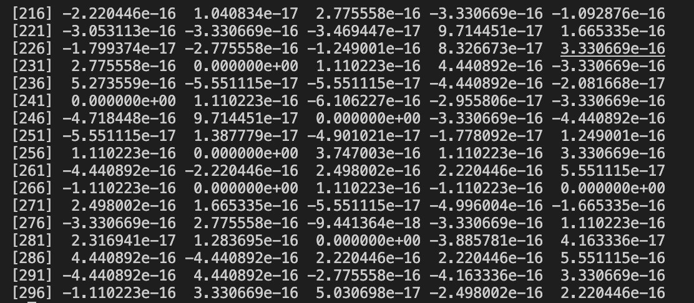
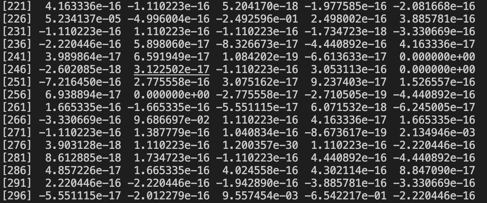
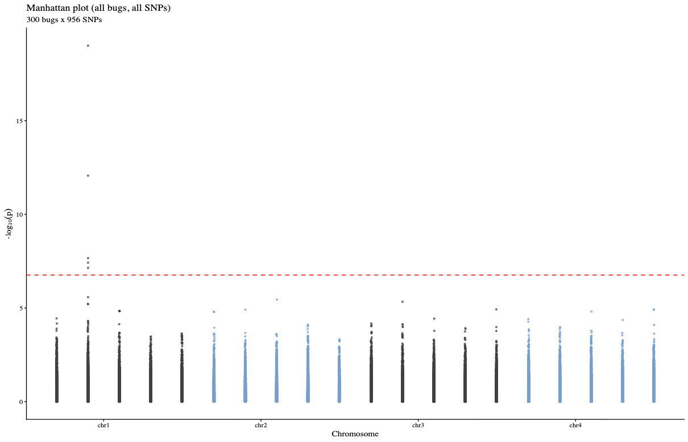

## 09/25 (mbGWAS)

## 1. Review

- In our last meeting, we settled on a fairly well-developed approach: separate modeling with joint estimation and integration over the zero part.
- Let’s set model modifications aside for now. First, we will build a complete mbGWAS simulation pipeline and at the same time review how others have implemented mbGWAS.

### 1.1. Correction1

The positive component of our joint modeling method actually already has slightly higher power than MaAsLin3.

### 1.2. Correction2

The only difference between the score and Wald versions of MaAsLin3 is the variance estimator. There was a minor issue in the previous PALM simulation code; after fixing it, the results are as follows.

## 2. mbGWAS method
[table.html](assets/table.html)
## 3. Reproduction of Maaslin3

For each covariate, MC correction takes the negative median of center-set effect sizes (p < 0.95) as the effect shift δ, then simulates per-taxon effects from their normal sampling distributions to estimate cov(β_i, M) and adds var_M − 2·cov to each taxon’s variance.

## 4. mbGWAS first test

use sim1000G

## 4. Future
- stats rarefy
- sampling zero
- down-sampling zero
- maaslin3 data down-sampling
