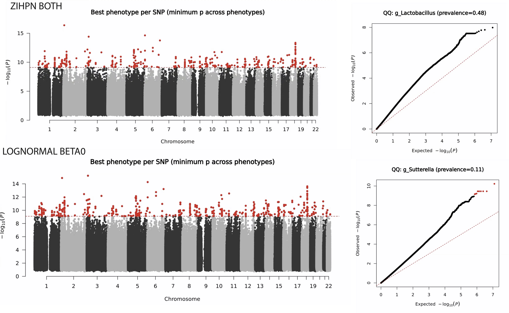
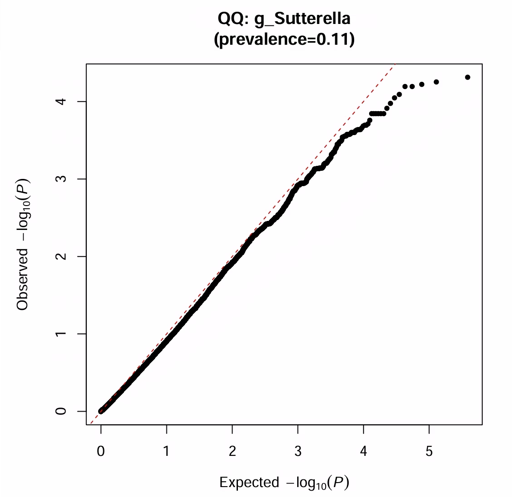

## 10/06 (Real Data)

## 1. Review

- Last week we discussed that our algorithm needs to be extended to real data, so parallelization is required.
- Although the parallelized code was not yet fully completed, we could still briefly look locally at the results when the qqplot reached the 1e-6 position.

This week we mainly completed the parallelized code for the algorithm, tested it on real data, and did some exploration based on the real data results.

## 2. Real Data

Experimental setup:
- Enable the simplest version of median correction throughout
- The prevalence model does not consider global random effects, i.e., LOCO
- Covariates are not considered
- minMAF = minMAC = 0
- Numer of SNP = 6174919
- pCut = 5e-8/62

### 2.1. Abundance Result
The following are the abundance results.

### 2.2. Prevalence Result
The following are the prevalence results.

### 2.3. SAIGE Test
I directly used the SAIGE package and fitted a single taxon separately. Compared to an ordinary logistic score test, it only adds random effects and SPA. Due to code issues, we only have results for 190,000 SNPs, and the results are as follows.

## 3. Future
