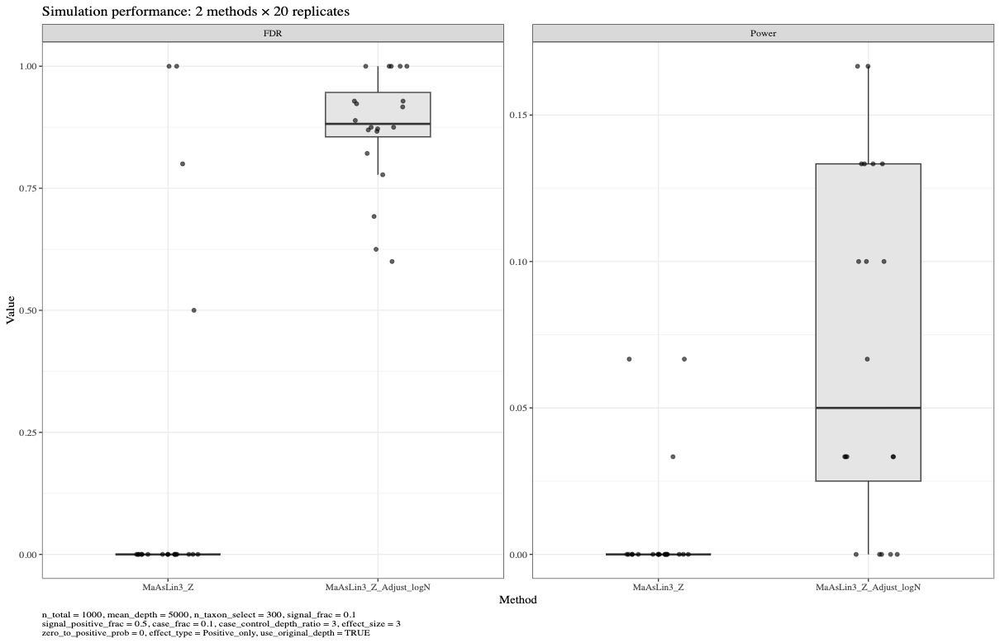
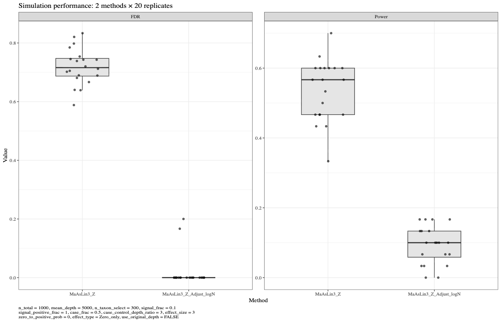
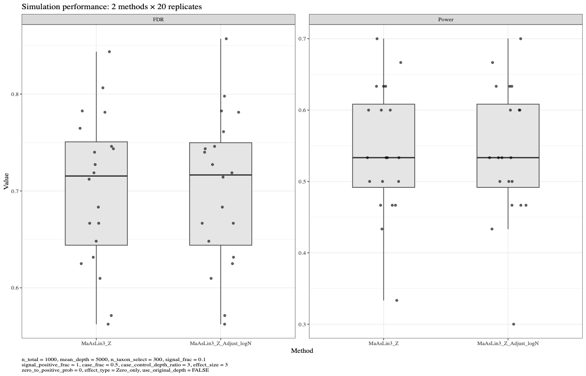
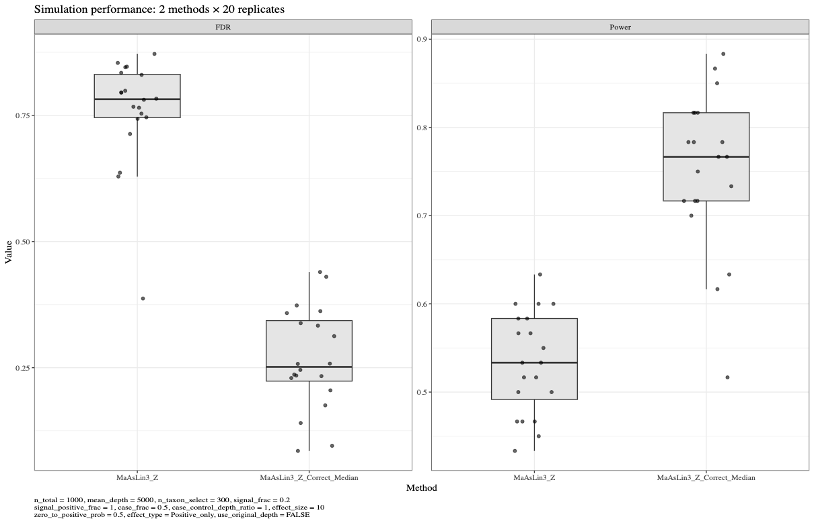
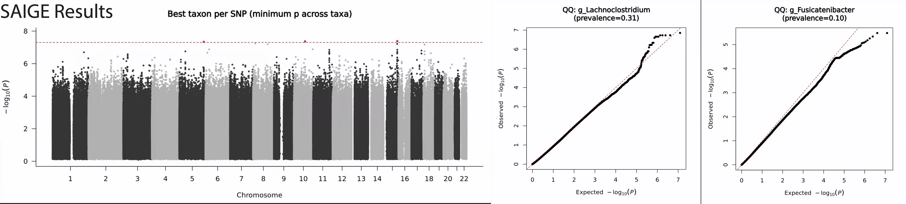
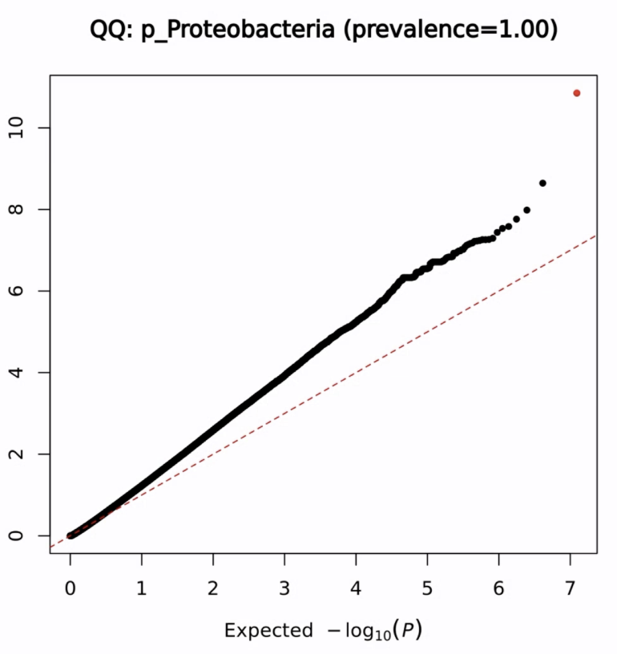
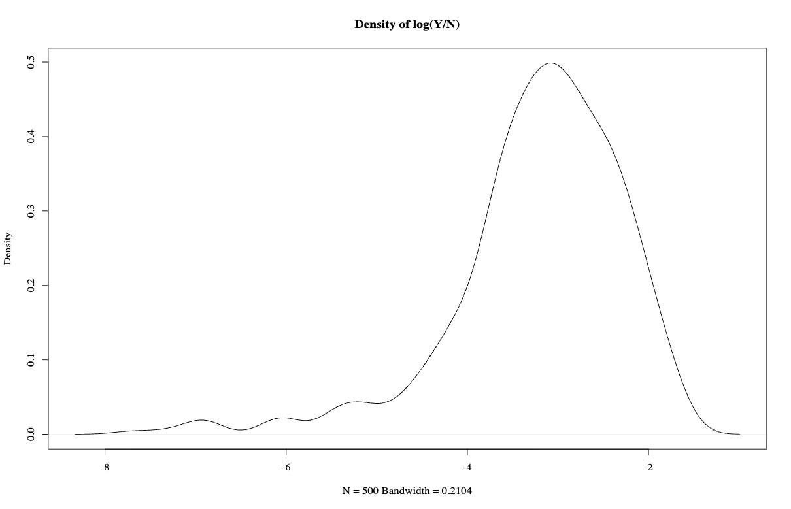
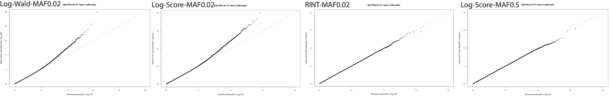

## 10/09 (Prev and Abund)

## 1. Review
Last week we discussed the results of the algorithms on real data. Specifically:

- There is no discernible difference between the ZIHPN algorithm and MaAsLin3's algorithm on real data.
- The abundance component shows some inflation for certain taxa, specifically manifested as an upward-bending QQ plot, with the result that only one taxon was detected as having an effect.
- The prevalence component shows relatively severe inflation, leading to multiple false positives. We suspect this is because SPA was not performed. We simply tried SAIGE, and found that the new QQ plot fits the diagonal, but large-scale testing has not been done.
- We also discussed a strange phenomenon: when seq depth is set very high and there are no sampling zeros, the effect is loaded onto the abundance component, and when depth is unbalanced between case and control, adjusting for depth in the prevalence component causes problems, whereas the abundance component does not.

## 2. Prevalence Part

### 2.1. Why does the problem arise when $N_i$ is related to $O_i$?

The reproduction results are as follows: we added the effect only under the abundance component, with the effect balanced between positive and negative signs. Then we set seq depth to be very large to ensure there are no sampling zeros, and there is a direct difference in seq depth between cases and controls.

We can explain this phenomenon this way:

We define $A_{ij} = I(Y_{ij} \neq 0)$, and assume that
$$\text{logit}(P(A_{ij}=1 \mid O_i, G_i)) = a_j + b_j\log O_i.$$

We can see there is no effect of $G$. But if we assume that $N_i$ is generated from $O_i$, with
$$\log N_i = \log O_i + \log C + G_i \log 3,$$

then substituting this in gives
$$\text{logit}(P(A_{ij}=1 \mid O_i, G_i)) = a_j + b_j(\log N_i - \log C - G_i \log 3).$$

Once we adjust for $N_i$, an effect appears. This is a bit like saying that when $X+Y$ is held fixed, $X$ and $Y$ become associated. There is a specific name for this: 'collider adjustment bias.'

### 2.2. A method for constructing problem data.

The issue with logistic modeling is that, when sampling zeros differ, the logistic model cannot distinguish whether the differences come from sampling zeros or structural zeros. 

If we only change the sequencing depth of the case and control groups, adjusting logN can indeed substantially mitigate this issue (of course, when sampling zeros are relatively rare). The specific experiments are as follows.

One strange phenomenon worth adding is that if we directly set the depth pool so that all sequencing depths are the same, whether or not we adjust does not change the results.

If we want to avoid the problems caused by differences in depth, one approach is that if the sampling zeros are caused by compositional effects, then they become difficult to distinguish. 

Specifically, if $Y_{ij}=\text{Multinomial}(W_{ij}/O_i, N_i)$ and the zeros are transmitted through $O_i$, then they cannot be distinguished. 

If there is only a prevalence effect and no abundance effect, then it may be possible to correct using a median correction approach, though the correction cannot be particularly good. 

But if both abundance and prevalence effects exist simultaneously, then naturally the compositional effect from the abundance part cannot be corrected precisely. The conditions are indeed quite stringent, but we can see the results as follows. (For simplicity, we set all sequencing depths are the same.)

### 2.3. SAIGE Result

Without considering covariates, the SAIGE results are as follows:

So in fact, the real data does not exhibit the aforementioned sampling zero problem; it is only possible that the presence of sampling zero reduces the power of the statistical method.

## 3. Abundance Part

### 3.1. Inflation Problem

The results obtained earlier using the Lognormal method are as follows:

The count distribution of the corresponding taxon is:

We separately simulated locally the shapes of the QQ plot under the null hypothesis for the cases MAF = 0.02 and MAF = 0.5, as well as the QQ plots after switching to the rint transformation, as follows:

It can be said that the problem with the QQ plot arises from the combined effect of MAF and the data shape.

### 3.2. An Idea

The core here is: how exactly should we view the abundance portion of the data?

One result seems to be that, from the Rank perspective versus ordinary normal regression, the power ratio difference is $3:\pi$, though this has not yet been verified.

If we do not assume a data structure, then we basically can only rely on rank or palm, the latter being overly conservative.

If we do assume a data structure, then there is one approach: use a large amount of data to verify whether this structure actually exists, and how many parameters are actually needed.

## 4. Future
