## 10/13 (RINT and Dist)

## 1. Review

- Last week we analyzed the erroneous results on real data separately:
  - For the abundance part, we found that the core reason was that the data did not satisfy the normality assumption combined with low MAF, which caused the QQ plot to be inflated. When the data were replaced with normal data after applying RINT, the QQ plot no longer showed inflation.
  - For the prevalence part, the issue mainly came from low MAF, and so far no problem caused by sample-zero imbalance was found. After applying SPA through SAIGE, the QQ plot no longer showed inflation.
- At the same time, we discussed trying to integrate a large amount of microbiome data to see whether the distribution can be uniformly represented by a few parameters.
- This first half of the week mainly involved organizing new data, exploring and comparing RINT's power, and jointly exploring a large amount of microbiome data.

## 2. RINT power

To compare RINT's power, we used Cauchy's arctan weighting to compute the combined p-value, then calculated FDR and power via simulation with multiple effect SNPs at fixed MAF under multiple testing, and also compared the power of KRV-related methods along the way.

It is worth noting that, because the standard KRV package does not have the speed to handle a large number of SNPs, we used a rewritten function; on small data, the p-value difference from the standard method was verified to be on the order of 1e-14.

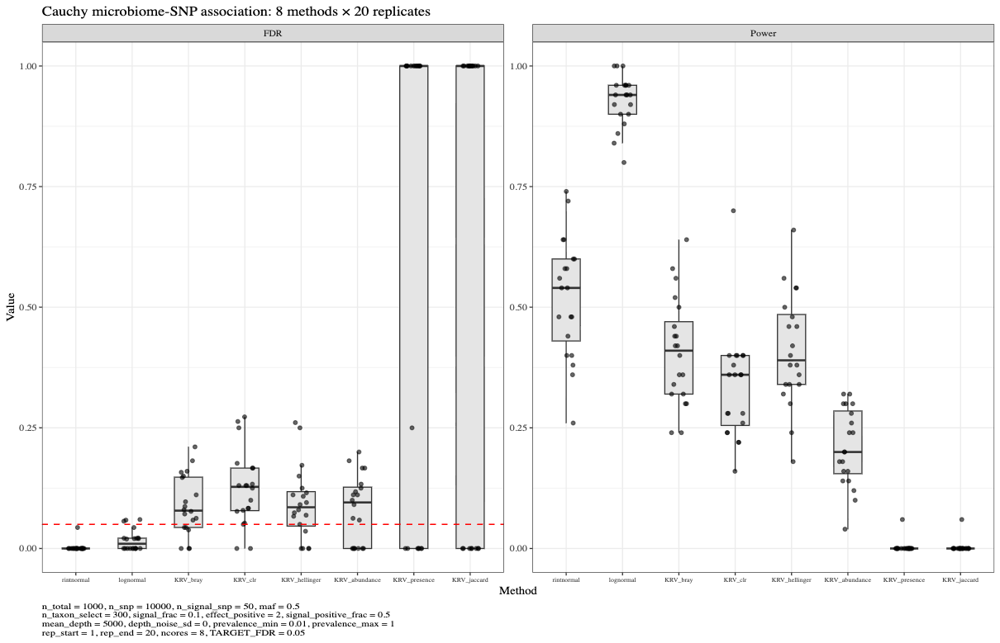

## 3. Exploratory Analysis of Multiple Microbiome Data

- Downloaded multiple open datasets on Qiita (due to time constraints, only 137 datasets from 16S sequencing were downloaded; in fact, there are currently 845 open ones. Although I only need the count matrix, all data were downloaded in full, which was very time-consuming).
- Performed coarse filtering with the following conditions: all taxa with prevalence greater than 0.1 and less than 0.3, samples with more than 100 individuals, and samples whose mean count of values greater than zero exceeds 100, resulting in 118 taxa from 8 different studies.
- We randomly selected 64 and plotted the distributions as shown below:

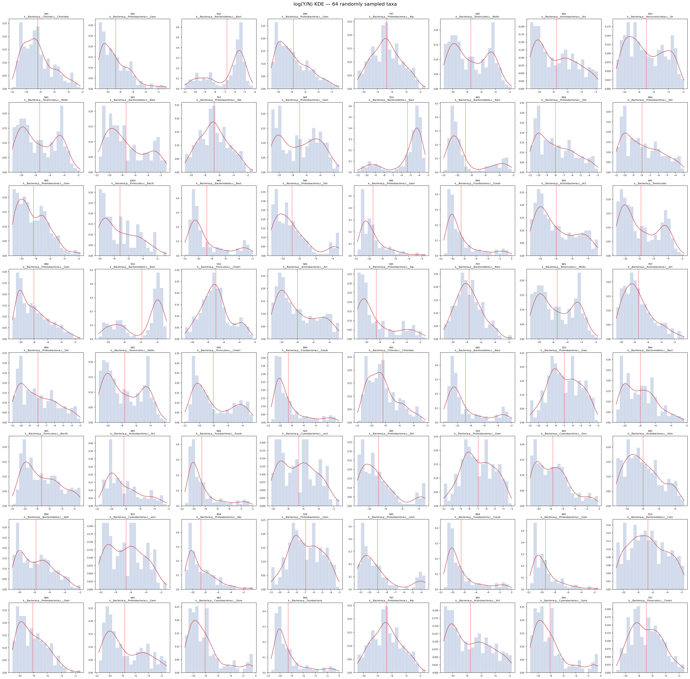

We can clearly see that the data indeed exhibit a bimodal structure.

This reminds me of the data that caused problems with PALM back then: the core issue was the presence of extreme values. But could these extreme values possibly be data from the second peak of the bimodal distribution, and only sampled once?

Going back to the taxa that had problems in the real data, the reason for deviation from normality is also that the low-count portion formed a second peak. Therefore, we can try to restore normality by removing the second peak.

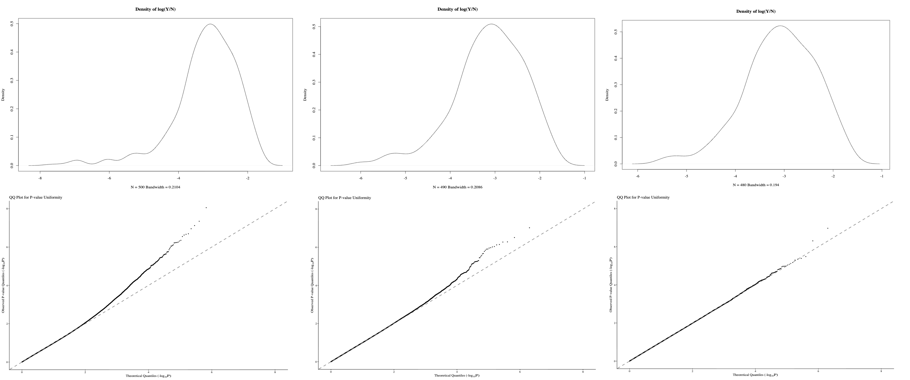

It can be seen that once normality is restored, the QQ plot no longer shows inflation.

## 4. Basic Analysis of GOLD Data

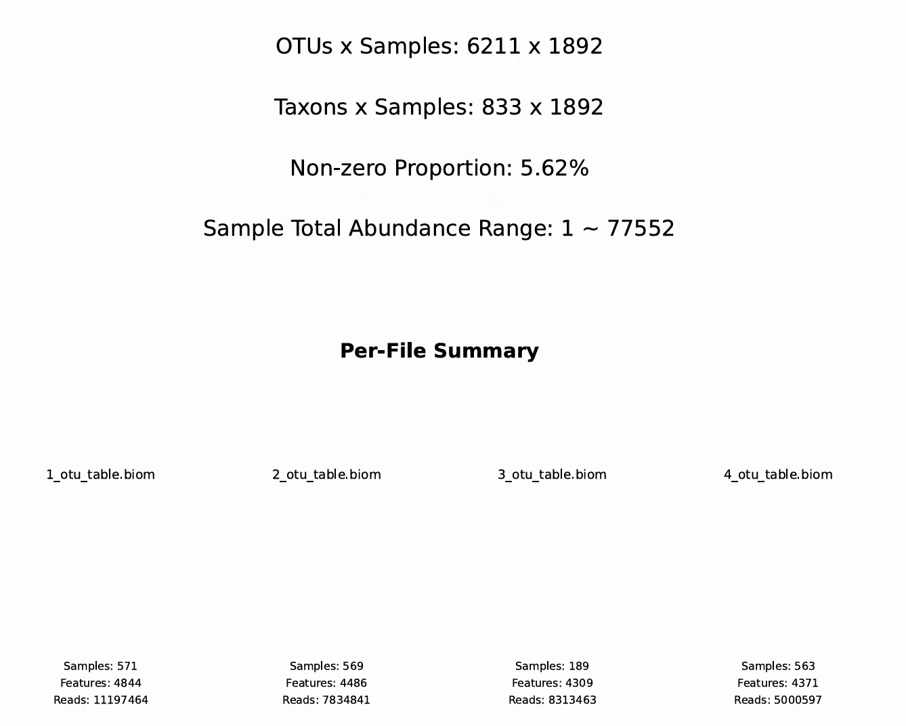

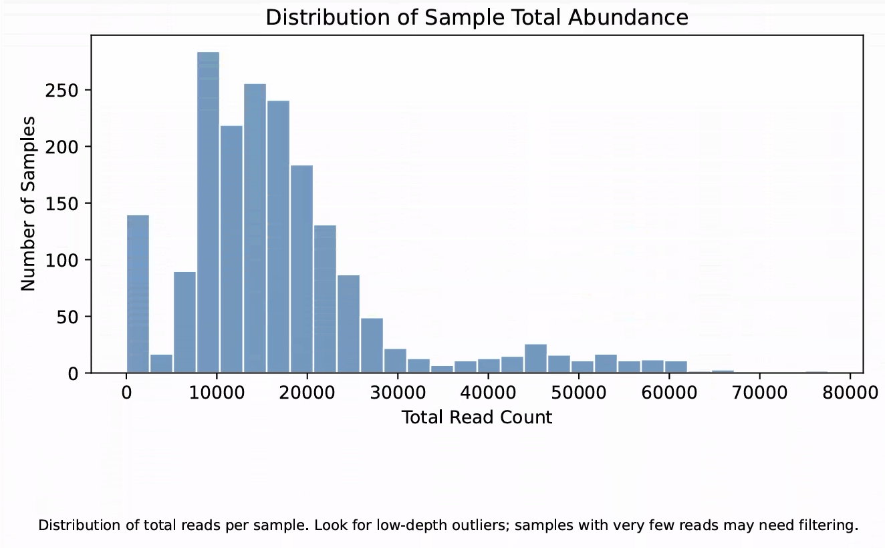

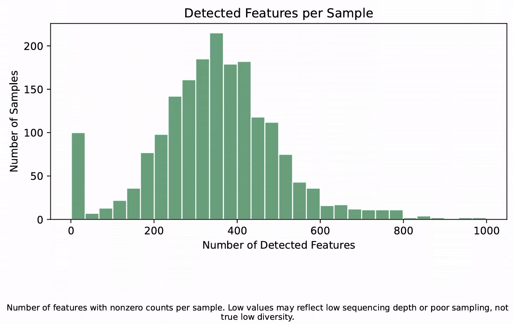

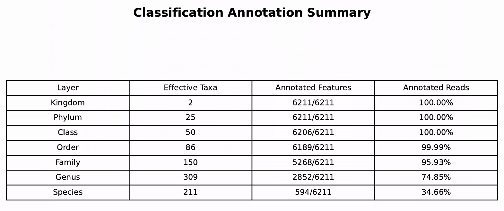

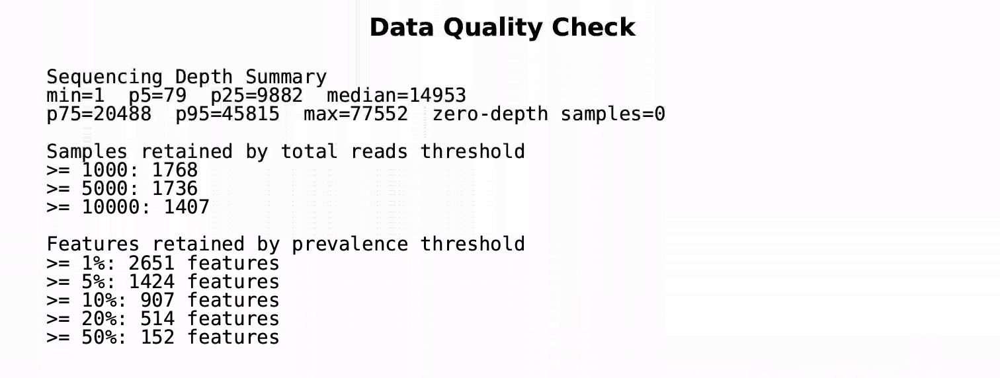

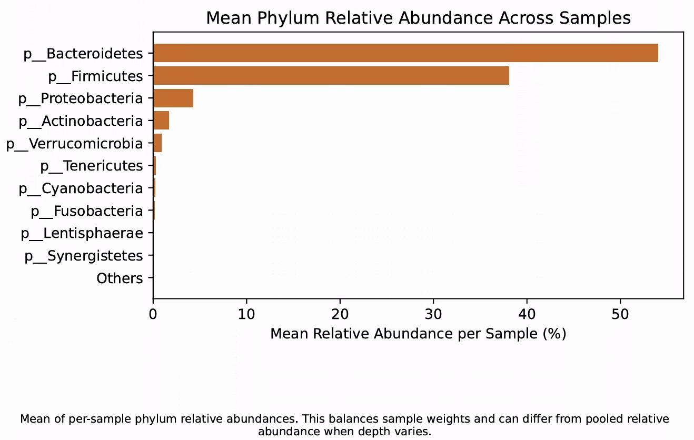

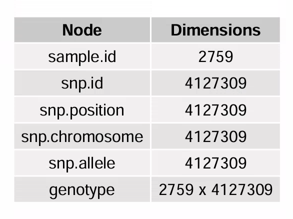

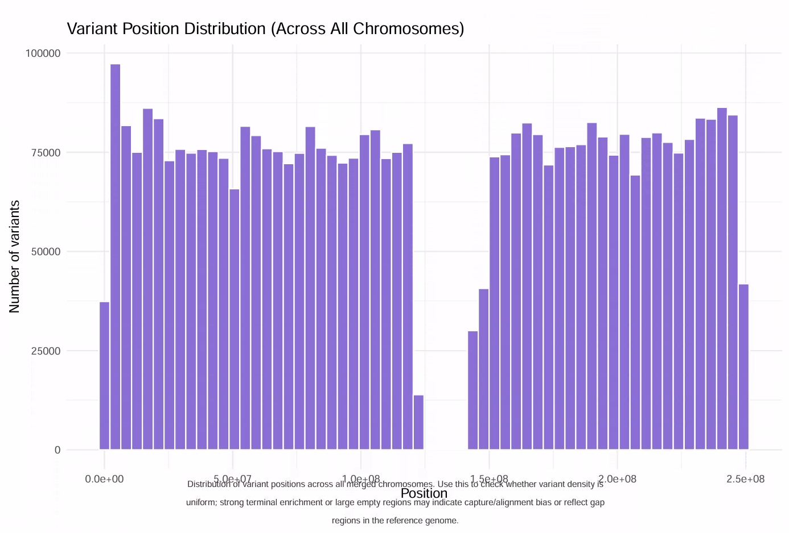

## 5. Future
- process data
- reproduce KRV paper
