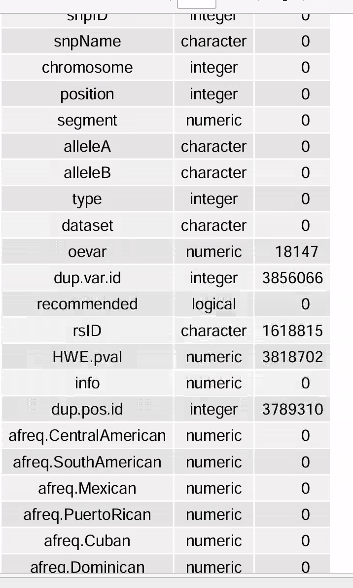
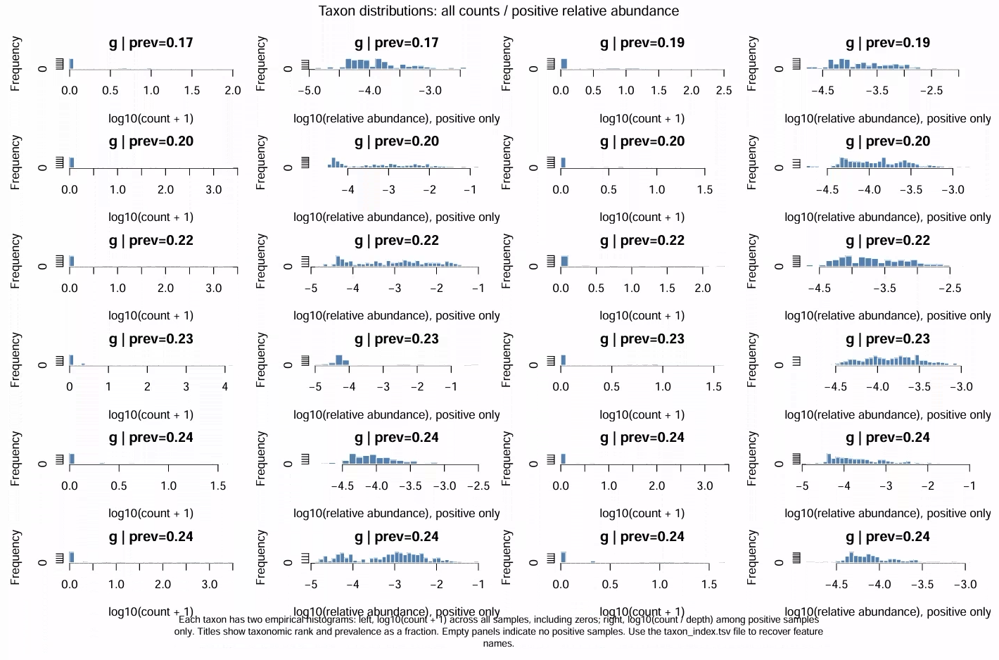
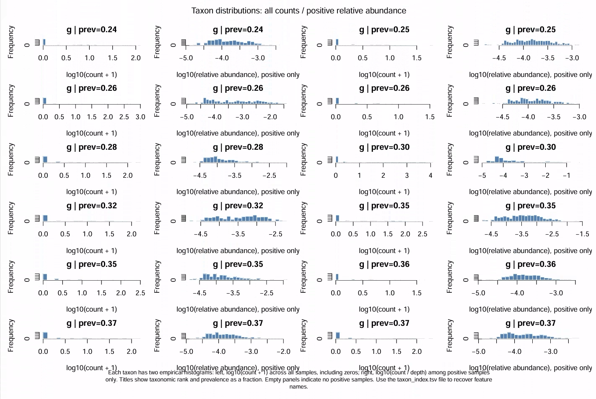
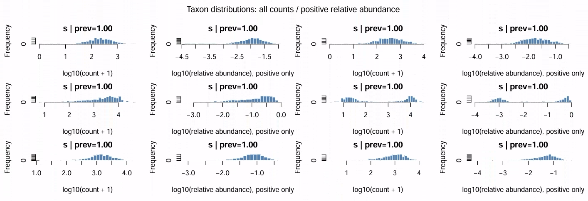
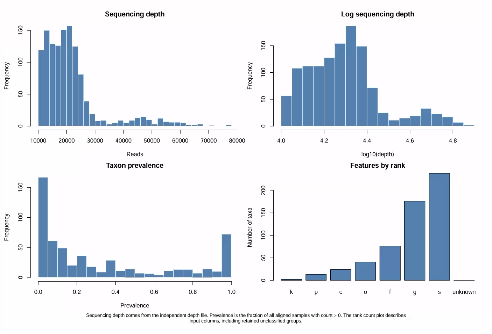
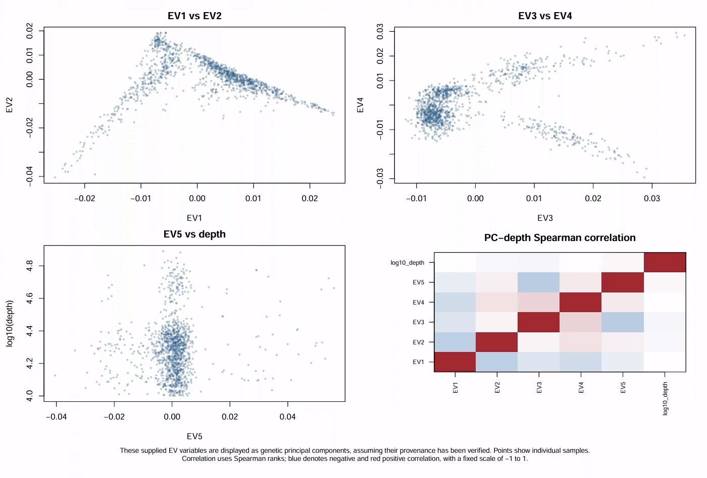
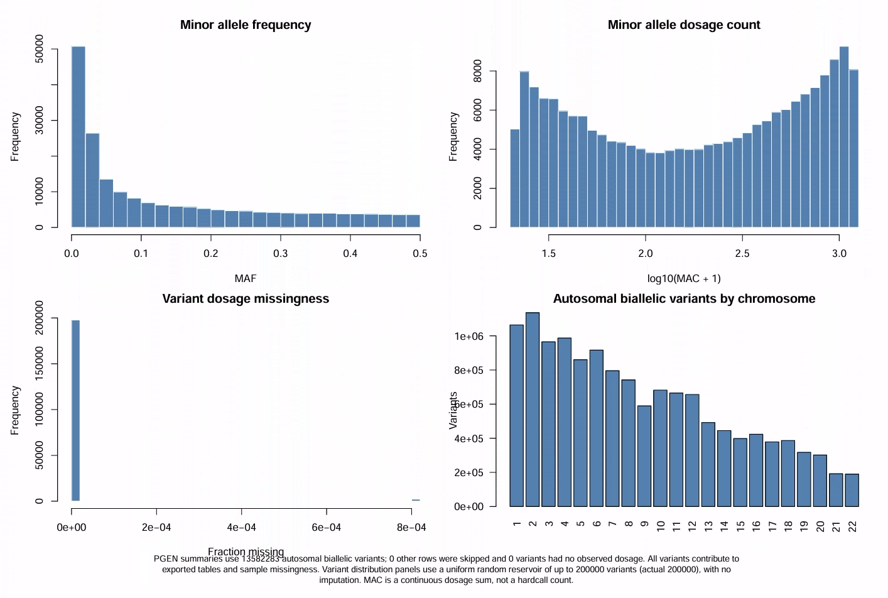
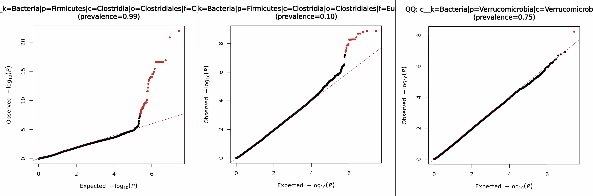
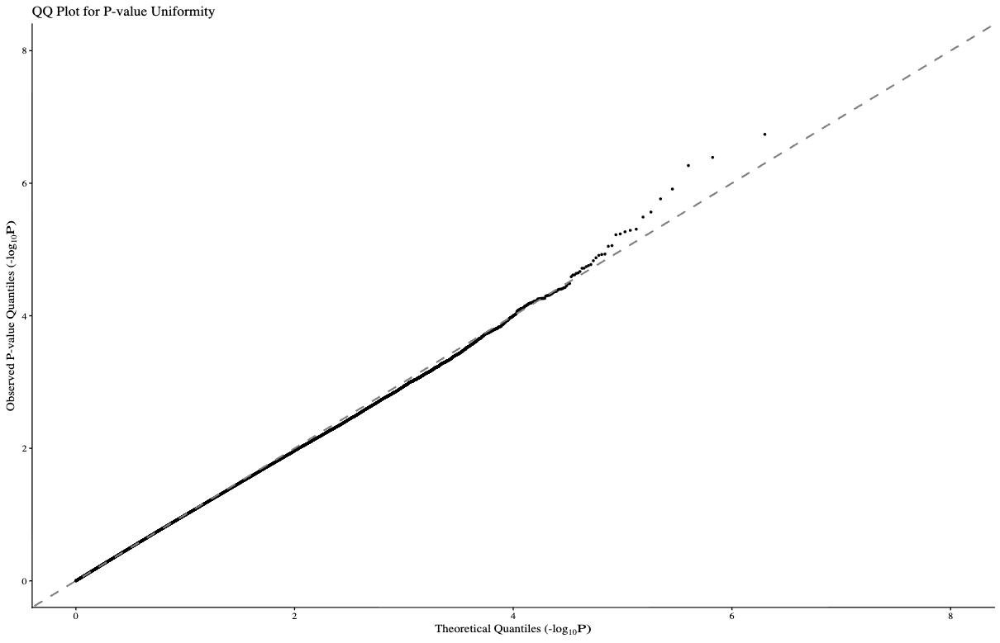

## 10/20 (GOLD Dataset)

## 1. Review

- We found that the upward bend in the QQ plot for the abundance part stems from a bimodality issue, and manually removing the second small peak directly resolves the upward bend in the QQ plot.
- At the same time, we roughly analyzed the data and noticed the number of samples and duplicate issues in the microbiome sequencing data.
- This week's main task was continuing the data organization and analysis.

## 2. Data Processing Pipeline

### 2.1. Genome Sequencing Data

The genome-related data we have is as follows:

- GDS files for chromosomes 1–23 in the imputed folder: The internal information includes: SNP id (1, 2, 3, 4, 5), Position (position on the chromosome), chromosome number, allele structure (A/T, A/AT, G/<CN0>, T/<CN2>, G/G, A/<INS:ME:ALU>), and dosage (stored as decimals).

- subject_annotation_2017-05-24_GOLD.xlsx: It stores the consent authorization of the data, which ethnicity (Mexican, Puerto Rican, Cuban, ...), the first five E.V.s, and the correspondence between sequencing IDs and standard IDs.

- 23 RData files in the annotation folder: The internally contained fields are as follows:

We'll put aside the information from the annotation folder for now and use only the imputed folder for the subsequent analysis.

Excluding chromosome 23, among chromosomes 1–22, only chromosome 14 has dosages containing "-1", with 569,670 such entries, accounting for roughly 4e-6 of all SNPs.

Ultimately, we obtained 2,759 samples and 51,932,115 SNPs.

After aligning with subject_annotation_2017-05-24_GOLD.xlsx, it turned out that the genome sequencing ID of one sample was not in the xlsx, so ultimately 2,758 samples were converted to standard IDs.

The 2023 paper cites the 2016 paper for the genomic processing, but does not state which genome coordinate version was used. However, another eLife paper, "Recent shifts in the genomic ancestry of Mexican Americans may alter the genetic architecture of biomedical traits," states that the coordinates are based on "GRCh37/hg19." Therefore, the gene annotation should also use these coordinates.

### 2.2. Microbiome Sequencing Data

We have the following microbiome-related data:

- The 16S folder stores files related to 16S sequencing, containing 6 different sub-biom files. The first 4 have no duplicate IDs, and the last two, marked with 'R', have duplicate IDs with the earlier ones.
- The Shotgun folder stores files related to Shotgun sequencing. Since the 2023 paper did not consider this data, we will not consider it for now.
- There are also two sas7bdat files, storing covariates such as age, weight, and questionnaire responses, as well as the correspondence between sequencing IDs and standard IDs.

We directly merge all biom files. For duplicate IDs, we keep the one with the greatest sequencing depth. We retain taxa at all taxonomic levels (including unclassified), obtaining 1905 samples (1920 in the paper).

Then we filter out samples with depth less than 10000 and filter out samples whose names contain 'BLANK'. The final sample IDs resemble the format 11666.G0123B, and we take the middle part G0123, obtaining 1677 samples and 1419 taxa.

Convert to standard IDs, keeping all of them.

### 2.3. Data Consolidation

Keep only those IDs that exist in both the microbiome data and the genomic data, leaving 1282 samples.

Use PLINK2's LD pruning to obtain marker SNPs, and use KING to remove samples with kinship greater than 0.05, leaving 1231 samples (1219 in the paper).

Then perform additional filtering on the SNP portion, removing SNPs with dosage missingness greater than 0.05 and removing SNPs with MAC less than 20, ultimately leaving 13582283 SNPs.

For the taxon portion, remove taxa with prevalence less than 0.01, ultimately leaving 570 taxa across different taxonomic levels.

### 2.4. Basic Statistical Results

## 3. Some SAIGE Results

We directly call the standard SAIGE package without applying any filtering (filtering was already done earlier), adjusting for EV1 to EV5. SAIGE itself has a bug: only stage 2 supports PLINK2-format genomes, while stage 1 does not (there is still an open request on GitHub for this). Therefore, in stage 1 we first convert to PLINK binary (BED) format, and in stage 2 we use PLINK2-format input. Due to time constraints, only 66 taxa were run out. The QQ plots for several representative taxa are shown below:

## 4. BImodal Distribution

We can model the bimodal distribution as follows:

$$ Y_i=X_i^\top\alpha+\beta G_i+\varepsilon_i, \qquad \varepsilon_i\sim\sum_{k=1}^{K}\pi_kN(\mu_k,\sigma_k^2), $$

## 5. Future

- population with EV1 EV2
- KRV two stage
