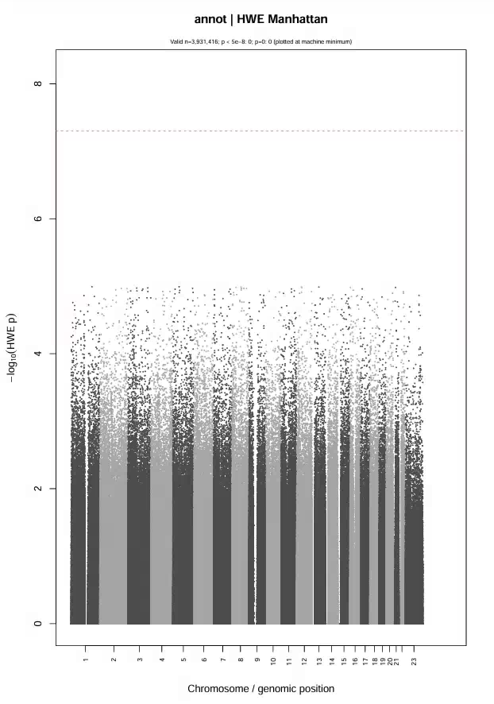
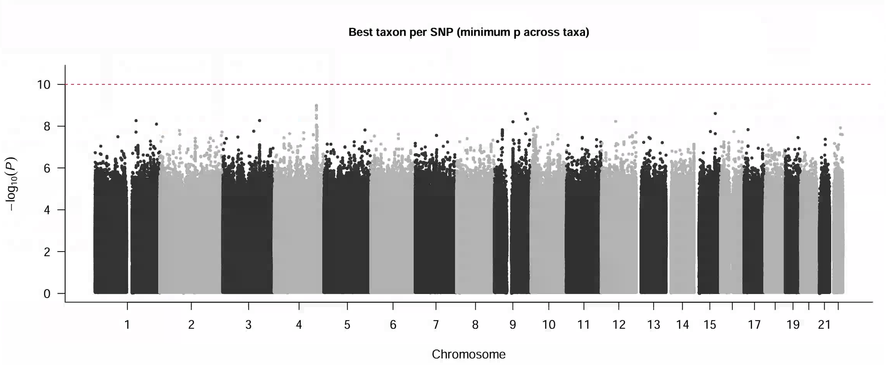
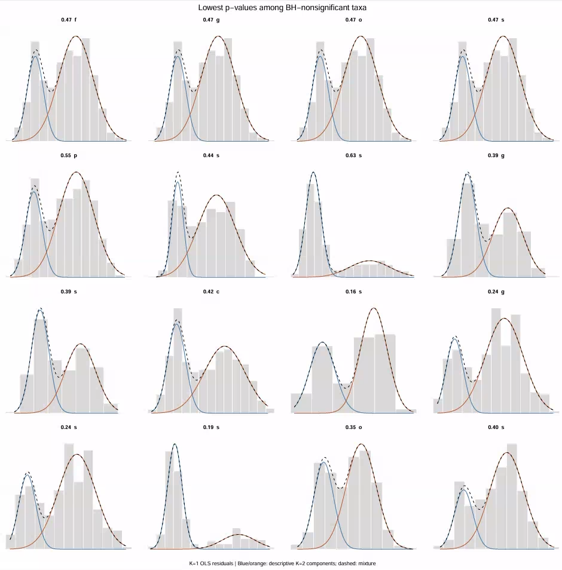
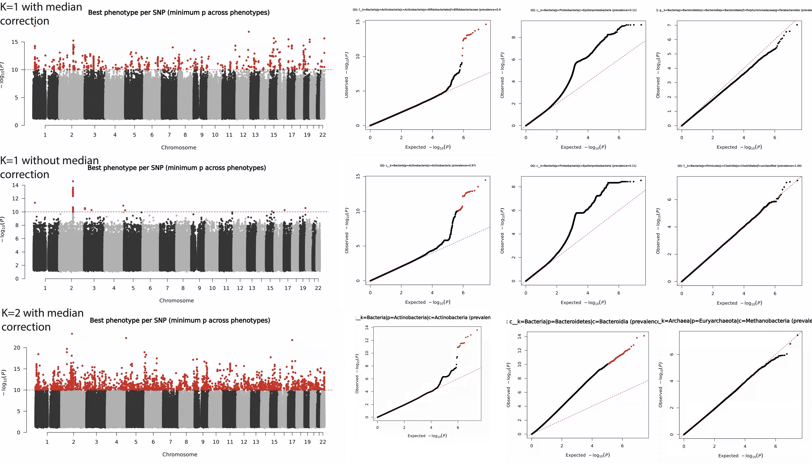
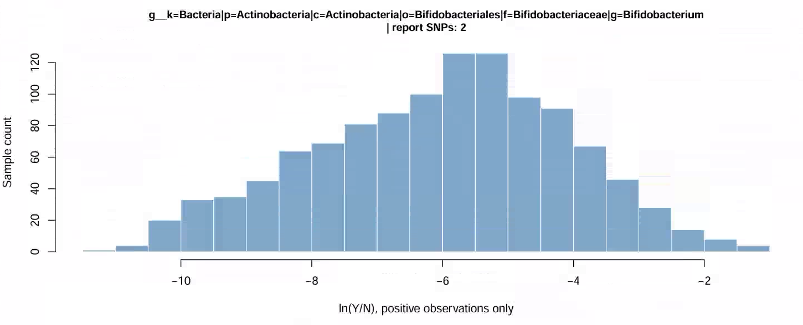
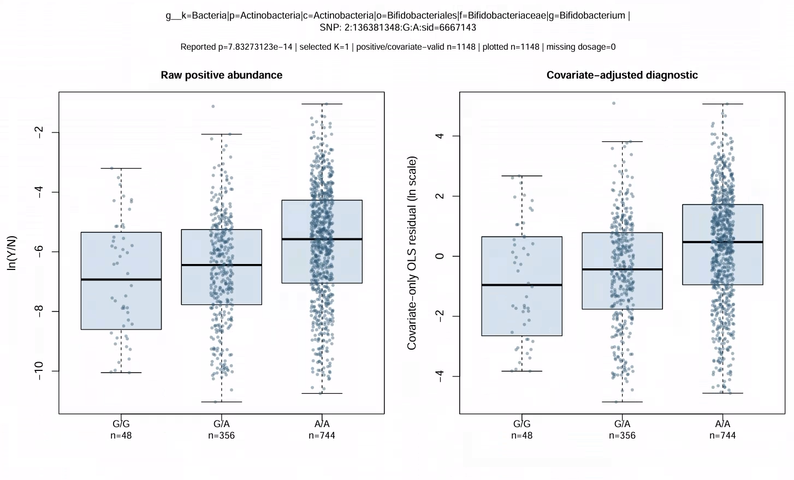

## 10/27 (Bimodal)

## 1. Review

- Last week we roughly examined the GOLD data. In summary, the microbiome part of the data does not quite match the paper (occasionally a few more samples or a few fewer samples). For the genomic part, the ID is off by one sample, and when we finally merged by ID, several more individuals were still mismatched. (One thing we missed last week: many SNPs have duplicated chromosome and position; our current approach is to keep them together but assign a different sid later.)
- We took a brief look at the structure of the microbiome data and found that some bimodal data are present.
- Through the SAIGE call, we roughly checked that the qqplot was not affected by sample zeros.
- Through a simple local test, the bimodal approach can solve the miscalibration problem in the qqplot.

## 2. Clarification

### 2.1. How does mbGWASTool manage to generate high-quality QQ plots?

Let us first look at how mbGWASTool actually works.

First, we assume the microbiome sequencing abundance is $Y_i$, which is a vector, where each component represents how much abundance of that taxon was detected in this sample.

Define a distance
$$
d_{ij}=d(Y_i,Y_j).
$$

The distance can take various forms. For example, the unweighted UniFrac distance is
$$
\boxed{
d_{\mathrm{UU}}(A,B)
=
\frac{\text{sum of branch lengths present in only one of the two samples}}
{\text{sum of branch lengths present in at least one sample}}
}
$$
The Bray–Curtis distance is
$$
d_{ij}
=
\frac{\sum_t|Y_{it}-Y_{jt}|}
{\sum_t(Y_{it}+Y_{jt})}.
$$

Similarly, we can define a distance between the genotypes of two samples:
$$
G_{ij}=|g_i-g_j|.
$$

The paper proposes the following working model:
$$
d_{ij}=\alpha+\beta_M G_{ij}+\varepsilon_{ij}.
$$
The goal is to test
$$
H_0:\beta_M=0,
\qquad
H_1:\beta_M>0.
$$

After centering the distances,
$$
\bar d=\frac{1}{\binom N2}\sum_{i<j}d_{ij},
\qquad
d'_{ij}=d_{ij}-\bar d.
$$

The score statistic is
$$
\boxed{
S_M=\sum_{i<j}d'_{ij}G_{ij}
}
$$
The remaining core step is to compute the variance, but here the viewpoint changes.

Under the more conventional view, the genotypes are fixed and the sequencing results fluctuate, thereby producing variance. However, when we construct QQ plots, essentially the sequencing results are held fixed and the genotypes are sampled extensively.

The paper's view is to assume that the sequencing results are fixed and the genotypes fluctuate; accordingly, the final variance computation is
$$
\operatorname{Var}_0(S_M\mid D)
=
\sum_{i<j}\sum_{k<l}
d'_{ij}d'_{kl}
\operatorname{Cov}_0(G_{ij},G_{kl}).
$$

The final test statistic is
$$
Z_M=
\frac{S_M}
{\sqrt{\operatorname{Var}_0(S_M\mid D)}}\sim N(0,1).
$$

When Hardy–Weinberg equilibrium holds and the samples are independent, the genotypes follow the assumed distribution. This means we know the distribution of the genotypes, and because this distribution is supported on integers, it is sufficiently precise, so it is feasible to compute the third and fourth moments in a saddlepoint-approximation-like manner.

For dosage data, however, this method fails.

In particular, KRV works in a similar way. It also first computes a distance matrix of the microbiome between samples and a distance matrix of genotype SNPs.

However, KRV computes the statistic
$$
\mathrm{KRV}=\frac{T}{\|A\|_F\|B\|_F}.
$$

Then it computes the first three moments of the statistic (by permuting the correspondence between the microbiome and the genome), finds a distribution that has these three moments (the Pearson type III distribution), and treats that distribution as the distribution of the statistic.

### 2.2. How does the KRV method go from a community-level effect to the taxon responsible for the effect?

In fact, the paper uses a heuristic approach. Specifically, if a SNP is judged to be associated with the microbiome, then it directly takes the kernel for which an effect was found, performs principal component analysis, takes the top 10 principal components, and fits a simple regression for each one, identifying the PCs that pass BH correction with <0.05. It then directly determines which taxon has a correlation greater than 0.5 with that PC.

In the paper, through gene aggregation, four genes were found to be associated, but two of these gene regions overlap, so in effect three gene regions are associated. Among these three associated gene regions, one kernel is abundance-related and two are prevalence-related. Moreover, the abundance-related one is almost at the threshold (the threshold is 2.6e-6; the two abundance-related genes in the paper are 1.1e-6 and 2.4e-6), while the prevalence-related ones are more significant (6.5e-8 and 2.5e-9).

The paper also performed single-taxon–single-SNP tests: for taxa with prevalence greater than 90%, it used the RINT-transformed abundance test; for those with prevalence between 10% and 90%, it used the prevalence test. It found two completely different significant loci, one abundance-related and one prevalence-related. The prevalence one also sits near the threshold (89 taxa, corresponding threshold 5.6e-10; the detected one is 2.2e-10, and the corresponding SNP has no associated gene), while the abundance one is more significant (4.2e-17).

## 3. SAIGE Results

Because sequencing depth does vary somewhat, we still adjust for logN, then exclude taxa with prevalence below 0.05 or above 0.95, and use the standard SAIGE for fitting. Covariates include 5 PCs and logN; the pval threshold is set at 1e-10.

## 4. Bimodal Method & Discovery

### 4.1. Bimodal

Our model is:
$$
\boxed{
y_i=X_i^\top a+\beta G_i+\epsilon_i,
\qquad
\epsilon_i\sim
\pi_1N(\mu_1,\sigma_1^2)
+\pi_2N(\mu_2,\sigma_2^2).
}
$$

E step:
$$
\boxed{
\tau_{ik}^{(t)}
=
P(C_i=k\mid Z_i,X_i,\theta^{(t)})
=
\frac{
\pi_k^{(t)}
\phi\!\left(
Z_i;X_i^\top\alpha^{(t)}+\mu_k^{(t)},
(\sigma_k^2)^{(t)}
\right)
}{
\sum_{h=1}^2
\pi_h^{(t)}
\phi\!\left(
Z_i;X_i^\top\alpha^{(t)}+\mu_h^{(t)},
(\sigma_h^2)^{(t)}
\right)
}.
}
$$
M step:
$$
Q(\theta\mid\theta^{(t)})
=
\sum_{i,k}\tau_{ik}^{(t)}
\left[
\log\pi_k
-\frac12\log\sigma_k^2
-\frac{
(Z_i-X_i^\top\alpha-\mu_k)^2
}{2\sigma_k^2}
\right]
+\mathrm{const}.
$$

The final per-sample score is:
$$
\boxed{
s_i=
\sum_k\tau_{ik}
\frac{y_i-X_i^\top a-\mu_k}{\sigma_k^2}.
}
$$
The overall score is:
$$
U_\beta=\sum_iG_i s_i.
$$

After profiling out $\alpha$, the score is:
$$
\widetilde U_\beta=\sum_i\widetilde G_i s_i.
$$
It satisfies:
$$
\boxed{
\sum_i\widetilde G_i=0,
\qquad
X^\top\widetilde G=0.
}
$$

For $\eta_j$ coming from $\epsilon$, the per-sample score is
$$
h_j(\epsilon_i)
=
\frac{\partial\log f_\eta(\epsilon_i)}{\partial\eta_j}.
$$
The overall score is
$$
U_{\eta_j}=\sum_i h_j(\epsilon_i).
$$

Then
$$
\begin{aligned}
\operatorname{Cov}(\widetilde U_\beta,U_{\eta_j})
&=
\sum_i\widetilde G_i
E[s(\epsilon_i)h_j(\epsilon_i)]\\
&=
c_j\sum_i\widetilde G_i\\
&=0.
\end{aligned}
$$

Therefore, the parameters related to $\epsilon$ require no correction.

### 4.2. Real Data Results

We can first directly look at some basic distributions. I selected some taxa that failed the unimodality test; the distributions are shown below:

Next, let's look at the results under the abundance test: for the unimodal model, the unimodal model without median correction, and the bimodal model.

We can also take a special look at the effect SNP discovered by RINT. It happens to be a completely unimodal SNP, so its qqplot is very good, and it should indeed have a real effect.

## 5. Future
