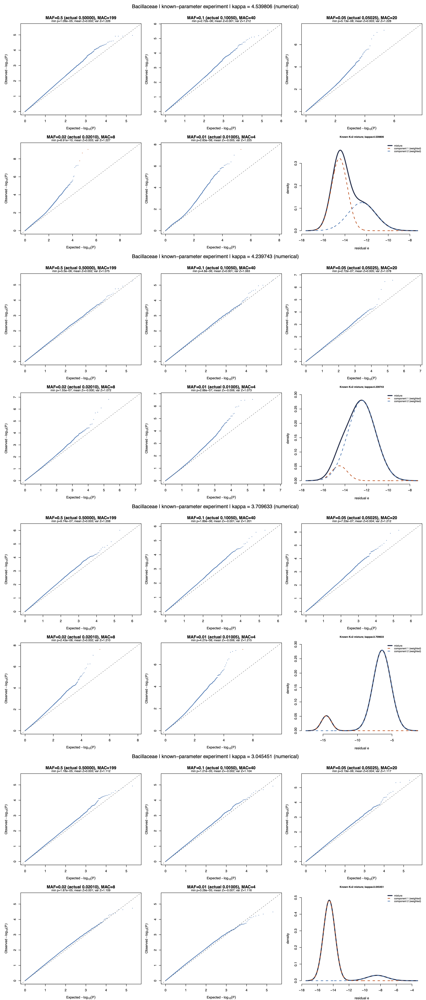
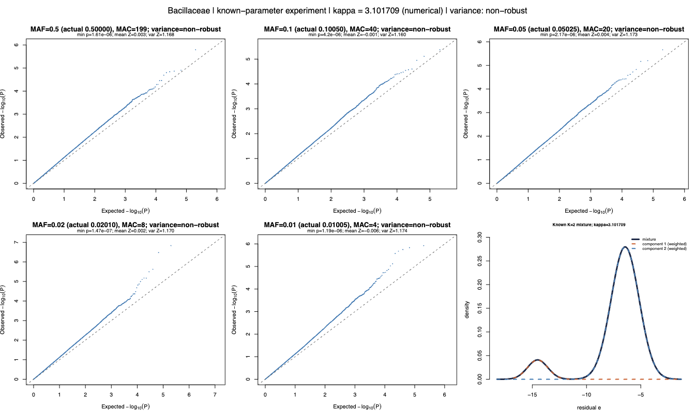
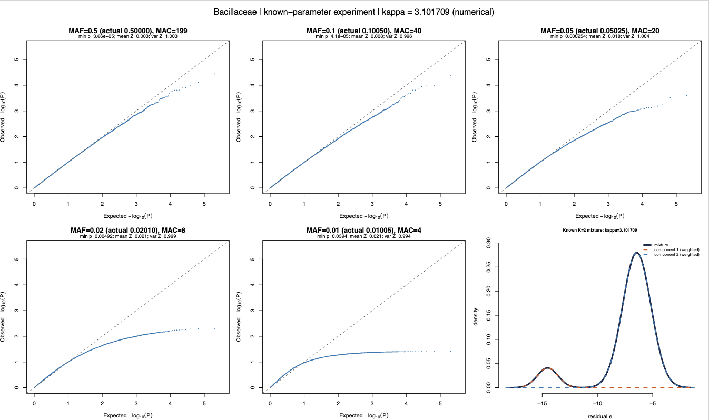

## 10/30 (Bimodal Results)

## 1. Review

- In our last meeting, we discussed the methods in the microbiomeGWASTool and KRV papers. Their qq-plot corrections rely, respectively, on strong assumptions about genome-wide SNPs and on computing the first four moments; however, I later found that such moment-based correction methods can fail in the tail below 1e-6. This is why the SAIGE-related papers adopt the SPA approach, which does not fail in the tail.
- We also discussed the bimodal structure that may appear in the data. Real data contain many bimodal structures. For such data, if one only applies a log transformation, the resulting qq-plot will be miscalibrated.
- Using the standard SAIGE package, we did not find any signal, indicating that the prevalence component has no signal at all.
- However, the bimodality test has not yet achieved good results on real data. The past half-week has mainly been spent on handling the bimodality test.

## 2. How should we understand the qq-plot degradation problem when bimodality is present?

Let us first examine the standard score

$$
U=\sum_{i=1}^n \tilde g_i\,s_i,\qquad \operatorname{Var}(s_i)=J.
$$

The final statistic is constructed as

$$
Z=\frac{U}{\sqrt{J\sum_i\tilde g_i^2}}.
$$

We expect $Z\sim N(0,1)$. This requires the Lyapunov condition of the central limit theorem to hold, specifically:

$$
\frac{\sum_i \mathbb{E}\left[(\tilde g_i s_i)^4\right]}{\left(\sum_i \operatorname{Var}(\tilde g_i s_i)\right)^2}\longrightarrow 0.
$$

Substituting $\operatorname{Var}(\tilde g_i s_i)=\tilde g_i^2 J$, and defining

$$
\kappa:=\frac{\mathbb{E}_f[s^4]}{J^2},
\qquad
n_{\rm eff}:=\frac{\left(\sum_i\tilde g_i^2\right)^2}{\sum_i\tilde g_i^4},
$$

we ultimately need

$$
\frac{\kappa}{n_{\rm eff}}\longrightarrow 0.
$$

In other words, even if the data fully satisfy the model assumptions, for the statistic to have a normal distribution we need $\kappa$ to be as small as possible. For a standard normal score, $\kappa=3$; for a bimodal distribution this must be computed explicitly.

In practice, I estimate that we roughly need to keep $\kappa<3.8$, in which case the qq-plot miscalibration will not be too severe.

Robust variance can improve the qq-plot for large MAF to some extent, but it may have a very large impact on the qq-plot for small MAF.

## 3. Results on real data

We can look separately at the results from the new bimodal fitting. To avoid irrelevant interference, we temporarily turn off the median correction.

In fact, the issues can all be identified by simulating 100,000 SNPs, so for all taxa we directly compute the qq-plot based on the simulated SNPs (without adding robust variance).

Then we can look at how the results change after adding robust variance. (Because I accidentally ran the robust-variance script in an overwriting manner on top of the results without robust variance earlier, for now we can only examine the results under robust variance.)

As for PALM and the microbiomeGWAS Tool, the results are still running.

## 4. Future
- get different dip plot
- different bimodal method
