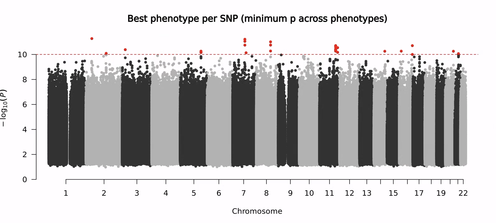
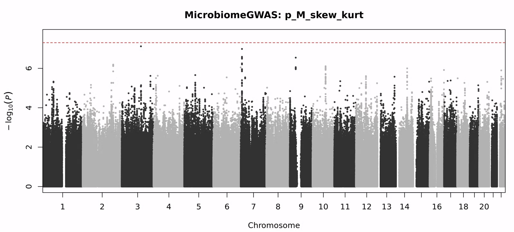
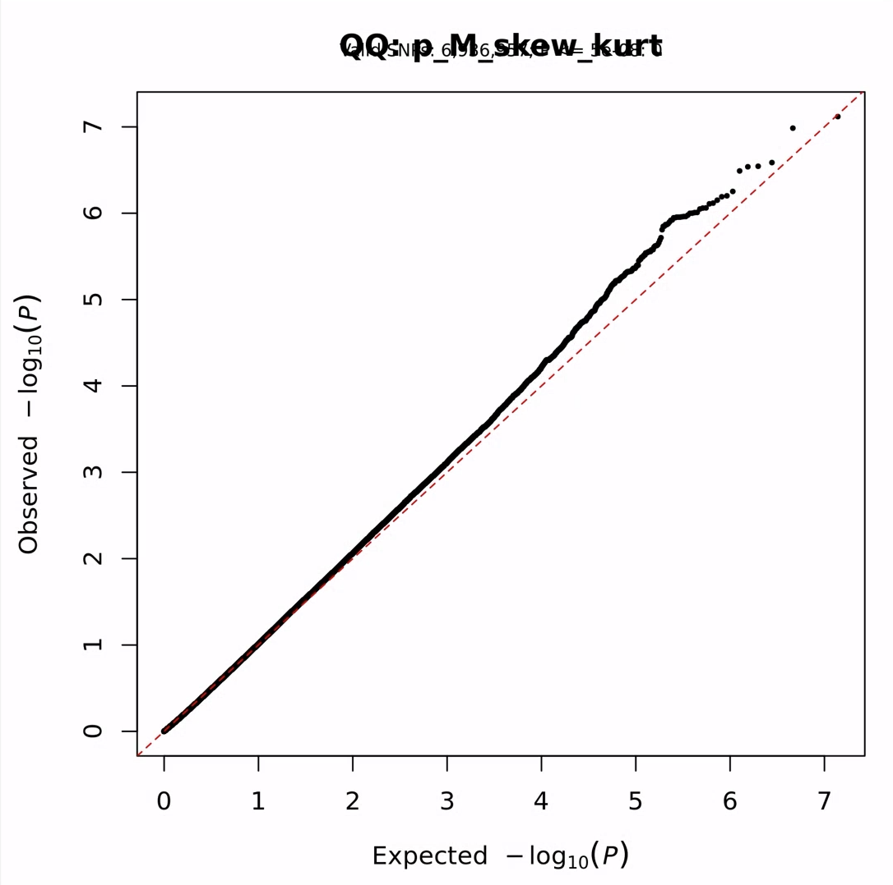
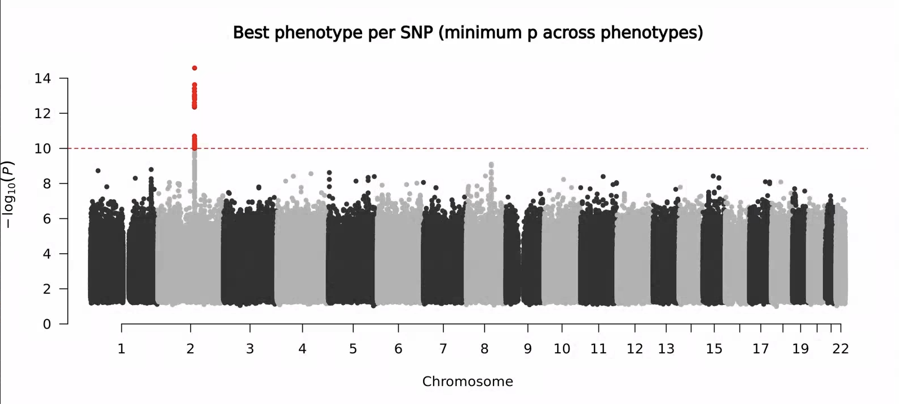
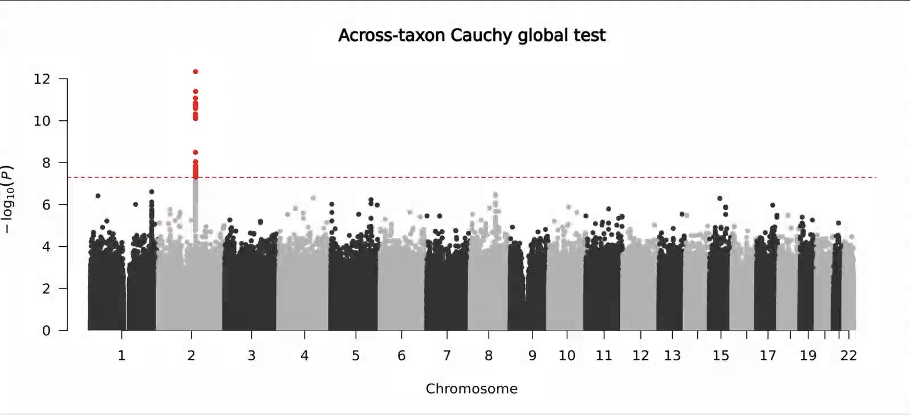

## 11/03 (Q-Q plot of Bimodal)

## 1. Review

- Last week, we mainly proposed kappa as an indicator for judging whether the score calculated from a bimodal distribution conforms to normality. By constraining kappa < 3.8, we successfully corrected almost all the QQ plots.
- This week, we continue exploring bimodality.

## 2. Other Method Results

### 2.1. PALM

### 2.2. MicrobiomeGWASTool

### 2.3. RINT

### 2.4. Cauchy

## 3. The significance of bimodality

## 4. Future
- permutation
