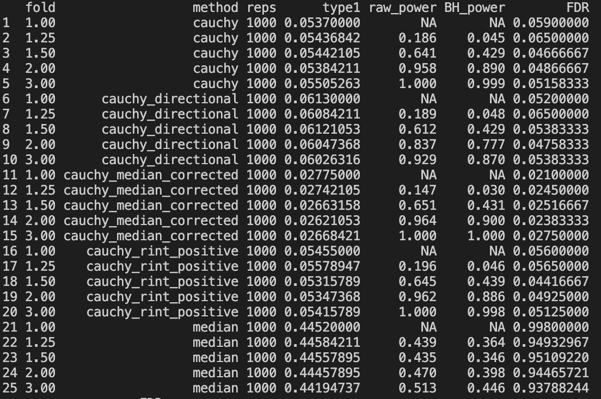

## 11/10 (Community-Level)

## 1. Review

Last week, we looked at the results from two methods without median correction: PALM and the microbiomeGWAS Tool. As we can see:

- PALM shows systematic inflation while also failing to detect the locus with the ultra-high effect.
- The microbiomeGWAS Tool produces a very good Q-Q plot with no systematic inflation, but it also fails to detect the locus with the ultra-high effect.

Meanwhile, we examined under what conditions the bimodal test outperforms the unimodal test. We found that:

- For most taxa, the unimodal test is already sufficient.
- Only when the MAC is sufficiently low in positive samples (below 20), and the data show one wide peak and one narrow peak with the narrow peak being dominant, does the unimodal test begin to fail and the bimodal test better maintain the Q-Q plot.

This week, the main focus is on thinking about how to enhance the power of community-level testing.

## 2. Exploration

If we assume that the absolute abundances $A_{ij}$ are fully known, how do we test for community-level effects?

Since, in all likelihood, the effect affects only a few taxa, we simplify the problem by assuming that it affects only a single taxon. We further assume only the positive part, that is, prevalence is all 1, and that everything strictly follows the log-normal assumption.

Then the best test for a single taxon is essentially regression. The question is: if we are testing for a community-level effect, what is the best effect?

If we assume that all taxa are independent, then the best test is to take the squared maximum of the per-taxon statistics. This matches our intuition and is also guaranteed by the corresponding mathematical theory.

If taxa are not independent and have some correlation, and we do not perform permutation, then I think there are not many tests left to choose from. The only ones I can think of are basically the following three types:
- Cauchy's ACAT test for combining p-values
- A maximum test based on an estimated correlation matrix
- An overall single-statistic test, such as multiple testing

Now we return to testing based on relative abundances. We still assume that only one taxon carries the effect. Compared with testing on absolute abundances, the extra information we can exploit is the compositional effect, which means that if one taxon produces a strong positive effect, then the other taxa produce the same weak negative effect. Therefore, what we can do essentially consists only of:
- Testing the strong positive effect
- Testing the weak negative effect
- Combining the strong positive effect and the weak negative effect

Whichever of the above methods we use, as long as we make a choice — that is, instead of producing the final statistic in one step, we choose which taxon has the strong positive effect and which taxa have the weak negative effect — then, if the final statistics are to be combined, the only available tools are the maximum and ACAT.

Thus, the tests that are relatively easy to implement and potentially effective are basically the following:
- Testing each taxon individually and combining the overall p-value using Cauchy
- Separately testing whether the median deviates from zero
- Applying median correction to each taxon and then combining the overall p-value using Cauchy
- Computing a community-corrected statistic for each taxon and then combining the p-values using Cauchy

The community correction can be computed as follows. Suppose we have:
$$
A_{ij}=\exp(\eta_{ij}+G_i\beta_j).
$$
Define
$$
L_{ij}=\frac{A_{ij}}{\sum_{\ell=1}^{K}A_{i\ell}}=\mathbb{E}\left(\frac{Y_{ij}}{N_i}\right).
$$
Then we have:
$$
\log L_{ij}
=
\eta_{ij}+G_i\beta_j
-
\log\left\{\sum_{\ell=1}^{K}
\exp(\eta_{i\ell}+G_i\beta_\ell)\right\}.
$$
$$
\begin{aligned}
\frac{\partial\log L_{ij}}{\partial G_i}
&=
\beta_j-
\frac{\sum_\ell \beta_\ell
\exp(\eta_{i\ell}+G_i\beta_\ell)}
{\sum_\ell\exp(\eta_{i\ell}+G_i\beta_\ell)}
\\
&=
\boxed{
\beta_j-\sum_{\ell=1}^{K}L_{i\ell}\beta_\ell.
}
\end{aligned}
$$
Let $q_\ell=\mathbb{E}(L_{i\ell})$, meaning that, on average across all individuals, this taxon's proportion is fixed. Then it can be approximated as:
$$
\theta_j\approx\beta_j-\sum_\ell q_\ell\beta_\ell.
$$
$$
\log(Y_{ij}/N_i)=\tilde{\eta}_{ij}+G_i\theta_j
$$

In real data, we can estimate the following:
$$
\hat q_\ell=\frac1n\sum_{i=1}^{n}\frac{Y_{i\ell}}{N_i}.
$$
Assume that only the $k$-th taxon is the effect taxon, that is,
$$
\beta_k=b,\qquad \beta_j=0\quad(j\ne k).
$$
Then we have:
$$
\theta_k\approx(1-q_k)b,
\qquad
\theta_j\approx-q_kb\quad(j\ne k).
$$

This naturally leads to the statistic:
$$
\boxed{
T_k=
\frac{(1-q_k)\hat\theta_k}{s_k^2}
-
q_k\sum_{j\ne k}\frac{\hat\theta_j}{s_j^2}
}
$$

However, in the simulation, we found that even if the original taxa have no correlation at all, the final variance cannot be obtained by simply adding up the variances of the individual taxa — the correlation must be taken into account; otherwise, the type I error will blow up.

Therefore, we can adopt a robust variance, that is, exploiting the fact that each score can be represented as the sum of per-sample scores.

These methods do not look good in the results so far. They have not yet been tested on real data, but the simulation results are as follows.

The maximum-based test is still under exploration. I found a paper called ASSET, but the details are still being worked out.

## 3. Future

- simulation of binomial test under cheeting way
