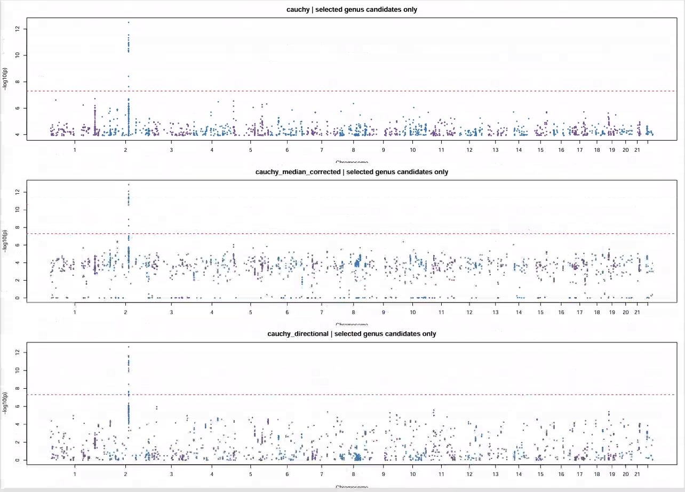
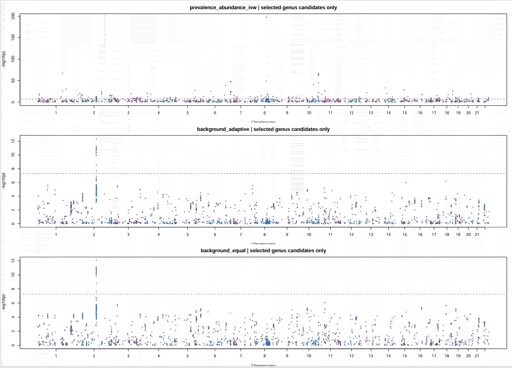
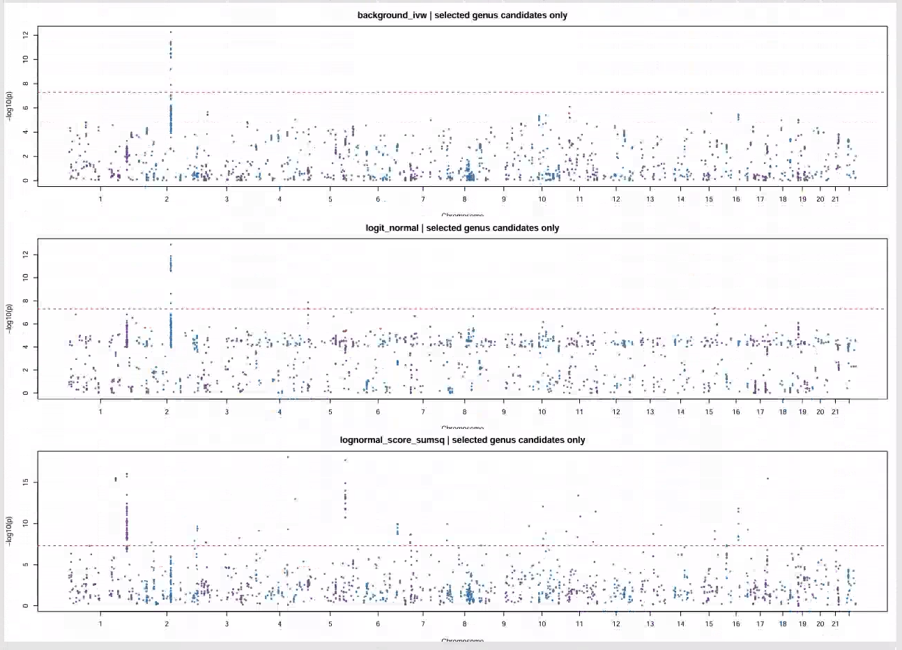
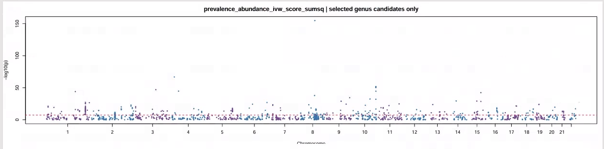

## 11/13 (Binomial Test)

## 1. Review

Last week I mainly tried to think about how to improve test power under the community-level test. This half-week I mainly looked at what would be a better approach from the binomial test perspective.

Supplement: ASSET originally can handle only about 10 phenotypes in a genome-wide setting, but ASSET fast can support up to 116. The reason is that, for example, we can select only phenotypes with p-value below 0.05 for ASSET. In this way, after screening 100 phenotypes, on average only 5 remain. We only need to correct the p-value by dividing it by 0.05 after the final calculation completes the phenotypes' p-values. However, this method is currently only a possible direction and is not necessarily effective.

## 2. Binomial Test under Cheeting Way

Let's construct the simplest case to examine the power of the Binomial Test.

We assume that the true AA data fully follows the log-normal assumption, and all samples are present; that is, all AA data are greater than zero. We then set a uniform sample size of 1000, a species count of 100, sequencing depth of 10000, equal case-control proportions, with the effect applied only to the first taxon, and we test only on the first taxon.

Thus, the model fully satisfies the assumptions as follows:

$$
\boxed{
\begin{aligned}
Y_i\mid u_i,g_i,D_i
&\sim \operatorname{Binomial}(D_i,p_i),\\
\operatorname{logit}(p_i)
&=\alpha+b g_i+u_i,\\
u_i&\overset{\mathrm{iid}}{\sim}N(0,\tau^2),
\qquad u_i\perp G_i.
\end{aligned}
}
$$

We can directly perform the test on this model, i.e., on the marginal likelihood, which requires numerical integration and model fitting. Due to some issues with the algorithm, we have not yet resolved fitting successfully for all cases, but we can still examine the test performance.

For a fairer comparison, we add the following tests:

1. Zero-truncated Binomial-lognormal, since this can rule out the influence of the zero effect.
2. The logit-normal test, i.e.,
$$
\log\frac{Y_{i1}}{D_i-Y_{i1}}
=\alpha+bG_i+\epsilon_i.
$$
This is used to compare the difference between the logit and log transformations; note that it is also computed only on the positive part.
3. background_equal, background_ivw, background_adaptive. These three methods follow the same logic as the original direction method: subtract the effects of other taxa from the effect computed from the current taxon, using robust variances to avoid correlation issues. The model is as follows:
$$P_{ij}=A_{ij}/T_i$$
$$
R_i=
\log P_{i1}
-
\sum_{j\ne1}w_j\log P_{ij},
\qquad
\sum_{j\ne1}w_j=1.
$$
The difference among these three methods lies in how the weights are chosen: equal weights, inverse-variance weights, and weights that optimize the covariance identity, respectively.
$$
\operatorname{Var}\left(
\epsilon_{i1}-\sum_{j\ne1}w_j\epsilon_{ij}
\right)
=
\Sigma_{11}
-2w^\top\Sigma_{-1,1}
+w^\top\Sigma_{-1,-1}w,
$$
4. prevalence_abundance_ivw: we fit a lognormal separately on the positive part and separately on the zero part, and finally combine them with an inverse-variance weighted statistic (ignoring the SPA effect):
$$
\hat B_j=
\frac{\hat b_{a,j}/s_{a,j}^2+\hat b_{p,j}/s_{p,j}^2}
{1/s_{a,j}^2+1/s_{p,j}^2}.
$$
5. The hurdle model jointly models the zero and positive parts, and finally uses a chi-square with 2 degrees of freedom for the distribution.

The final comparison results are as follows:

## 3. Real Data Result

## 4. Future
- ASSET
- PALM->Bino->pval
- prevalence-abundance spa
