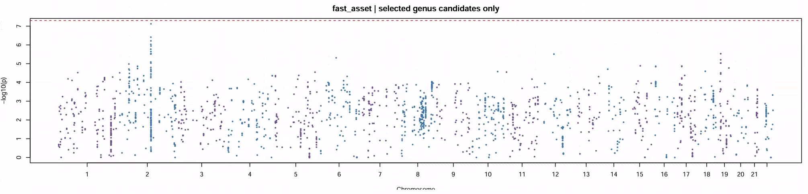
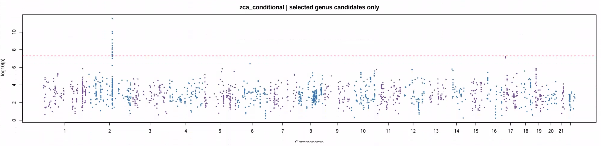
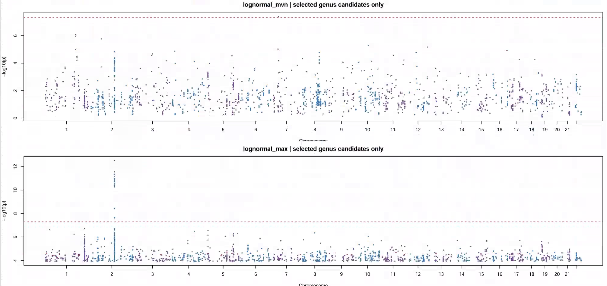
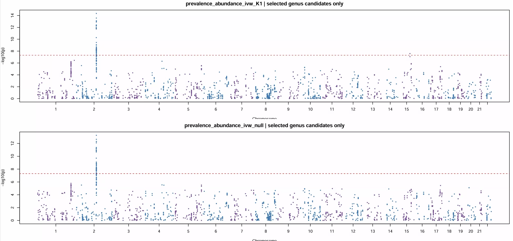
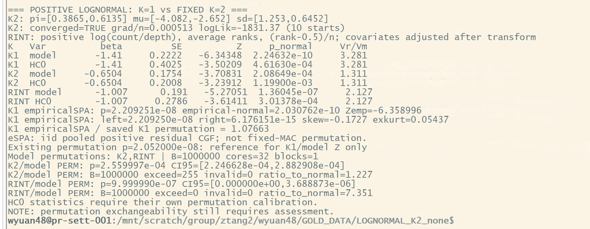

## 11/17 (ASSET)

## 1. Review

## 2. ASSET

For simplicity, we restrict our model to be lognormal and consider only the abundance component.

### 2.1. Standard ASSET

Suppose we have $n$ samples and $K$ phenotypes, and fit a simple Gaussian regression:
$$
\boxed{
Y_{ik}=\mathbf X_i^\top\boldsymbol\alpha_k+\beta_kG_i+\varepsilon_{ik},
\qquad k=1,\ldots,K.
}
$$
From this we obtain the associated statistics
$$
Z_k=\frac{\widehat\beta_k}{\operatorname{SE}(\widehat\beta_k)},
\qquad
\mathbf Z=(Z_1,\ldots,Z_K)^\top.
$$
Under the null hypothesis, the statistics are assumed to satisfy
$$
\boxed{\mathbf Z\overset{\cdot}{\sim}N_K(\mathbf0,\mathbf R).}
$$
We define a new statistic. For any nonempty subset $S\subseteq\{1,\ldots,K\}$ and pre-specified weights $w_k>0$, the statistic is given by
$$
\boxed{
Z(S)=\mathbf a_S^\top\mathbf Z=
\frac{\displaystyle\sum_{k\in S}w_k Z_k}
{\displaystyle\sqrt{
\sum_{j\in S}\sum_{k\in S}w_jw_kR_{jk}
}}\sim N(0, 1).
}
$$
Note that we require the statistic to be standard normal, which imposes a condition on the weights—namely, they must satisfy $$a_S^\top\mathbf R\mathbf a_S=1$$

We then define the overall statistic
$$
\boxed{
T_{\mathrm{same}}
=\max_{S\ne\varnothing}|Z(S)|,
\qquad
\widehat S=\arg\max_{S\ne\varnothing}|Z(S)|.
}
$$
The p-value is finally computed as
$$
\boxed{
p_{\mathrm{same}}
=
P_{\mathbf Z^{(0)}\sim N(\mathbf0,\mathbf R)}
\left\{
\max_{S\ne\varnothing}|Z^{(0)}(S)|
\ge T_{\mathrm{same,obs}}
\right\}.
}
$$
For each subset we define its neighbors
$$
\mathcal N(S)=
\{S\triangle\{k\}:k=1,\ldots,K\}
\setminus\{\varnothing\}.
$$
If $|Z(S)|$ is larger than all of its neighbors, we call it a local maximum. The global maximum is necessarily also a local maximum.

We have
$$\begin{aligned}
p_{\mathrm{same}}&=P_0\Bigl(\max_S |Z(S)|\ge t\Bigr)\\[4pt]
&\le P\Bigl(\exists S:\ |Z(S)|\ge t,\ |Z(T)|<|Z(S)|,\ \forall T\in\mathcal N(S)\Bigr)\\[4pt]
&\le\sum_{S\ne\varnothing}P\Bigl(|Z(S)|\ge t,\ |Z(T)|<|Z(S)|,\ \forall T\in\mathcal N(S)\Bigr)\\[4pt]
&=2\sum_{S\ne\varnothing}\int_t^{\infty}\phi(z)\,P\Bigl(|Z(T)|<z,\ \forall T\in\mathcal N(S)\mid Z(S)=z\Bigr)\,dz\\[4pt]
&=p_{\mathrm{DLM}}(t).
\end{aligned}$$
We can compute the covariance relation $$\mathrm{Cov}\bigl(Z(S),Z(T)\bigr)=\mathbf a_S^\top \mathbf R \mathbf a_T=r_{ST}$$, which implies
$$
Z(T)\mid Z(S)=z
\sim N(r_{ST}z,\ 1-r_{ST}^2).
$$
The conditional probability for a single neighbor can be computed as
$$
\boxed{
h_{ST}(z)=P\Bigl(|Z(T)|<z,\ \forall T\in\mathcal N(S)\mid Z(S)=z\Bigr)=
\Phi\!\left(\frac{z-r_{ST}z}{\sqrt{1-r_{ST}^2}}\right)
-
\Phi\!\left(\frac{-z-r_{ST}z}{\sqrt{1-r_{ST}^2}}\right).
}
$$
Finally, we can compute
$$
\boxed{
p_{\mathrm{same}}
\approx
2\sum_{S\ne\varnothing}
\int_t^\infty
\phi(z)
\prod_{T\in\mathcal N(S)}h_{ST}(z)\,dz
=2q\sum_{S\ne\varnothing}
\int_0^1
H_S\!\left(\overline\Phi^{-1}(qv)\right)\,dv.
}
$$
where
$$
H_S(z)=\prod_{T\in\mathcal N(S)}h_{ST}(z),
\qquad
q=\overline\Phi(t)=1-\Phi(t).
$$

### 2.2. Fast ASSET

The procedure is as follows:
$$
\boxed{
\begin{gathered}
\mathbf Z
\;\xrightarrow{\text{decorrelate}}\;
\mathbf W=\mathbf L^{-1}\mathbf Z
\\[5pt]
\xrightarrow{\text{convert to two-sided }p\text{-values}}\;
p_k=2\{1-\Phi(|W_k|)\}
\\[5pt]
\xrightarrow{\text{screen}}\;
A=\{k:p_k\le0.05\}
\\[5pt]
\xrightarrow{\text{adjust screened}}\;
\widetilde p_k=\frac{p_k}{0.05},
\qquad k\in A
\\[5pt]
\xrightarrow{\text{restore signed normal statistics}}\;
V_k=
\begin{cases}
\operatorname{sign}(W_k)
\Phi^{-1}\!\left(1-\dfrac{\widetilde p_k}{2}\right),
& k\in A,\\
0,&k\notin A
\end{cases}
\\[5pt]
\xrightarrow{\text{reintroduce correlation}}\;
\mathbf Z_{\mathrm{adj}}=\mathbf L\mathbf V
\\[5pt]
\xrightarrow{\text{keep coordinates in set }A}\;
(\mathbf Z_{\mathrm{adj}})_A
\;\longrightarrow\;
\mathrm{ASSET}
\;\longrightarrow\;
p_{\mathrm{final}}.
\end{gathered}
}
$$
The proof of the adjustment is as follows. Suppose we have $P_k\sim U(0,1)$, and define $Q_k=\frac{P_k}{\tau}$, where $\tau$ is the screening threshold. Then for any $u$,
$$
\begin{aligned}
P(Q_k\le u\mid P_k<\tau)
&=
\frac{P(P_k\le\tau u)}{P(P_k<\tau)}\\
&=\frac{\tau u}{\tau}\\
&=u.
\end{aligned}
$$
That is,
$$
\boxed{Q_k\mid\{P_k<\tau\}\sim U(0,1).}
$$
Consequently,
$$
\boxed{V_k\mid\{P_k<\tau\}\sim N(0,1).}
$$

### 2.3. ZCA Modification

Because the Cholesky transformation in the original paper depends on the ordering of the taxa, we adopt a more symmetric transformation:
$$
\mathbf W=\mathbf R^{-1/2}\mathbf Z,
\qquad
\mathbf Z_{\mathrm{adj}}=\mathbf R^{1/2}\mathbf V.
$$
Let $\mathbf B=\mathbf R^{1/2}$. If the final screened set is $A$, then the statistic is actually $(\mathbf Z_{\mathrm{adj}})_A=\mathbf B_{AA}\mathbf V_A$, and the covariance passed to ASSET is
$$\boxed{
\mathbf C_A
=\mathbf B_{AA}\mathbf B_{AA}^{\top}.
}$$
### 2.4. Covariance Matrix Computation

We set
$$
\boxed{
\mathbf e_i\sim N_K(\boldsymbol\mu,\boldsymbol\Sigma_e).
}
$$
The log-likelihood is
$$\log f(\mathbf{e}_i) = -\frac{1}{2}\log|\boldsymbol{\Sigma}| - \frac{1}{2}(\mathbf{e}_i - \boldsymbol{\mu})^\top \boldsymbol{\Sigma}^{-1}(\mathbf{e}_i - \boldsymbol{\mu})$$
but since the data contain missing values, we adopt the EM algorithm.

The E step requires computing:
$$Q(\theta \mid \theta^{(t)}) = \sum_i E_{\mathbf{e}_{i,M} \mid \mathbf{e}_{i,O},\, \theta^{(t)}}\big[\log f(\mathbf{e}_i; \theta)\big]$$
By normality, we have
$$\mathbf{e}_{i,M} \mid \mathbf{e}_{i,O} \sim N(\mathbf{m}_{i,M},\ \mathbf{C}_{i,MM})$$
$$\mathbf{m}_{i,M} = \boldsymbol{\mu}_M + \boldsymbol{\Sigma}_{MO}\boldsymbol{\Sigma}_{OO}^{-1}(\mathbf{e}_{i,O} - \boldsymbol{\mu}_O)$$
$$\mathbf{C}_{i,MM} = \boldsymbol{\Sigma}_{MM} - \boldsymbol{\Sigma}_{MO}\boldsymbol{\Sigma}_{OO}^{-1}\boldsymbol{\Sigma}_{OM}$$
$$E(\mathbf{e}_i \mid \mathbf{e}_{i,O}) = \mathbf{m}_i$$
$$E(\mathbf{e}_i\mathbf{e}_i^\top \mid \mathbf{e}_{i,O}) = \mathbf{m}_i\mathbf{m}_i^\top + \mathbf{C}_i$$

The M step requires maximizing the Q function, from which we obtain
$$\boldsymbol{\mu}^{\text{new}} = \frac{1}{n_*}\sum_i \mathbf{m}_i$$
$$\boldsymbol{\Sigma}^{\text{new}} = \frac{1}{n_*}\sum_i\Big(\mathbf{m}_i\mathbf{m}_i^\top + \mathbf{C}_i\Big) - \boldsymbol{\mu}^{\text{new}}(\boldsymbol{\mu}^{\text{new}})^\top$$

### 2.5. Results Display

## 3. Maximum and Chi-Square

To keep things simple, we restrict our model to the lognormal distribution. We still compute the covariance following the approach described above, and then try both the maximum value and a direct multivariate normality test. The results are as follows.

## 4. Reconciling Prevalence and Abundance

### 4.1. SPA without Weighting

Last time we discussed that directly superimposing the effects computed separately from the zero part and the positive part yields a new statistic:
$$
\boxed{
\widehat\beta=\frac{U_p+U_a}{I_p+I_a},
\qquad
\operatorname{SE}=\frac1{\sqrt{I_p+I_a}}.
}
$$
Define $R_i=\mathbf1(Y_i>0),\qquad\pi_i=P(R_i=1\mid\mathbf X_i)$; we consider the single-sample contribution $T_i=g_{pi}(R_i-\pi_i)+R_i g_{ai}S_i$. Naturally, we can compute the CGF as follows:
$$
\boxed{
M_i(t)
=
(1-\pi_i)e^{-t g_{pi}\pi_i}
+
\pi_i e^{t g_{pi}(1-\pi_i)}
M_S(tg_{ai}),
}
$$
$$\boxed{K(t)=\sum_i\log M_i(t).}$$
For both the unimodal and bimodal cases, we can give the final CGF, except that the bimodal case requires numerical integration. For example, the unimodal result is:
$$
\boxed{
K(t)=
\sum_i\log\left[
(1-\pi_i)e^{-t g_{pi}\pi_i}
+
\pi_i
e^{t g_{pi}(1-\pi_i)+t^2g_{ai}^2J/2}
\right].
}
$$
We can see that the numerical results are as follows:

### 4.2. ZI-Poisson-IG

Since I've come to recognize that distributional precision is not that crucial, in order to jointly model the zero and positive parts, perhaps we can replace the lognormal with the Inverse-Gaussian, which would be more appropriate. However, this is still under exploration.

### 4.3. Exploratory Analysis of the Data Alone

## 5. Lognormal, Permutation and Empirical SPA

Above we showed a significant result under SPA, but is this result truly significant? I examined that specific taxon-SNP signal separately, directly performing permutations for comparison. Meanwhile, it suddenly occurred to me that although the distribution is not correct, one can still adopt the Empirical CGF for SPA correction, for which there is already a precedent in SPACox:
$$
K_U(t)=\sum_{i=1}^n
\log\left\{\frac1n\sum_{j=1}^n e^{ta_i r_j}\right\}.
$$
The problem is the high computational cost. One might adopt an interpolation approach similar to SPACox, i.e., precompute $K_r(s),K_r'(s),K_r''(s)$ on a grid $s_1,\ldots,s_L$ in advance, and then, when finding the root for each SNP, use interpolation to obtain $K_r(ta_i)$ and its derivatives, without needing to traverse all residuals again.

## 6. Future
