## 11/20 (Empirical SPA)

## 1. Review

In our last meeting, we roughly discussed possible ways of aggregating p-values across multiple taxa showing an effect to obtain a final p-value — namely ASSET and its fast version — but there didn't seem to be any new findings; the original loci with strong effects were actually somewhat weakened in significance.

We also explored other ways of aggregating taxon effects, such as directly taking the maximum or using chi-square. The former yielded no new findings, while the latter actually weakened the originally strong effect loci.

Since in the meeting before last, when we experimented with a cheating approach to examine potential power gains from the binomial test, we found that incorporating information from the zero-inflated portion might improve power to some extent, I roughly tried Poisson Inverse Gaussian. In the process, it occurred to me that we may not need to strictly require the data to obey model assumptions — we could simply use the empirical CGF to construct an empirical SPA and thereby compute p-values. We roughly compared these p-values against those from permutation and found them very close.

This week mainly continued from the Empirical SPA angle.

## 2. Empirical SPA

### 2.1. What is Empirical SPA

Let us begin with the simplest approach. Suppose the final score takes the form $S=\sum_i G_i r_i$.

If we assume that all the $r_i$ are independent and identically distributed, and the distribution of $r$ has cumulant generating function (CGF)
$$
k(s)=\log \mathbb{E}_{r}\left[e^{s r}\right],
$$
then the empirical CGF is
$$
\hat{k}(s)=\log\left(\frac{1}{n}\sum_{i=1}^{n} e^{s r_i}\right),
$$
and the empirical CGF of the overall score is
$$
\hat{K}(\theta)=\sum_{i=1}^{n} \hat{k}(\theta G_i)
=\sum_{i=1}^{n}\log\left(\frac{1}{n}\sum_{j=1}^{n} e^{\theta G_i r_j}\right).
$$

The saddlepoint approximation (SPA) then computes the needed quantities by differentiating this expression and solving for the root.

In the actual computation, two optimizations are important.

The first optimization arises because we need to evaluate $\hat{K}(\theta)$, $\hat{K}'(\theta)$, and $\hat{K}''(\theta)$ repeatedly. If we compute them directly from the expression above, each evaluation requires $O(n^2)$ additions. SPACox instead uses interpolation to approximate these functions, so that after the one-time interpolation setup, each evaluation costs only a constant amount of work; as a result, each call reduces to $O(n)$. 

One additional point: for some of the subsequent methods, although the score itself can still be written in the above form, $r_i$ is no longer a scalar but a vector, such as a three-dimensional vector, so the interpolation must also be performed in three-dimensional space.

The second optimization is a merging (aggregation) step. When there are no covariates, $G_i$ takes only finitely many values (without dosage, only 0/1/2). The summation can then be merged over these distinct values, further reducing each evaluation to $O(1)$.

### 2.2. Relation to Permutation

Permutation also relies on the assumption that the $r_i$ are i.i.d. Under this assumption, there are two kinds of permutation: the standard permutation, which directly shuffles the $G_i$, and a bootstrap procedure, which resamples the $G_i$ (sampling with replacement).

The former is the usual permutation test, while the latter, because of the extra layer of resampling randomness, generally tends to produce more conservative $p$-values — although there is no strict inequality guaranteeing this, and in some cases it may actually yield larger values.

For our empirical SPA, the computed $p$-values are closer to those obtained from the bootstrap resampling procedure. This can be seen in a set of numerical experiments, where we take 32 taxa at random, fit the ZIPLN model (which will be discussed shortly), randomly generate 100 SNPs with a control:case ratio of 1:1, and compare the smallest SPA $p$-values against those from 500,000 replicates of both permutation procedures.

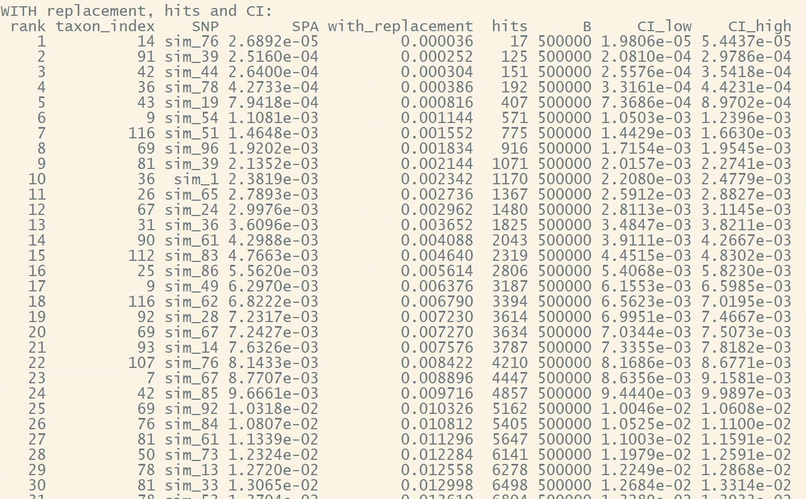

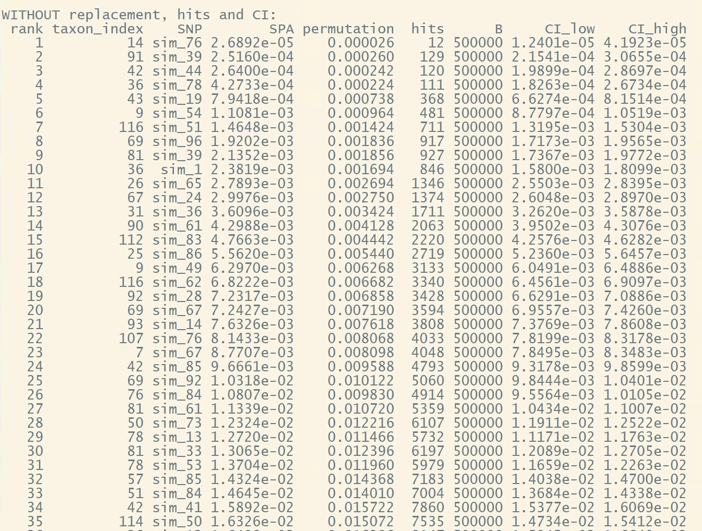

## 3. ZIPLN

Since the previous meeting, we have observed—through a "cheating way"—that incorporating the zero part may improve the power of the test. Moreover, given the experience above, the Empirical SPA method is almost entirely universal, which frees us from the requirement that the model assumptions be exactly correct. Even with very large offsets, it does not matter at all, so we can explore more models.

Because in previous experiments PALM and a series of related methods were all hard-pressed to reproduce the p-value for that strongest-effect point, we use this effect point as the basis for comparison and explore whether the p-values computed by various methods at this effect point can make it significant.

However, it is worth noting that the core assumption of the Empirical SPA (that the scores must be independent and identically distributed) is not satisfied, because covariates are present. This is an approximation, and consequently permutation/bootstrap may not be correct either.

### 3.1. Comparison to Multiple Methods

The methods we compare are as follows. The information matrix is temporarily taken as the observed information matrix; all `normal_pval` refer to the normal approximation; all methods that require numerical integration need the relative error of the integration to be sufficiently small:

1. Lognormal method
2. PIG and ZIPIG, where IG stands for inverse Gaussian and ZI stands for zero inflation; a method without ZI means we estimate it only on positive samples
3. PGIG and ZIPGIG, where GIG stands for generalized inverse Gaussian, a three-parameter model
4. NB and ZINB
5. PLN and ZIPLN, where LN stands for lognormal, i.e., the random effects follow a lognormal distribution

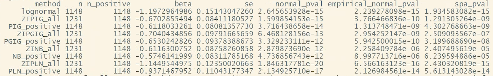
It can be found that only PLN and ZIPLN are able to maintain the significance of the p-value reasonably well.

### 3.2. Simple Test on Real Data

We applied the ZIPLN method to the more than 2,000 significant SNPs extracted last time, and, incidentally, I also applied the earlier ZIPIG method, and the results are as follows:

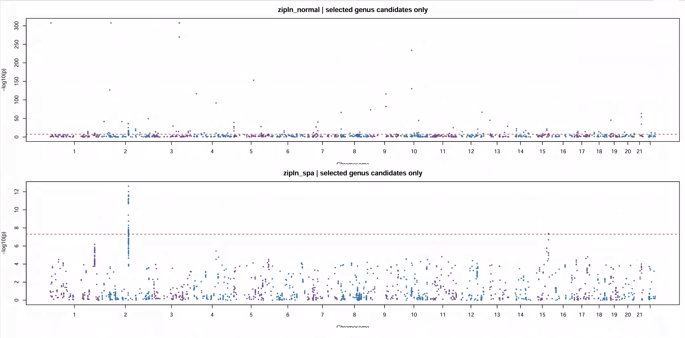

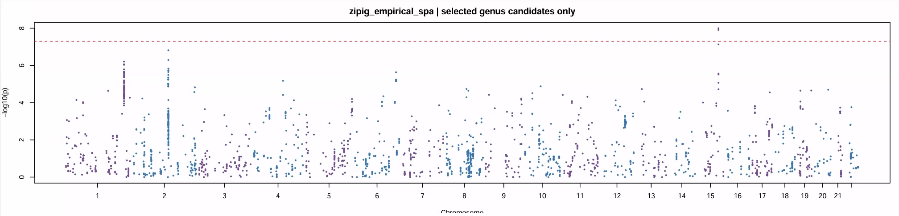

### 3.3. Further Analysis of the New Effect Locus on Chromosome 15

Both ZIPLN and ZIPIG proposed a new effect locus on chromosome 15, and naturally we are interested in whether this effect locus is real.

This SNP is an A→ACT insertion variant located within the second intron of the MINAR1 gene, about 724 bp from the upstream exon and about 3,898 bp from the downstream exon.

The biological evidence is as follows:

1. MINAR1/UBTOR can regulate mTOR. Experimental studies show that it inhibits mTOR signaling by stabilizing DEPTOR; reducing its expression enhances mTOR activity.
2. The mTOR–autophagy pathway participates in host defense against *Pseudomonas aeruginosa*. Studies in mice and macrophages have found that the Akt1–mTOR–ULK1/2 pathway is associated with autophagy and bacterial clearance, although it pertains to the *P. aeruginosa* species, which belongs to the genus *Pseudomonas*.

Directly examining the permutation results for this effect locus is as follows, running for about 4 hours on 3,200 CPUs:

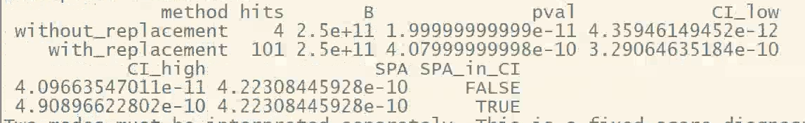

We then examine whether correcting for covariates and the median has an impact.

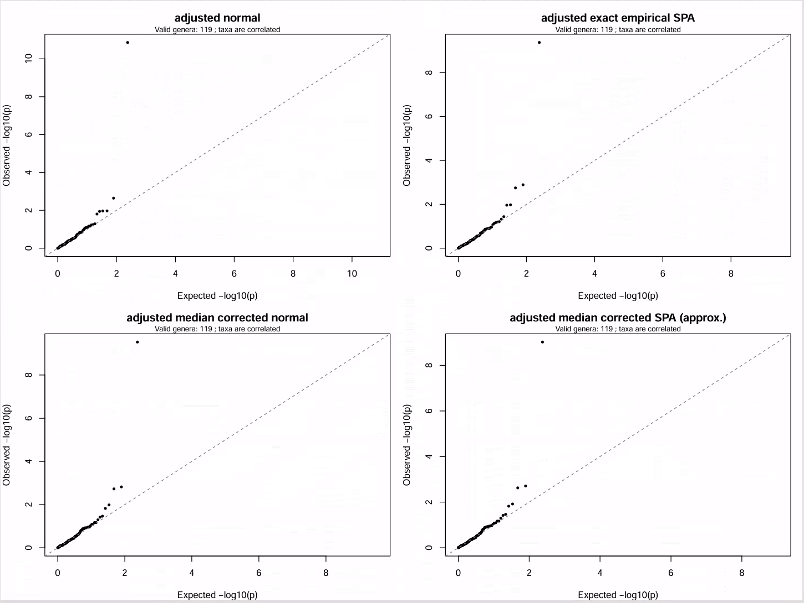
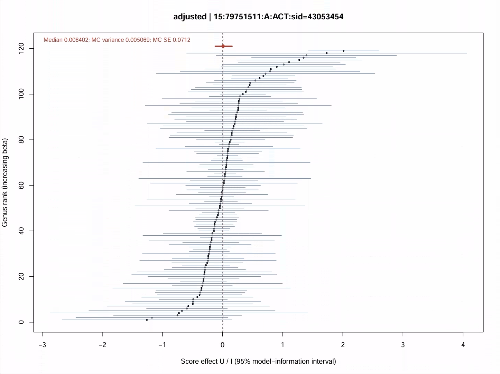
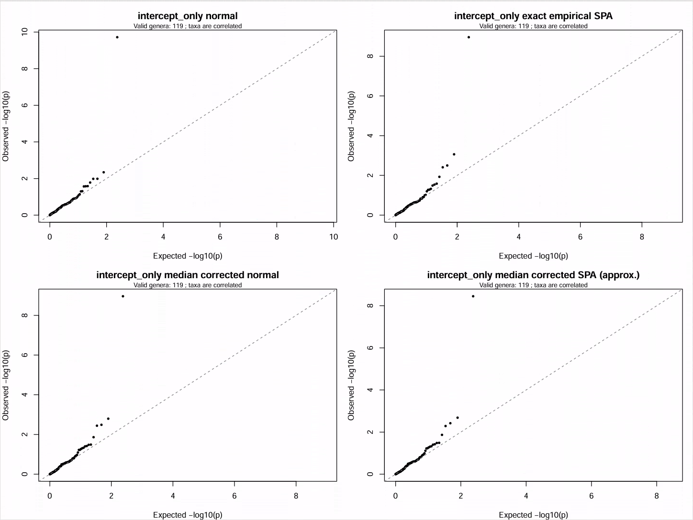

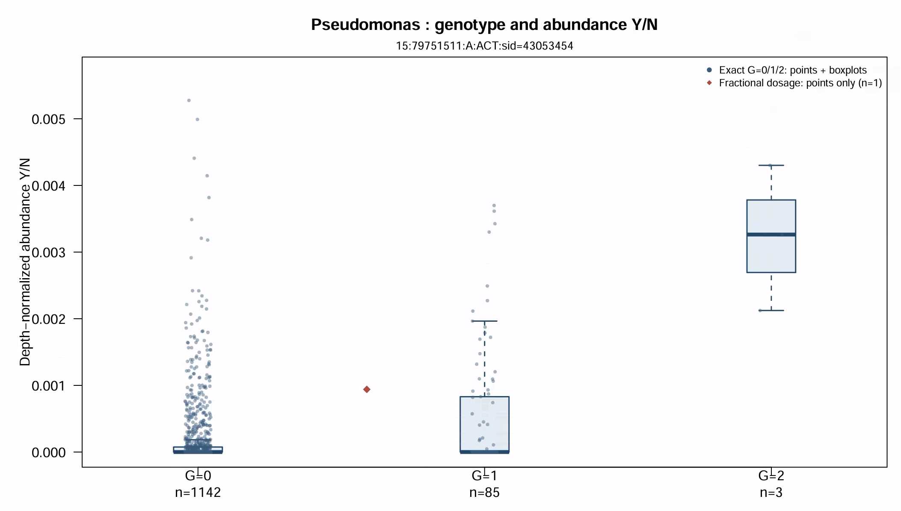

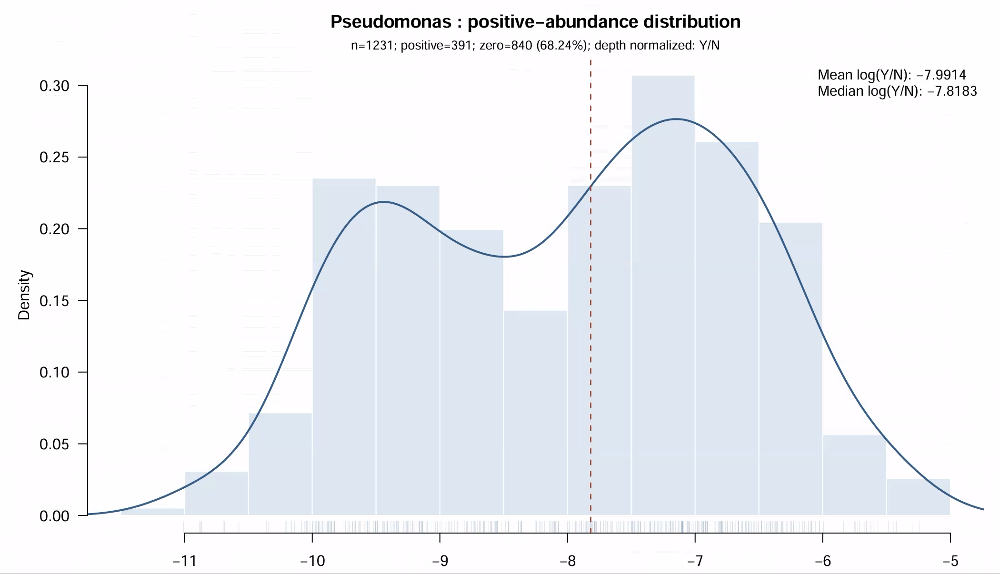

It can be seen that the median does not deviate from zero, and not correcting for covariates reduces the p-value to some extent. Taken together, it is hard to say whether this is a real effect locus.

## 4. Future
- binomial related
- palm with spa on positive/all part
- nb/palm qqplot under spa/normal
