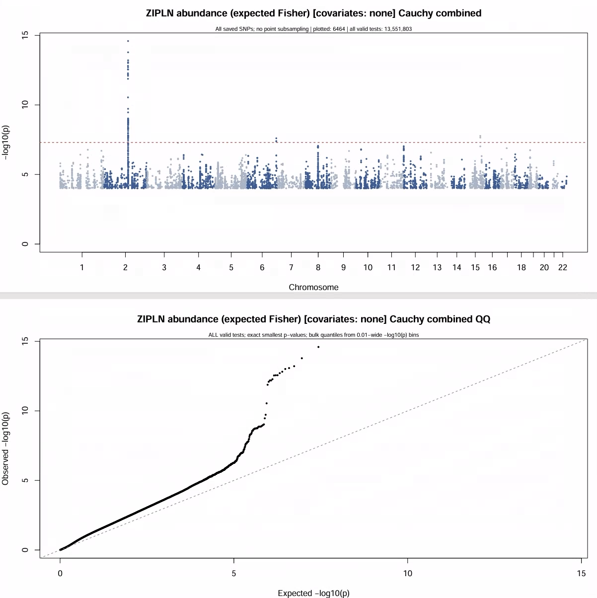
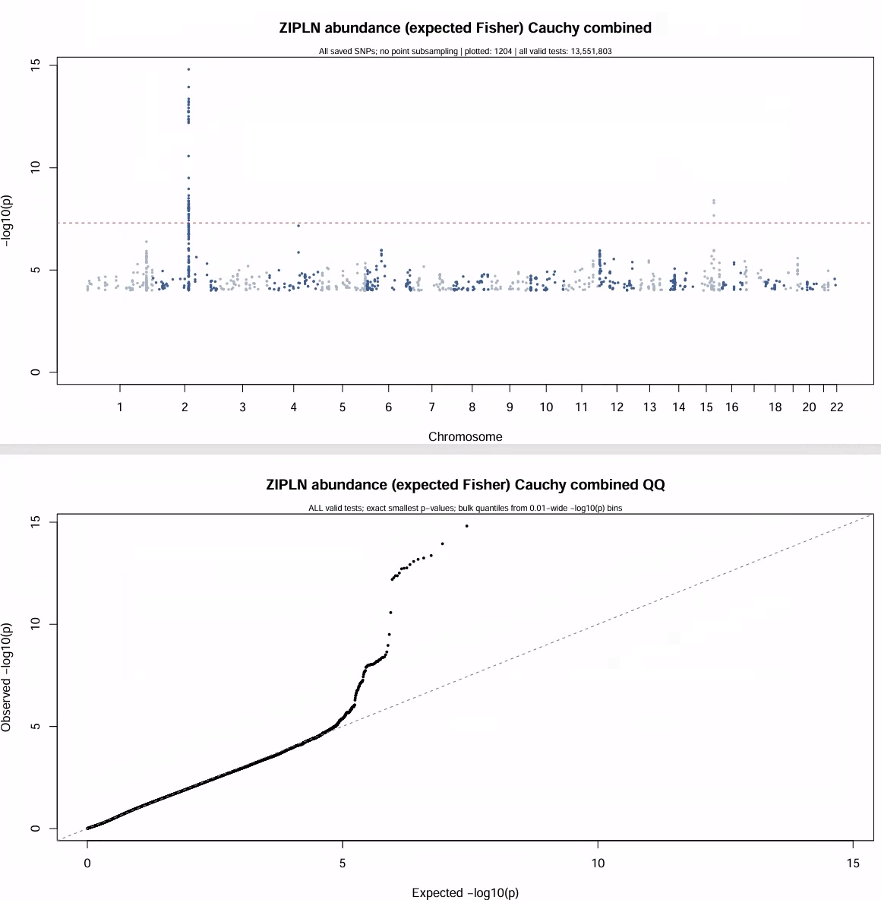
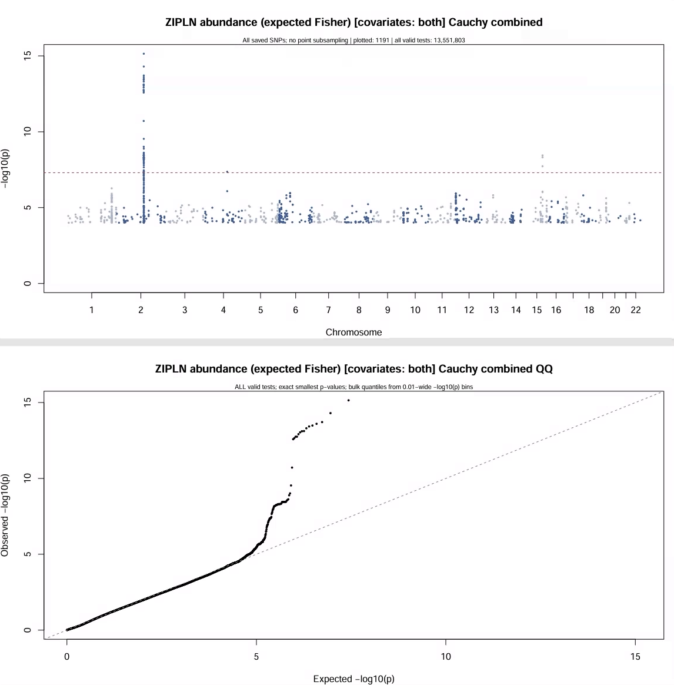
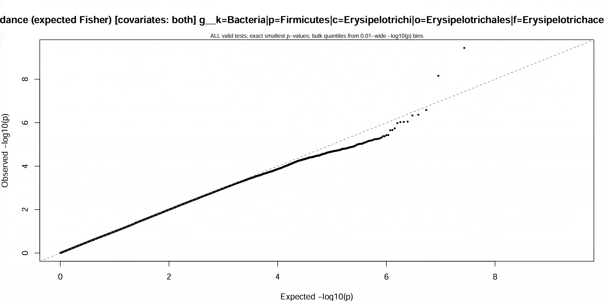
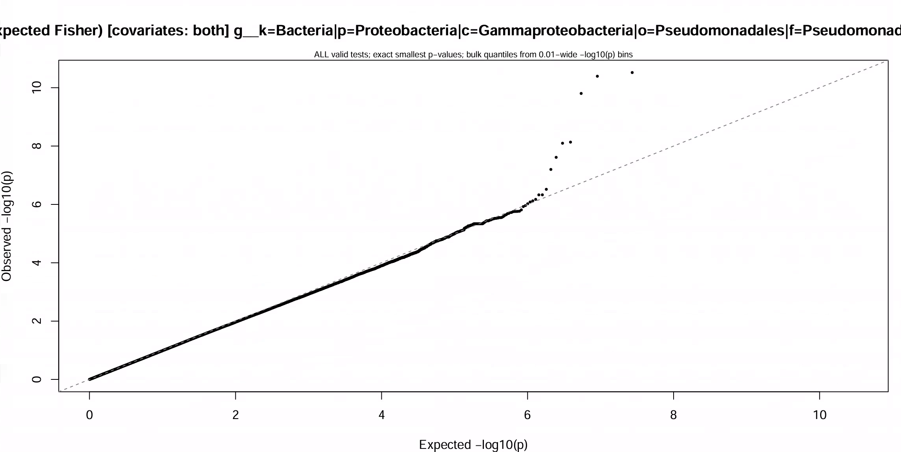
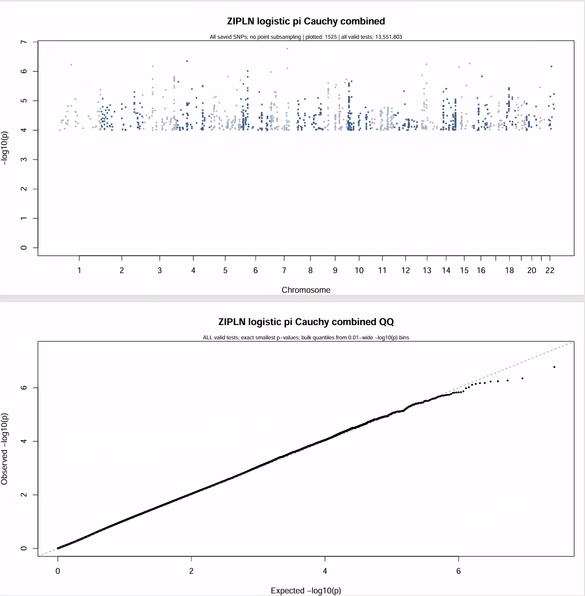
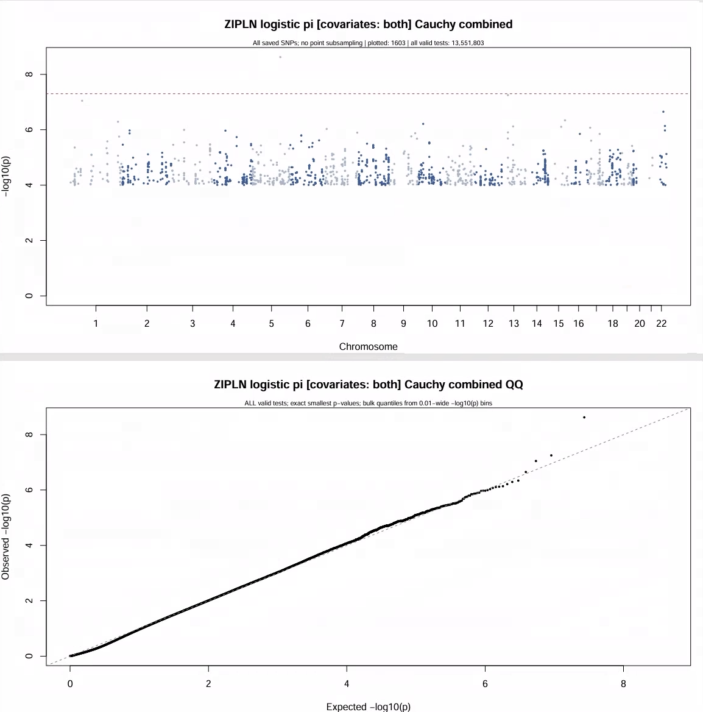
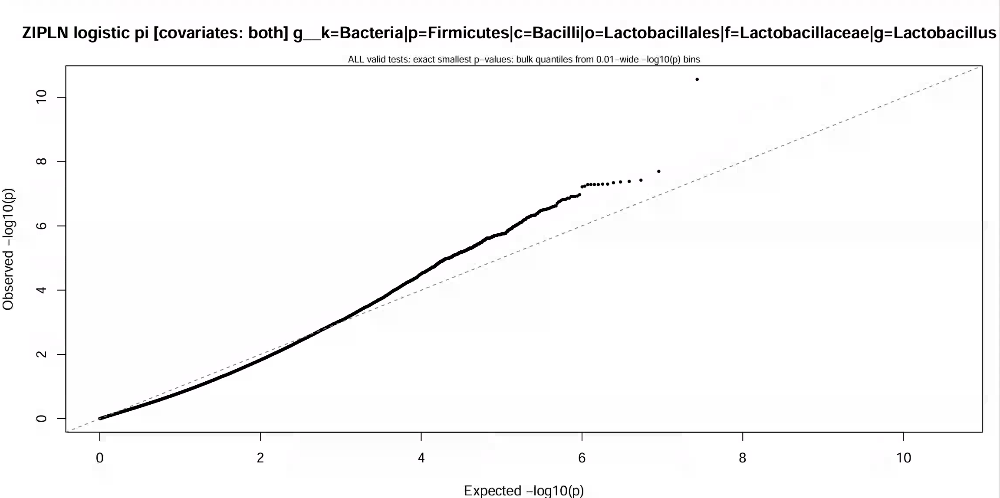
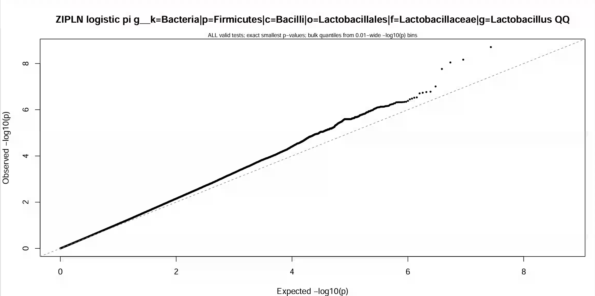
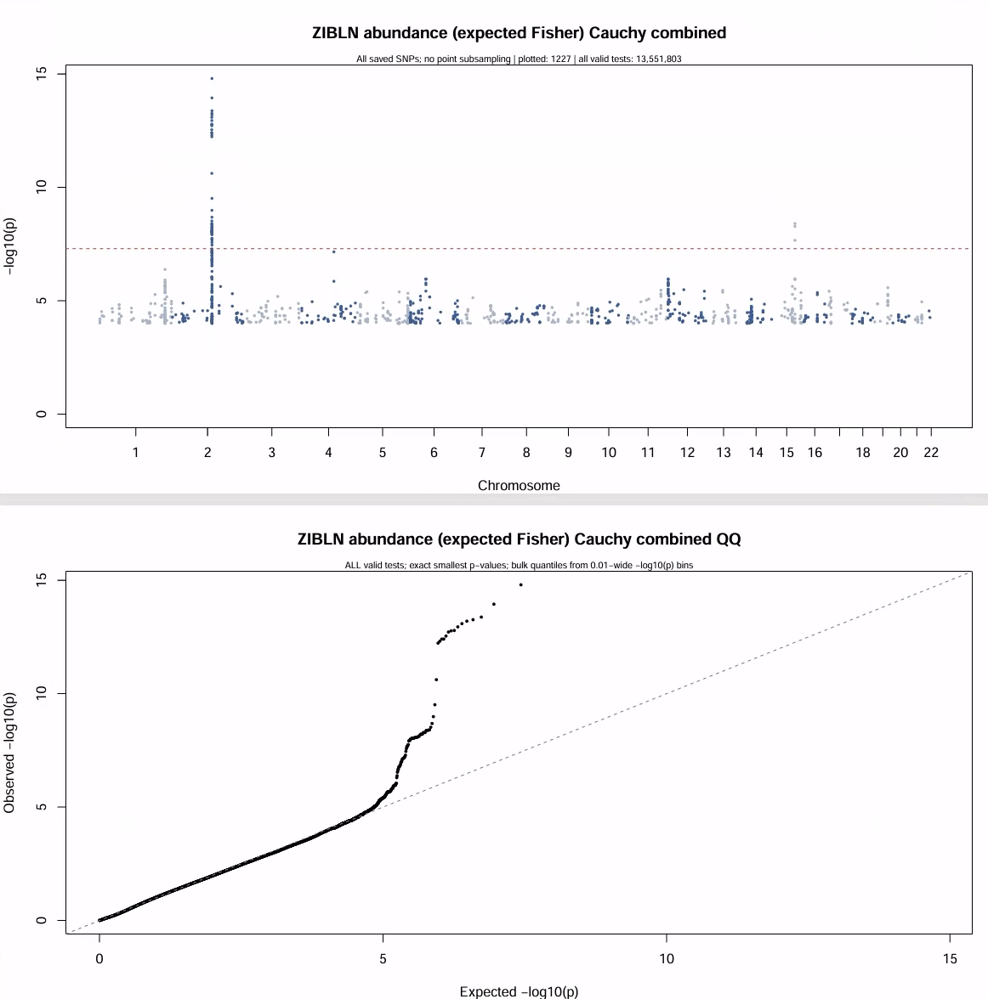

## 11/24 (Large-scale Experiments)

## 1. Review

Last week we discussed Empirical SPA, and found that it does not require any prior distribution assumptions, relying only on the independent and identically distributed property of the final computed scores. By comparing the permutation and bootstrap results, we found that it closely approximates the bootstrap results and is more conservative than the permutation results.

From this, we compared the p-value significance of different methods at the LCT gene on chromosome 2, and found that only ZIPLN can maintain significance.

We then conducted numerical experiments on candidate effect sites and identified a possible novel effect locus, although the compositional effect is not significant.

This half-week is mainly spent continuing to explore the ZIPLN model.

## 2. Large-scale Experiments

Our ZIPLN model, in practice when applied to real data, cannot perform SPA for every single SNP; instead, it must first identify SNPs through some criterion and then apply SPA only to the tail SNP. However, since we are currently in the testing phase, we can leverage 3200 CPUs in parallel, which allows us to perform SPA on nearly all points.

It is worth noting that the SPA method is only valid in the tail; when the p-value is relatively large, the SPA approximation may produce values greater than 1. Therefore, we adopt a standard decision rule of running SPA only when the absolute value of the normal statistic exceeds 2.

Last time we used the observed information matrix; this time we use the expected information matrix for computation. Summing over tens of thousands of possible Y values only needs to be done once in the null model.

At the same time, our covariates can be added simultaneously to both the structural zero probability part and the abundance part. In the results shown last time, the covariates were only added to the abundance part; this time we try several different ways of adding covariates.

If no covariates are included, the qqplot shows deviation, and the results are as follows:

If covariates are included, in fact, when they are added only to the abundance part, the qqplot for testing abundance alone is already fine:

If covariates are also added to the prevalence part, new effect loci can be discovered:

Apart from the strong effect locus on chromosome 2, the qqplots for the two remaining weak effect loci are as follows, and neither deviates from the diagonal:

The newly discovered effect on chromosome 4 also has weak biological evidence supporting it:
1. The effect locus is located in the ANK2 gene, within an intron.
2. A 2020 Cell paper titled 'The human and mouse enteric nervous system at single cell resolution' shows that ANK2 is expressed in the enteric nervous system of the human colon, being relatively more prominent than other colon cell types.
3. A 2022 mouse study 'Mouse Model of Weak Depression Exhibiting Suppressed cAMP Signaling in the Amygdala, Lower Lipid Catabolism in Liver, and Correlated Gut Microbiota' reports that liver Ank2 expression is negatively correlated with Lactobacillus abundance, which is at the same taxonomic level as our effect bacterium Bulleidia only at the 'phylum' level.
4. An in vitro fermentation experiment using pig fecal microbiota shows that increasing purple sweet potato polyphenols can increase the relative abundance of both Bulleidia and Lactobacillus (though this is a bit of a stretch).
5. A Korean gut study 'Host Genetic and Gut Microbial Signatures in Familial Inflammatory Bowel Disease' lists ANK2 as one of 17 candidate genes for potentially deleterious variants.

Now let's look at the prevalence part. If only the abundance part has covariates while prevalence does not, then the results are

If covariates are added to the prevalence part, then the results are

It looks like a new effect locus has appeared, and the qqplot also fits the diagonal very well. However, this effect locus is likely a false positive; let's look at the qqplot separately for details.

This is not a problem caused by adding prevalence covariates, because when prevalence originally had no covariates, the qqplot was also deviated.

I suspect it's because the number of PCs used for correction is insufficient, and I'm currently trying to increase the PC dimensions I compute myself.

Additionally, the Binomial-related ZIBLN does not improve power, though it does not reduce it either. Below is the model when only the abundance part has covariates.

## 3. Future

- PALM/NB related
- NB QTL?
- GWAS summary stats
- platform x
